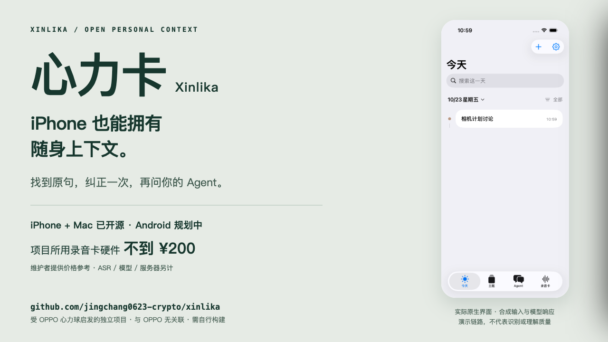
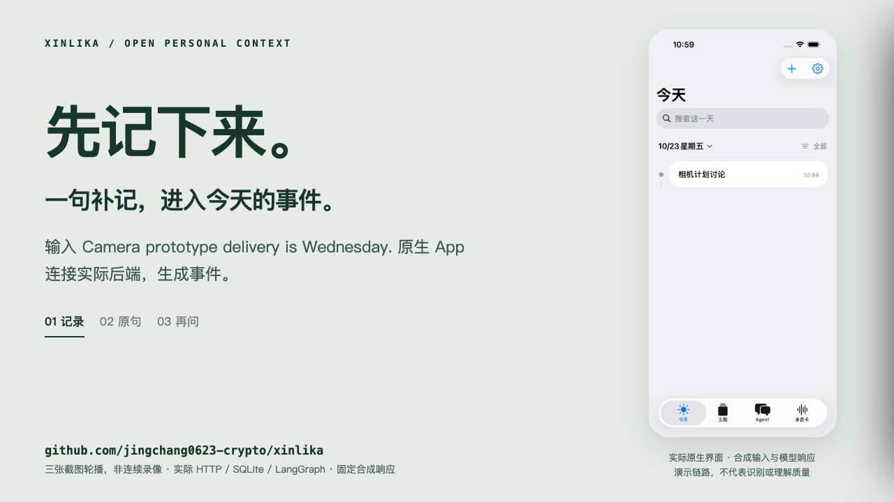

# 心力卡 · Xinlika

**iPhone 也能拥有随身上下文。把日常记录变成有出处、可纠正的 Personal Agent 记忆。**

受 OPPO 心力球启发的独立开源项目。**原生 iPhone + Mac 已提供源码；跨品牌 Android 是下一步。** 项目所用录音卡硬件不到 **200 元**（维护者提供的价格参考，非整套运行成本）。自己部署后端，选择自己的 ASR 和模型，从录音、事件、主题到问答都能继续改。

[完整运行](docs/full-app.md) · [无需硬件体验](docs/quickstart.md) · [演示与素材](docs/launch/demo.md) · [选择 Fork 方向](docs/fork-guide.md) · [English](README.en.md)



开发者预览 [v0.2.0](https://github.com/jingchang0623-crypto/xinlika/releases/tag/v0.2.0) · 后端 MIT / 客户端 GPL-3.0-only · 需要自行构建，无预签名安装包。

## 2026-10-26 · main 更新

已同步 iPhone 0.3.10 的持续采集、机身录音接入、持久补传队列、统一事件时间线和可撤销的关注反馈。服务端新增版本化 v6 Skill、增量事项续写、滚动复核、跨对话关联，以及只读 MCP 与聊天导出文件导入。

[本轮更新与验证](docs/github-sync-2026-10-26.md) · [启用 v6 / MCP / 文件导入](docs/runtime-v6.md)。v6 需安装可选 Agent 依赖并明确选择处理配置；默认兼容原有部署。真实资料不随仓库发布，质量限制保留在验证说明中。

## 看过心力球，用 iPhone 的你可以从这里开始

心力球让更多人开始问：**个人 Agent 怎样用上我们在现实生活中说过、决定过的事？** 心力卡沿着这个问题，提供一个可以自己运行、检查和改造的实现。

| 你关心什么 | 心力卡现在提供什么 | 还需要知道什么 |
|---|---|---|
| 我用 iPhone | 原生 Swift 客户端，CB08 采集、本地保存、补传和共享工作台 | iOS 17+，用 Xcode 自行构建；公开新包实体 BLE/锁屏仍待复验 |
| 我用 Mac | 原生查看、补记、问答、来源纠正；可选本机录音卡采集模式 | macOS 14+；默认与 iPhone 共用自托管后端 |
| 我用其他 Android 手机 | 后端与接收协议可复用，已有明确的 Android 扩展任务 | **尚无公开 Android 客户端，也未验证各品牌兼容性** |
| 硬件入门多少钱 | 本项目所用录音卡硬件不到 200 元，价格由维护者提供 | 不是固定售价；需核对型号/固件，ASR、模型和服务器另计 |
| 我想掌握数据与模型 | 自托管账本、原声与文字来源、可配置 ASR/文字模型 | 外部服务可能收费；使用外部模型时相应内容会发送给它 |
| 我不想被错误记忆带偏 | 原句可追溯；纠正使相关旧答案失效，重新问答使用新依据 | 自动关联、识别和建议质量仍需真实样本评估 |

关于手机限制：截至本页 2026-10-23 核查，[极客公园 10 月 16 日实机报道](https://www.geekpark.net/news/372428)描述的心力球体验版需 OPPO、一加或 Realme 手机，暂不支持其他品牌。这个范围比“只支持 OPPO”更准确；不是永久限制或完整官方兼容清单。详见[对比依据](docs/oppo-context.md)。**心力卡使用 CB08，不连接 OPPO 心力球硬件或服务。**

## 看一遍：记录 → 找到原句 → 纠正 → 再问



这是实际 iPhone 模拟器界面的**三张截图轮播**，不是连续操作录像。输入、模型响应均为固定合成夹具；HTTP、SQLite、LangGraph 与原生界面实际运行。它展示链路，不代表 ASR 或模型质量。[原图、后端前后对照与复现步骤](docs/launch/demo.md)

心力卡围绕三个结果开发：今天发生了什么、同一件事进展到哪了、现在有什么值得提醒。上传批次不直接等于事件；主题可以跨记录；observe → respond → review → publish 在没有有用变化时保持安静。当前没有外部消息推送或受托执行。

## 选一条运行方式

| 方式 | 需要准备 | 能看到的结果 |
|---|---|---|
| **合成演示** | Python 3.11+；无需硬件、密钥或付费调用 | 时间线、跨记录主题、带出处回答、纠正前后 HTML 报告 |
| **完整 App · 先用文字** | Mac、Xcode、XcodeGen、自有兼容文字模型 | iPhone/Mac 补记 → 实际模型整理 → 问答与纠正 |
| **完整 App · 接录音卡** | 上述环境 + CB08 + 自有兼容 ASR + iPhone 实机签名 | 采集 → 本地保存/补传 → ASR → 多端事件、主题和问答 |

先跑无需凭据的演示：

```bash
git clone https://github.com/jingchang0623-crypto/xinlika.git
cd xinlika
PYTHON=python3.12 ./scripts/bootstrap.sh
.venv/bin/python examples/demo.py
```

将 `python3.12` 换成本机 Python 3.11+ 命令；打开终端输出的 HTML 路径。[详细快速开始](docs/quickstart.md)

完整应用路径：**CB08 → iPhone → 你自己的处理服务 → iPhone / Mac**。安装依赖后，生成私有连接配置，设置模型/ASR 密钥，启动后端，再构建两端：

```bash
# 先按完整指南配置并启动你自己的服务
.venv/bin/python clients/tools/build-mac.py
open .build/XinlikaOpenSource.app
xcodegen generate --spec clients/project.yml
open clients/Xinlika.xcodeproj
```

服务地址、模型名称、密钥环境变量和 iPhone 签名的逐步说明都在[从 clone 到完整心力卡](docs/full-app.md)。iPhone 真机不能用 Mac 的 `127.0.0.1`；离开局域网需自己的 HTTPS 后端。无卡可先补记文字。Mac 本机采集是独立部署模式，不会自动汇入共享账本。

## Fork 后，从一个具体扩展开始

| 方向 | 第一份成果 | 从哪里改 |
|---|---|---|
| **Android 跨品牌客户端** | 先连共享空间、补记与同步，再做手机麦克风/BLE 和断网恢复 | [Android 分阶段任务](docs/android-plan.md)、mobile ingest、原生协议参考 |
| **让现有 Agent 查上下文** | 带鉴权、版本、出处的只读 MCP 工具 | [MCP 验收任务](docs/fork-guide.md#只读-mcp)、共享快照与 recall |
| **做你自己的个人助理** | 一组有依据、少打扰的中文提示词与反例 | `prompts/personal-agent/`、personal agent 回归 |
| **接手边的硬件或模型** | 一个能重试、保留来源且可复现的适配器 | ASR 适配器、mobile ingest、CoreBluetooth 参考 |
| **改进中文事件与跨天主题** | 改期、撤回、旧录音回填的授权对照集 | organization / topics / recall 回归 |

**Android 和 Watch App 尚未实现；只读 MCP server 已提供，需自行配置。** [Fork 指南](docs/fork-guide.md)给出各方向的文件入口、最小输出与验收方法；[路线图](ROADMAP.md)区分已交付和待做。欢迎带着运行环境、失败步骤或你 fork 的一个具体目标来[提交 Issue](https://github.com/jingchang0623-crypto/xinlika/issues/new/choose)。无需上传私人录音或凭据。[贡献指南](CONTRIBUTING.md)

## 验证过什么，尚未验证什么

v0.2.0 已通过干净 clone 构建、193 项后端回归、23 项 iPhone 采集测试、1 项完整原生 UI 流程、90 项 Core/探针及 10 项会话时钟检查。原生集成使用合成模型响应，Mac 原生 API 读回同一纠正和引用答案。[原生验证记录](docs/native-validation.md)

开发阶段另有特定环境下的 iPhone 锁屏、75 秒服务中断补传、CB08 同文件重连接流与实录来源检查；不等同新公开包已在所有设备通过。**全天无损连续记录、全天续航、通用声纹识别、自动活动边界及长期建议有效性尚未验收。** 跨对话关联仍可能漏报。Mac 窗口自动化本轮未完成。[实测范围与限制](docs/evidence.md)

## 开发与授权

```bash
.venv/bin/python -m unittest discover -s scripts -p 'test_*.py'
.venv/bin/python -m unittest discover -s examples -p 'test_*.py'
```

[架构](docs/architecture.md) · [授权核查](docs/client-licensing.md) · [第三方说明](THIRD_PARTY_NOTICES.md) · [传播文案与素材包](docs/launch/README.md)

独立项目，与 OPPO 无关联、无官方授权或背书；不表示与心力球等同功能、协议兼容或同等质量。后端 MIT，`clients/` GPL-3.0-only；厂商二进制、固件、模型权重及外部服务额度不包含。保留原声增加存储和管理成本。当前面向开发者与愿意自行部署的早期用户。
