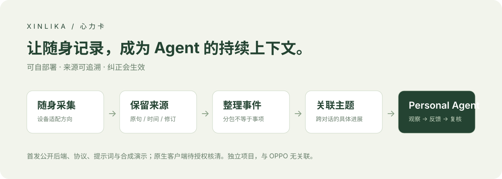
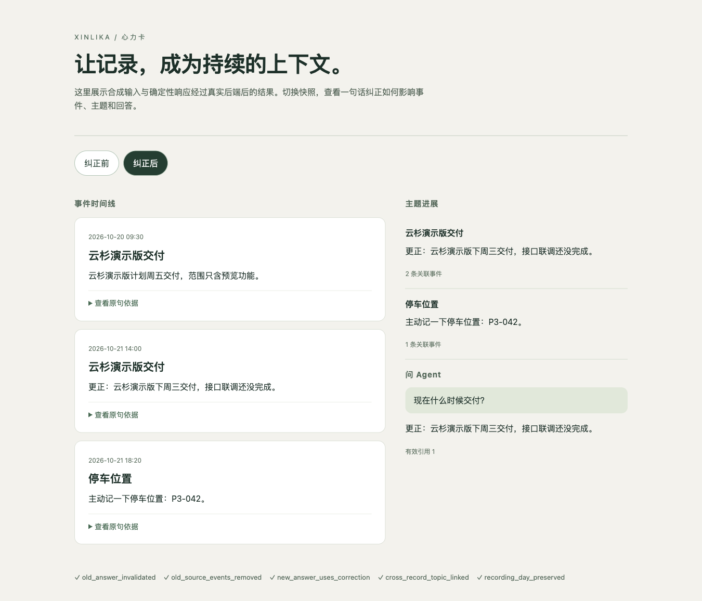

# 心力卡 · Xinlika

**把随身记录变成 Personal Agent 的持续上下文。**

**v0.2.0：已包含原生 iPhone / Mac 客户端。** [从 clone 跑通完整应用](docs/full-app.md) · 后端 MIT / 客户端 GPL-3.0-only。

受 OPPO 心力球启发，心力卡探索一条可自部署、可追溯、可纠正的开放路线：录音卡采集声音，服务端整理事件与主题，Agent 在有用时反馈。

[English](README.en.md) · [快速体验](docs/quickstart.md) · [真实验证与限制](docs/evidence.md) · [架构](docs/architecture.md) · [路线图](ROADMAP.md)



## 先体验，再接硬件

现已公开 **原生 iPhone/Mac 客户端、Python 处理后端、四阶段 Agent 循环、中文提示词、恢复协议和回归测试**。无需录音卡、API Key 或付费调用，也能运行脱敏演示：

```bash
git clone https://github.com/jingchang0623-crypto/xinlika.git
cd xinlika
python3 -m venv .venv
source .venv/bin/activate
python -m pip install -r requirements-heartball.txt
python examples/demo.py
```

要求 Python 3.11+；当前首发在 macOS 本机验证。演示会生成今天时间线、跨记录主题、带出处回答，以及“一句话纠正后旧答案失效”的报告。打开终端输出的 HTML 文件即可查看。**输入和模型响应均为明确标注的合成夹具，走真实存储与 LangGraph 流程；它不代表语音识别或模型理解质量。**



上图为可运行后端生成的合成演示报告，不是已发布原生 App。

真实模型和共享服务接入见[快速开始](docs/quickstart.md)。iPhone/Mac 客户端已纳入 `clients/`，经权利人确认按 GPL-3.0-only 发布；后端仍为 MIT。完整原生构建、配置和录音流程见[完整应用指南](docs/full-app.md)。模型/ASR 使用你自己的授权服务，厂商二进制 SDK 无需安装。

## 为什么做这个

心力球引发的一个有价值的问题是：**AI 如果始终缺少日常上下文，怎样真正理解正在发生的事？** 用户想随口记下想法、找回前天的决定，并让自己的 Agent 用上；只多生成几篇会议纪要还不够。

心力卡围绕三个结果开发：

- **今天发生了什么**：短事项简短展示，长交流收进可展开的活动；一分钟上传批次不会变成一分钟一张卡。
- **这件事进展到哪了**：跨记录关联同一具体主题，保存决定变化和原句；不能仅凭都在谈“AI”就合并。
- **现在有什么值得提醒**：observe → respond → review → publish；没有有用变化时保持安静，纠正能使旧建议失效。

## 已有代码与当前边界

| 模块 | 公开内容 | 当前边界 |
|---|---|---|
| 可靠接收 | 身份、序号、哈希、幂等回执、卡上参考对齐、跨物理续段关联 | 服务端协议；包含原生 BLE 客户端；实际设备/固件需按指南核对 |
| 事件与主题 | 原句引用、录制时间、活动容器、可逆归并/拆分、纠正失效 | 跨对话关联仍漏报；自动活动边界未独立验收 |
| 个人 Agent | 持久观察、生成、独立复核、冷却、去重、中文角色提示词 | App 内反馈；无外部消息推送或受托执行 |
| 多设备空间 | 可撤销设备凭据、只读/编辑权限、修订快照、备份恢复 | 单用户多设备；不是公开注册的多租户服务 |
| 声音旁路 | 声音标签队列、声纹登记与撤销、证据上下文 | 模型权重另配；不能可靠识别播放声或餐桌本人声音 |

开发阶段已做 iPhone 锁屏、75 秒服务中断补传、CB08 同文件重连接流与实录来源检查。详细范围见[证据表](docs/evidence.md)。**未通过全天无损连续记录、全天续航、逐字准确率或长期建议有效性验收。**

## 与 OPPO 心力球的关系

心力卡是独立项目，与 OPPO 无关联、无官方授权或背书，也不连接心力球硬件或服务。这里的“心力球开源替代探索”指相近的用户目标；不表示等同功能、协议兼容或已达到同等质量。

我们的差异是：可自部署的处理逻辑、用户掌握的原声与来源、可重跑和可纠正的派生结果、开放的设备接入方向。保留原声也带来存储与管理成本。开源代码免费不代表 ASR、模型和服务器免费；目前没有经过完整统计的省钱比例。

公开体验资料：[极客公园实机报道](https://www.geekpark.net/news/372428)、[用户关于全天上下文与 Agent 的反馈](https://x.com/dontbesilent/status/2112103009354448901)。资料检索于 2026-10-20 至 23 日；用户自述不作为本项目实测。

## Fork 可以做什么

1. 改 `prompts/personal-agent/`，实验更少打扰、能解释依据的个人助理。
2. 为手机麦克风、其他录音卡或 Watch 编写符合接收协议的适配器；Apple Watch 当前没有实现。
3. 改进中文事件边界、跨天主题和来源纠正；用公开授权的脱敏样本提交可复现对比。
4. 实现只读 MCP 适配器，让现有 Agent 查询个人上下文；**本仓库尚未实现 MCP server**。

从 [贡献指南](CONTRIBUTING.md) 和 [路线图](ROADMAP.md) 开始。欢迎报告真实失败；不要在 Issue 上传私人录音、声纹或凭据。

## 开发

```bash
python -m unittest discover -s scripts -p 'test_*.py'
python -m unittest discover -s examples -p 'test_*.py'
```

复用 LangGraph、SQLite、OpenAI 兼容 SDK 和 Pydantic。Omi、OpenClaw、Hermes、OpenMuse 是设计参考，不等于已部署其整套产品。语音研究适配器的第三方服务条件需单独核对。见 [第三方说明](THIRD_PARTY_NOTICES.md)。

[后端 MIT / 客户端 GPL-3.0-only](docs/client-licensing.md) · 实验阶段 v0.2.0 · 面向开发者和早期体验者
