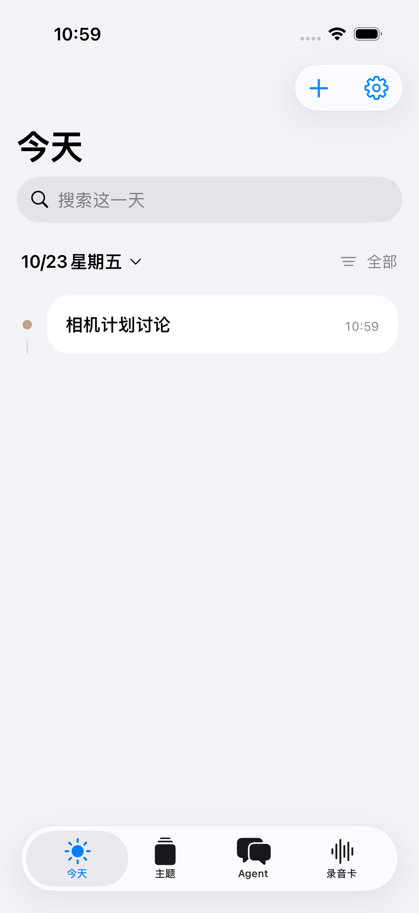
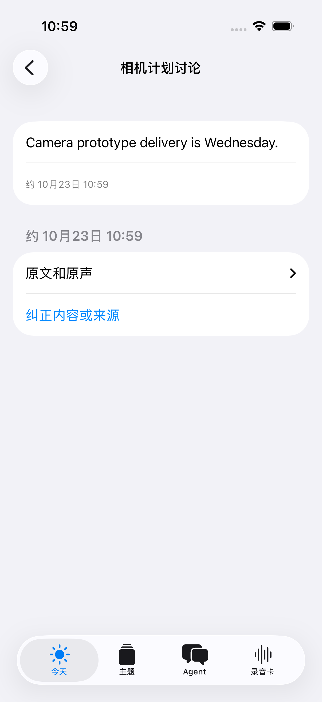
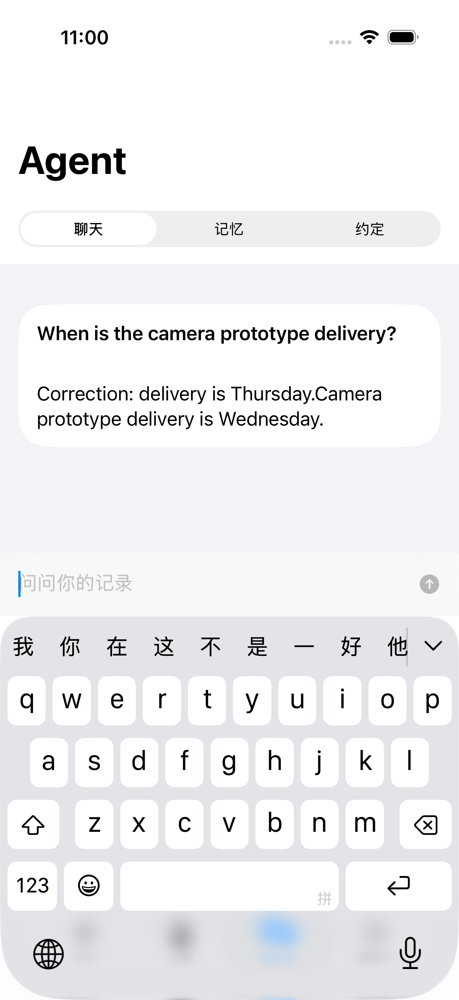

# 演示素材、复现与口播

## 先区分三件事

| 素材 | 证明什么 | 不证明什么 |
|---|---|---|
| [原生三步轮播](../../assets/launch/native-walkthrough.gif) / [MP4](../../assets/launch/native-walkthrough.mp4) | iPhone 实际界面可连接、补记、打开原句、纠正并问答；每帧停留 4 秒 | 是三张截图的轮播，不是连续录像；固定合成模型，不证明识别/理解准确率 |
| [纠正前](../../assets/demo-before.png) / [纠正后](../../assets/demo-after.png) | 可运行后端的原句、主题、引用和纠正失效链路 | 合成报告，不是原生 App 截图，也不是实际语音识别 |
| 开发阶段的硬件记录 | 特定设备/固件及条件下的采集、锁屏与恢复 | 不等同新公开包通过实体复验；见 [evidence](../evidence.md) |

实际原生截图，完整原图未修改：

| 记录成为事件 | 打开原句 | 纠正后再问 |
|---|---|---|
|  |  |  |

场景输入是 `Camera prototype delivery is Wednesday.`，纠正加入 `Correction: delivery is Thursday.`。测试模型直接回显更新后的主题内容，因此截图里的回答仍可同时看到原文与更正；这是测试夹具的原样结果，不拿它包装成高质量自然语言回答。真实质量需配置自己的模型另测。

## 无密钥后端演示

```bash
PYTHON=python3.12 ./scripts/bootstrap.sh
.venv/bin/python examples/demo.py
```

打开输出的 HTML，观察时间线、主题、回答，然后比较纠正前后。[快速开始](../quickstart.md)解释合成数据与实际存储流程。

## 重新捕获原生截图

需要 Mac/Xcode/XcodeGen 和已安装 iOS 模拟器。先运行 bootstrap，再开一个终端启动**独立合成服务**：

```bash
.venv/bin/python examples/native-test-server.py \
  --root .build/my-new-native-demo --port 28788
```

必须是新空目录，不要指向实际个人账本。此服务仅绑定 loopback，凭据是明确的测试假值，不调用模型、ASR 或硬件。另一个终端：

```bash
xcodegen generate --spec clients/project.yml
xcrun simctl list devices available
# 把 SIMULATOR_UUID 换成上一步已有 iPhone 模拟器的 UUID
xcodebuild -project clients/Xinlika.xcodeproj -scheme Xinlika \
  -destination 'platform=iOS Simulator,id=SIMULATOR_UUID' \
  -derivedDataPath .build/ios -resultBundlePath .build/my-native-demo.xcresult \
  -parallel-testing-enabled NO -only-testing:XinlikaUITests \
  CODE_SIGNING_ALLOWED=NO test
.venv/bin/python scripts/export-native-demo.py \
  --result .build/my-native-demo.xcresult
```

结果包路径也需未使用过。测试成功后导出三个有明确名称的附件；原图按字节复制并生成 SHA-256，不复制模拟器 ID。用完在服务终端 Ctrl-C 停止。源码见 `clients/UITests/WorkspaceFlowTests.swift`。测试数据有独立命名空间，不会启动录音卡。

封面与轮播以 [board.html](../../assets/launch/board.html) 排版；打开 `?step=1`、`?step=2`、`?step=3`，在 1280 × 720 视口截图，即得到三张 frame。无 `step` 为封面。相同文件名可用以下命令制作轮播，要求 FFmpeg：

```bash
ffmpeg -framerate 1/4 -start_number 1 -i assets/launch/frame-%d.png \
  -vf 'fps=1,split[a][b];[a]palettegen=max_colors=128[p];[b][p]paletteuse' \
  -loop 0 assets/launch/native-walkthrough.gif
ffmpeg -framerate 1/4 -start_number 1 -i assets/launch/frame-%d.png \
  -vf 'fps=24,format=yuv420p' -c:v libx264 -movflags +faststart \
  assets/launch/native-walkthrough.mp4
```

先移走旧输出文件或使用你自己的输出名；不要给没有更新过的旧截图换一个“最新实测”标签。

## 75 秒口播与画面脚本（待录制）

这是一份拍摄脚本，不代表完整 75 秒连续视频已经录制。

| 时间 | 画面 | 口播要点 |
|---|---|---|
| 0–10 秒 | 封面 + iPhone 截图 | 看过 OPPO 心力球，但用 iPhone？心力卡把原生 iPhone/Mac 和处理后端开源了。 |
| 10–20 秒 | 运行路径表 | 项目所用录音卡硬件不到 200 元，维护者价格参考，服务费另计；没卡没密钥也能先试合成报告。 |
| 20–35 秒 | 原生记录与原句两帧 | 真正想展示的是能回到依据。这部分是实际界面、合成模型响应，先看流程能否跑通。 |
| 35–48 秒 | 更正与后端前后报告 | 改正原句后，相关旧结果失效，再问采用新版本。原声/原文可以追溯和重跑。 |
| 48–60 秒 | 完整运行指南 | clone 后配置自己的模型/ASR，启动自己的服务，再用 Xcode 构建。不是免配置安装包。 |
| 60–75 秒 | Fork 入口与 Android 计划 | 下一步是跨品牌 Android；还可做只读 MCP、硬件适配或中文主题。欢迎先跑一次，提交具体问题。 |

若另录真实声音，使用事先选好的合成口述、明确同意的参与者与自己的服务，显示实际耗时/失败/修复；保留真实录制时刻，不用截图轮播假装实时识别。画面始终标清当前使用的模型和样本类型。独立项目，与 OPPO 无关联。
