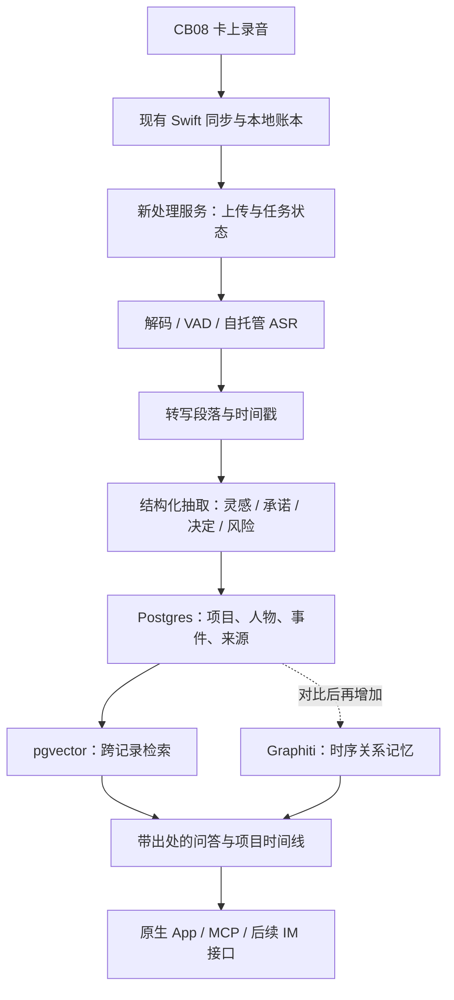

# 用开源方案让 CB08 与深脑 App 接近心力球体验

> **最新深度核查：**[Omi、OpenMuse 与 CB08 长时实时能力](personal-agent-oss-and-hardware-deep-dive-2026-10-20.md)。组件选型与硬件实时能力判断以该文为准；“约三小时”仅有历史单文件切段依据，不应解释为总录音或续航上限。

> **方案修正（2026-10-20）：**本文主要覆盖采集与处理基础设施，不能完整代表 Personal Agent 产品方案。社交实用反馈与 Agent 运行层复核见 [Personal Agent 模式重估](personal-agent-reassessment-2026-10-20.md)。当前应优先验证“持续上下文输入→有状态 Agent 被事件唤醒→选择性主动反馈→用户纠正改变后续行为”。本文中的“短灵感保存后可查询”降为数据通路检查；“实时后置”调整为先在受控连续会话中验证及时反馈，再扩展全天可靠性。Omi 主动反馈机制、OpenClaw/Hermes 运行骨架的优先级高于单独叠加记忆与检索组件。

日期：2026-10-20。范围：基于当前硬件、Mac/iOS 客户端代码和公开开源资料的方案分析。按用户最新要求，不以现有深脑后端为前提，重点寻找可替代处理服务的开源项目。本次没有修改业务代码、操作录音卡、读取个人录音或部署服务。

## 1. 建议结论

保留 CB08、Swift 原生 App 和已经完成的可靠同步工作，建立可独立运行的开源处理后端。第一阶段优先获得“短灵感能留下、不同录音能串到项目、能带出处地问历史、外部 Agent 能读取”的效果；全天实时采集单独验证。

推荐主线：

**Omi 作为产品与处理流程参考；FunASR 做可自托管语音处理；Postgres + pgvector 保存记录、事件与检索索引；模型做有证据的结构化抽取；官方 MCP SDK 或 FastMCP 提供外部查询。Graphiti 是增强跨会议时序记忆的候选，经过对比再决定是否加入。**

这是一套需要整合的方案，不是下载后即可替换全部接口的成品。开源组件可以替代现有云端处理，但仍需音频接入、任务状态、原生 App 接口和数据模型之间的连接代码。若大模型和 embedding 使用外部 API，也仍有云端依赖；完全本地运行还需选择并部署对应模型。

## 2. 我们当前实际拥有的基础

| 层面 | 代码或已有验证能证明什么 | 不宜直接承诺什么 |
|---|---|---|
| 独立录音 | CB08 可通过已验证的 `TYPE=1 CMD=0/2` 开始、结束保存；短时实验中断开手机后同一文件继续录制 | 所有固件都一样、整天连续使用稳定或达到 24h 续航 |
| 实时码流 | 真机记录曾收到 `1-1` 实时 Opus 通知 | 码流完全连续、与下载并发安全、锁屏和断线后无缺口 |
| 文件同步 | 有下载检查点、续传、完整字节数验证、哈希、落盘账本和上传恢复 | 无需任何打开 App 的动作、后台永远可运行 |
| 三小时切段 | 共用核心有续接判定，Mac 上传流程有相关处理 | iOS 已实现相同的跨文件合并；设备文件就等于一场真实沟通 |
| 说话人 | 有匿名说话人、逐句时间戳、人工指认、人物与项目读取 | 匿名说话人 1 就是佩戴者；跨录音编号相同就是同一个人 |
| 分析呈现 | iOS 当前模型接收摘要、判断原子 `atoms`、引文、承诺与日期 | 已经有完整的跨会议项目记忆及状态更新 |
| 检索 | Mac 有逐句本地索引，命中可对应录音时间点 | 全量知识库语义问答、iOS 已具备同等本地搜索 |
| 语音检测 | Mac 有自研 `VoiceActivity`，接入处只作提示，不自动拦截；注释记录仅 8 个样本 | 已经有经过广泛验证的 VAD，更不能认为能排除电视或短视频人声 |

关键代码：

- [录音控制真机验证](ios-0.1.8.md)。
- [实时帧处理](../Sources/LuyinbiCore/BLEClient.swift)：当前收到实时帧后计数并过滤，未进入持续音频处理管线。
- [App 开始录音后的断连策略](../iOS/AppModel.swift)：确认录音开始后断开这条连接，避免持续接收不用的实时音频。
- [语音检测接入](../Sources/LuyinbiCore/Monitor.swift)：仅记录疑似噪音提示。
- [现有分析模型](../iOS/Meeting.swift)、[说话人和项目接口](../Sources/LuyinbiCore/Speakers.swift)、[本地检索](../Sources/LuyinbiCore/LocalSearch.swift)。

这些是可复用的客户端与设备接入能力。替换云端后，需要新服务产生相应结果，不能依赖旧服务继续提供项目、人物或分析数据。

## 3. 硬件可以接近哪些效果

### 现有 CB08 可以先做

1. 继续采用卡上独立录音，保存后自动取回的路径，减少每次主动操作和盯守。
2. 支持短灵感：为主动保存的短录音增加专门路径，优先处理，而不是与长会议一起等待。
3. 把一条长文件切成多个有意义的事件或对话，再跨文件归到项目；文件边界不再决定产品的信息边界。
4. 在 App 内标记重点，记录 `capture_id + offset_ms`，让分析优先关注该范围；Mac 的整条收藏也不能直接代替片段级重点。
5. 在完成音频解码后，试验实时 VAD 和小片段处理，逐步降低结果延迟。

### 需要真机探索

实时流的包边界、帧长、采样率、序号和丢帧行为；实时发送与本地录音是否稳定共存；断线是否继续落盘；重连如何补齐；锁屏时手机可运行多久；设备与手机实际耗电；是否有可独立用作“标重点”的机身事件。

现有代码已经对录音控制回复做了独立路由，因此无需把它描述成完全没有分发能力。但持续实时采集仍需专门的有界队列、落盘、背压、超时和恢复策略，不能只删除实时帧过滤条件。

### 软件不能直接补出的能力

9.8g 形态、夹持舒适度、电池容量、隐私灯、收纳盒检测和机身按键语义，需要硬件或固件支持。当前没有证据说明可以把 CB08 的长按改成独立 AI 键，也没有依据给它刷 Omi 固件。

只有在佩戴、续航、断线缓存或按键能力被证明是主要阻碍后，才考虑 Omi 开源硬件方案。更换前应要求连续采集、断线本地缓存、可识别的重点事件与工作状态提示，而不是只看能否实时传音频。

## 4. 首选开源项目与使用边界

| 项目 | 最适合补什么 | 对我们的用法 | 当前核对的边界 |
|---|---|---|---|
| [Omi](https://github.com/BasedHardware/omi) | 随身音频、实时转写、对话、记忆、待办、聊天和外部调用的完整产品流程 | 重点参考对话切分、暂存与恢复、记忆分层、查询交互 | 仓库主许可证 MIT；默认完整后端涉及多项外部服务；不是即插即用的 CB08 后端 |
| [FunASR](https://github.com/modelscope/FunASR) | 自托管中文 ASR、VAD、标点与说话人处理管线 | 第一阶段替代云端 ASR；比较 SenseVoiceSmall、带时间戳的 Paraformer 等配置 | 工具代码 MIT，模型权重单独核查；离线模型不自动等于真正流式模型 |
| [sherpa-onnx](https://github.com/k2-fsa/sherpa-onnx) + [Silero VAD](https://github.com/snakers4/silero-vad) | 手机/Mac 本地 VAD、流式与非流式 ASR、说话人相关能力 | 用一个运行时逐步接入需要的端侧能力，优先测试 VAD | sherpa-onnx 为 Apache-2.0，Silero 为 MIT；提供 Swift/iOS 路径，但模型质量、功耗要实测 |
| [pgvector](https://github.com/pgvector/pgvector) | 在现有关系型数据库中增加语义检索 | 存录音、人物、项目、事件和向量，以时间和项目过滤后回答 | PostgreSQL 许可；它不是记忆引擎，也不提供 embedding、自动抽取或中文分词 |
| [Graphiti](https://github.com/getzep/graphiti) | 事实随时间变化、跨记录关联与来源追踪 | 用于“原计划→变更→新决定”等时序问题；先与 SQL+向量基线对比 | Apache-2.0；需要自己的图数据库、模型与运维；不自动获得 Zep 商业服务能力 |
| [Mem0](https://github.com/mem0ai/mem0) | 用户偏好、个人长期事实和个性化回答 | 可选，用于经过确认的个人记忆；首版不与 Graphiti 同时叠加 | Apache-2.0；README 明确部分性能来自托管平台专有优化，不能当作 OSS 效果保证 |
| [官方 MCP TypeScript SDK](https://github.com/modelcontextprotocol/typescript-sdk) / [FastMCP](https://github.com/PrefectHQ/fastmcp) | 把记录、项目和记忆暴露给外部 Agent | Python 新服务可优先 FastMCP；TS 服务用官方 SDK；两者选一 | 当前 FastMCP 为 Apache-2.0；官方 TS SDK README 说明新贡献 Apache-2.0、已有代码 MIT，实施时固定版本核对 |
| [Supabase](https://github.com/supabase/supabase) | 可自托管的认证、Postgres、存储与 REST 数据访问基础 | 若要延续现有登录与 PostgREST 客户端模式，可作独立新后端的基础 | 主仓库 Apache-2.0、子组件各有许可；业务 API、表结构与数据迁移仍需实现 |

可选替代：

- [Argmax OSS / WhisperKit + SpeakerKit](https://github.com/argmaxinc/argmax-oss-swift)：更贴合 Swift 的端侧转写和说话人分离路径。仓库 MIT，但开源与 Pro 能力要分清；当前项目 Mac 最低版本为 13，而其 README 的安装前提列出 macOS 14，需要评估兼容策略。可优先做 Mac 本地处理实验，不急着把重模型常驻 iPhone。
- [pyannote.audio](https://github.com/pyannote/pyannote-audio)：独立服务端说话人分离候选。代码 MIT；community-1 模型需要接受用户条件，precision-2 是商业能力。分离说话人不等于识别佩戴者。
- [LangGraph](https://github.com/langchain-ai/langgraph)：MIT，可用于持久、可恢复并含人工确认的分析流程。简单线性管线先用明确任务状态与重试即可，不必第一版引入。
- [libopus](https://github.com/xiph/opus)：需要在端侧处理裸 Opus 时的解码候选；许可与专利说明见其 COPYING。现有 OggWrap 负责封装，不能替代 PCM 解码器。
- [lomehong/record](https://github.com/lomehong/record)：我们硬件的直接公开协议参考，适合研究事件和实时流。其主 README/根页面本次未显示清晰的许可证声明，不据此认定可以任意复制全部代码；同时必须保留我们已经完成的固件适配。

## 5. 为什么不直接把 Omi 整套搬过来

Omi 是最接近目标体验的完整参考：支持多种采集端、对话处理、记忆、行动项和查询。它的[转写文档](https://docs.omi.me/doc/developer/backend/transcription)还区分了真正静音、意外空转写、超时与上游失败，并描述失败后保留缓冲与客户端恢复的行为，这些都值得借鉴。

但[后端搭建文档](https://docs.omi.me/doc/developer/backend/Backend_Setup)列出了 Firebase、Google Cloud、Pinecone、Redis、模型与语音服务等依赖。代码自己运行不等于依赖都已经变成独立本地服务。其后端 README 与较新的转写文档还存在服务提供商口径差异，实施时需要固定提交后逐项校准。

此外，Omi 的 BLE UUID、音频头和包序号与 CB08 的 AE20/AE21/AE22/AE23 协议不同，需要设备适配层，不能直接连接。原生客户端当前的认证、上传和结果 API 也不同，需要 API 适配层或改造客户端。

另一个版本细节：Omi 仓库里的旧 `mcp` 本地桥接包已标记 deprecated，官方转向托管远程端点。可以参考它的工具划分，自己实现新服务的 MCP，不宜把旧包当作我们新后端的长期核心。[Omi MCP 说明](https://github.com/BasedHardware/omi/tree/main/mcp)

因此有两条可行路线：

| 路线 | 优点 | 主要工作 | 建议 |
|---|---|---|---|
| Fork Omi 完整后端 | 成套产品能力丰富，适合快速体验完整流程 | CB08 适配、原生 API 与认证适配、云依赖替换、中文语音和数据模型调整 | 适合实验分支和对照产品，不能预设改动更少 |
| 用开源组件搭小型后端 | 对现有 Swift App 与数据边界更可控，可独立替代旧处理服务 | 需要写任务、接口、事件模型与关联逻辑 | 推荐作为交付主线，先完成小闭环 |

## 6. 推荐架构：首先能独立替代处理服务

第一阶段可以运行在一台 Mac 或可访问的自托管服务器上：原始文件先保存到受控目录，语音任务与抽取任务分开运行，数据库保留进度。大模型暂不可用时仍能保存录音、展示转写和重试，不能让一次抽取失败引发重新上传或重复转写。

需要用户体系时，可选自托管 Supabase；它比较贴合现有客户端的技术方向，但并非最轻部署。仅做本机验证时可减少组件，面向手机或多人访问时再补齐正式认证、TLS 与访问边界。

模型选择策略：

- 短片段/离线中文先比较 FunASR 中合适的模型与时间戳管线。
- 实时路线使用明确支持流式的模型或经过验证的窗口方案，不把 SenseVoiceSmall 离线推理称为原生流式。
- 结构化抽取、embedding 和重排分别做中文样本评测，不因模型大小或厂商演示直接定型。
- 第一版无需做实时语音回复、TTS 或复杂自主执行，这些不影响“记住、串联、找回”的核心效果。

## 7. 客户端替换点

硬件协议、下载检查点、完整性校验、账本、后台上传调度和阅读组件可以保留。改动主要集中在处理服务边界：

1. 为客户端定义处理服务接口，例如上传、查询阶段、取结果、取项目、取说话人、搜索和指认。
2. 新增开源后端实现，由新服务独立提供这些能力；旧实现可以保留为回退选项，但不是新闭环运行前提。
3. 可选择兼容当前 `/api/recordings` 的创建/分片/stop/finalize 语义，以及 `/api/mobile/sessions`、`/api/mobile/transcript/{id}` 的结果形状，以减少 UI 改造。
4. Mac 的部分项目、人物、逐句转写读取直接使用 PostgREST；新服务必须提供兼容表/视图，或者替换这些数据方法。不能仅修改一个 `apiBase` 就宣布接入完成。
5. 将当前客户端已经使用的 `atoms`、`commitments` 作为新服务输出契约的参考。新服务需要自己生成、保存与修订这些结果。

新后端的对象存储、分片票据与认证必须相互一致；不能把旧 COS 上传地址、旧账号会话与新数据库混用。

## 8. 处理思路：从每条生成文章转为增量维护状态

建议按四层组织数据：

| 层 | 内容 | 行为 |
|---|---|---|
| 来源 | 录音、转写版本、说话人、时间范围 | 可回听、可重跑、可追溯，删除遵循用户选择 |
| 事件 | 某人提出的灵感、承诺、决定、风险 | 保留是谁、何时、在哪条记录中说的 |
| 项目状态 | 当前方向、已发生的变更、未完成的承诺 | 新沟通到来时增量更新，不覆盖历史证据 |
| 建议 | 追问、行动建议、周期复盘 | 展示依据，允许用户驳回和纠正 |

示例：周一说周五发布，周三说延期到下周二。系统应能回答“现在计划是哪天、为什么改、谁确认的”，并能分别打开两次沟通的依据。把两场会各生成一篇摘要不能自动得到这种体验。

每个事件建议至少具有：`capture_id`、`transcript_id`、`revision`、原文范围、录音内起止时间、发生时间、入库时间、说话人及身份确认状态、项目、事件类型和抽取版本。承诺的负责人、截止时间、完成证据另存，缺失时保持未知。

重试去重按来源、转写修订和抽取版本处理。实时预览与事后完整文件归到同一次采集，避免同一句话被两次计入承诺或两次产生洞察。转写修订后能使旧派生结果失效并重建。

项目关联先结合已有项目名/别名、确认人物、时间与语义候选；不确定时给出候选归属。自动新建项目、自动合并同名人物容易污染长期记忆，应保留纠错入口。

检索需要同时考虑项目、时间、人物、精确词和语义。中文专有名词不宜只依赖英文分词默认配置；向量库本身不会解决这个问题。回答返回来源和时间点，找不到证据时说明缺失。

## 9. Graphiti 与 Mem0 如何选择

Graphiti 更贴近本项目的重点：关系、项目进展、事实变更和历史查询。例如“客户 A 上次拒绝方案的原因，后来是否变化”。它把来源作为 episode，保留时间信息，可参考或使用其时序建模。[Graphiti 官方说明](https://github.com/getzep/graphiti)

但它需要 Neo4j、FalkorDB 等图后端，不能直接把 pgvector 当作其图存储。本次 README 已标记 Kuzu 不再适合作新项目默认选择。图存储分组字段也不是完整权限系统，组织和用户边界仍由我们的服务执行。

Mem0 更适合“用户偏好简短回答”“某个长期背景是什么”等个性化记忆。可以作为后续选项，但不宜让抽取结果和模型自己的建议无区别地成为已证实事实。[Mem0 官方说明](https://github.com/mem0ai/mem0)

推荐先用 SQL 保存明确事件和项目状态、pgvector 做检索；再拿“跨场会议、同名项目、改期、撤回决定”等固定问题比较 Graphiti 是否改善回答。若项目记忆成为主要价值且收益明确，再让 Graphiti 成为派生记忆层。第一版不同时维护 Graphiti、Mem0 和自研记忆三套相互竞争的真相。

## 10. 短灵感与重点标记的具体设计

当前 iOS 默认 `minimumSeconds=60`，短于阈值进入待确认，不是被删除。用户已经可以调整最小时长，但这仍没有区分“有意记下一句话”和“误录了几秒”。[导入策略](../iOS/ImportPolicy.swift)

建议区分三种路径：

- 主动口述的灵感：保存后优先处理，保留用户主动选择的信号。
- 正常会议：复用已有自动同步与可靠恢复。
- 被动发现的短文件、长录音或旧队列：继续按现有额度与导入偏好处理，不静默放开全部历史音频。

重点首先在 App 中按录音时间偏移记录；识别到“记一下”可产生候选，不能保证该句话来自用户本人。只有硬件确实提供独立事件且不会触发停止/暂停时，才考虑机身按键映射。

VAD 判断“有没有人声”，无法排除电视、播客或短视频；说话人分离判断“不同声音”，也不自动知道哪个是用户。对本人声纹登记、设备播放声音提示与语境相关性应分别处理。不要为了只留本人而丢掉对方提出的重要信息。

## 11. 三阶段落地与验收

### 第一阶段：用旧硬件跑通新的开源处理闭环

范围：卡上录音→同步→新服务转写→事件抽取→项目时间线→带出处问答→只读 MCP。先不接实时 BLE，不要求依赖旧后端。

第一组产品结果可以限定为：

- 今日：灵感、承诺、决定和待确认事项。
- 项目：最新结论、变更记录、未闭环事项及对应证据。
- 询问：某件事最近进展如何、当时为什么这样决定、有哪些承诺还没完成。
- 周期复盘：从有出处的观察给一两条可操作建议，允许用户否认，不急于生成人格画像。

首版 MCP 建议只提供 `search_records`、`get_record`、`get_project_timeline`、`list_commitments`。返回必要范围内的原文和时间。后续真需要写入，再单独设计状态和确认语义。

验收关注完整文件能独立走完新链路、同一文件重试不重复入库、短灵感可找回、变更不覆盖旧事实、回答能打开依据、不同账号/组织不串数据。中文人名/项目名、多说话人、噪音和模型不可用场景纳入固定样本。

### 第二阶段：逐步降低结果延迟

独立验证实时音频接收、解码、VAD、分段和中断补齐。先在 Mac/前台短会话验证，再验证 iPhone 锁屏、断连和重启。已有控制回复路由继续保留，实时管线独立存储音频，不让耗时推理堵塞蓝牙回调。

原始离线码流按当前 `40B/20ms` 参数约为每小时 7.2MB；16kHz、单声道、16-bit PCM 约为每小时 115.2MB，均为十进制估算且不含协议开销。实时码流格式是否相同需要验证。避免为了本地推理把整天 PCM 一直上传或长期保存在内存。

本地 VAD 能减少后续转写量，不代表减少了持续 BLE 传输和设备录音耗电。是否能保持全天使用必须由真机数据决定。

### 第三阶段：按证据决定是否换硬件

若当前硬件已满足日常佩戴、采集与补传，就继续打磨项目记忆与查询。若核心阻碍确定是佩戴、续航、缓存、重点按键等硬件问题，再选择 Omi 兼容设计或其他具备相应能力的硬件，保持后端输入契约一致。

不以“某条录音识别成功”证明整日可用，也不以开源仓库功能清单证明我们已有同样效果。

## 12. 资料与复核边界

开源能力与许可证按 2026-10-20 访问的官方仓库、README、LICENSE 和文档核对；模型权重和子组件单独核查。没有采用项目自报的性能数字来估算我们的效果，也没有拿商业版本能力当作开源版本保证。

Omi 源码研究固定到提交 `b44802109ad4f0e55cc6d0e671cd959ac9b3a3fb`；Supabase README 固定到 `d897e1462ad33ee9c7daba8cfee8f14e303c0cf5`。其他网页资料与仓库元数据保存在 [调研来源目录](../research/oppo-ai-xinliqiu-2026-10-20/open-source/)。部分 GitHub REST 元数据请求限流，相关项目改以官方仓库页面核对，不据不完整 API 响应推断维护状态。

本方案的实际边界：已经完成代码与资料分析，还未安装上述推理组件、做真实中文音频横评、验证部署或运行兼容接口。下一步最小有价值的成果是一个能处理一条用户明确选择的录音、保存项目事件并通过 MCP 找回依据的独立开源后端原型。
