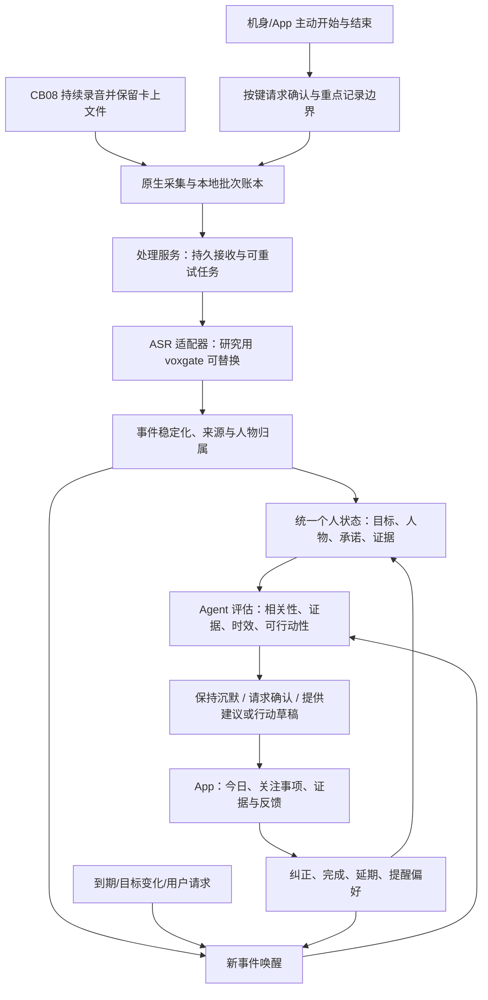

# 开源心力球应用：基于现有工程的交付方案

> 产品定位已由用户明确：以现有 App 和 CB08 适配为基础建设开源心力球应用。本项目的目标是持续感知、主动重点记录和 Personal Agent 闭环，后续按新产品的模块与接口演进；当前工程名称仅用于定位已有代码。

日期：2026-10-21。本文区分已交付的采集／重点原型与尚待实现的 Personal Agent。现已完成专用按键与握手试次，并实现独立原生 Mac App、本机采集服务及持久任务；没有切换生产路由、部署云服务或恢复已暂停的 heartbeat。

> 最新交付：本轮继续接上了 voxgate 转写与 LangGraph 处理图。两份已确认多人选段完成持续／重点处理；先用新录音验证并行调度（空转写，不算内容通过），再由用户参与实时口述：41.28 秒重点在全局结束前返回非空转写并完成整理，用户确认识别片段与本人刚才所说基本一致。跨对话依赖冲突、到期跟进、用户纠正、建议失效及引用最新记忆的回答，已经通过隔离虚构对话＋真实模型验收。当前属于 M1/M2/M3 的本机首条链路，不是全部里程碑完成；真实语音逐字准确率、iOS 后台、云部署和通用 Agent 规划仍未验收。当前能力、开源复用与证据以 [处理闭环交付](heartball-processing-loop-2026-10-21.md) 为准；下文早期“尚未接通”的段落保留为阶段记录。

## 本轮已经落地的第一条链路

`HeartballLab` 与本地服务已真机贯通持续接收、默认 60 秒封批、App 重点开始／结束、全局保存及完整卡上归档。一份 211.06 秒录音建立三个独立重点，其中 77.52 秒重点跨三个批次；结束重点不向硬件发命令，同一文件继续录制。完成态服务重启保留会话、范围、批次与任务身份，重复重点结束保持幂等。详细使用方式、代码与脱敏证据见 [可运行原型](heartball-local-prototype-2026-10-21.md)。

当前是采集和处理账本可用：ASR、语义事件、个人状态、主动建议与反馈没有接通，任务停在质量审核状态。重点边界按已接收音频包划分，精确采样／词级起止未知。正常握手在两次前后台协议试次避免了此前断连且接到卡上起始编码；已测机身保存手势依然停止整条录音，模式拨动未建立独立事件。持续模式目前使用 App 重点入口，不能宣称硬件无中断重点键或 M0 全部验收通过。

## 产品目标与第一条主线

用户进一步明确两种核心场景：持续被动记录，以及用户按键主动开始/结束一段特别想保留的内容。下一版按“两路输入、同一个 Personal Agent”设计；两种都作为核心能力。

| 输入 | 交付行为 |
|---|---|
| 持续感知 | 用户开启持续记录后，分钟级处理、自动聚合生活/工作事件、汇总并更新人物与当前事项，值得介入时反馈 |
| 主动重点记录 | 明确开始/结束，形成独立逻辑记录；短片段也保留并优先处理，结束时提交尾段，展示独立结果卡；关联到共同的个人上下文 |

主动记录不要求先选项目或建立目标。“关注一个真实工作项目”是首轮 Agent 闭环的验证范围，不限制主动记录灵感、备忘或其他对话。具体硬件协议、未知项和验证矩阵见 [双场景与物理按键研究](cb08-dual-mode-recording-2026-10-21.md)。

下一版 Agent 首轮验证先服务一个真实的工作项目：跨多次对话持续知道发生了什么，维护人物与承诺，在状态变化或临近截止时主动给出有依据的建议，并记住用户的纠正。

第一条闭环选“项目承诺跟进”：

1. 用户指定一个关注项目及目标，建立最小的个人上下文。
2. 对话自然发生，系统持续形成有来源的事件。
3. 从事件中识别承诺、负责人、截止时间和依赖，跨对话维护状态。
4. 新变化、冲突或截止时间触发评估；值得介入时提供一张卡片。
5. 卡片能跳回原声/原句，用户能纠正归属、标记完成、延期或调整提醒策略。
6. 纠正更新后续判断，已有建议随状态变化失效或完成。

这是一个完整的 Personal Agent 使用单元。下一版不必同时覆盖生活教练、健康管理、全自动外部执行和所有个人数据来源。

## 当前基础与真实缺口

| 部分 | 已有基础 | 下一步缺口 |
|---|---|---|
| CB08 采集 | Mac 独立原型同一文件约 3 小时 20 分钟；重连后整段编码与卡上一致 | 正式客户端持续接收、缺口补齐、iOS 锁屏与电池条件尚未验收 |
| 恢复 | 实测断连缺 5.2 秒未自动补发；保存尾部缺 40ms；卡上文件保留 | 在逻辑会话中记录缺口；归档可用后按证据修复，不把两端直接拼成无缺口 |
| 语音处理 | 已有分钟/五分钟上传实验和三个历史选段 | 用户确认后两份为多人场景；142643 的 10/15 秒内部切段输出差异 26.36%，逐字准确率仍未知 |
| 原生 App | 既有下载／上传账本；新增独立 Mac 原型，持续采集与重点范围已真机验证 | iOS 持续路径、个人状态、跨录音任务及主动反馈入口 |
| 单次理解 | `Meeting` 已有摘要、关键判断、参与者及 commitments，界面明确它们只是对话中的行动 | 把“提到过的行动”升级成有归属、证据、修订和生命周期的跨事件承诺 |
| 后端 | 现有 DeepBrain 协议、voxgate 研究服务；新增独立本机持久批次／重点任务服务 | 真实 ASR 执行、事件／个人状态／Agent 调度、远端部署与结果契约 |

当前 ASR 质量闸门约束正式切换、自动记忆写入和自动派生行动。状态模型、任务服务、反馈机制及 App 闭环可以先用已核对文本或明确标为待确认的事件开发，和 ASR 修复并行推进。

本轮把 `142643`、`152927` 两份已选历史范围记录为用户确认的多人场景，第一份不计入多人验收；没有把场景确认扩大成说话人身份、噪声或准确率确认。实验依据见 [真实音频结果](validation/voxgate-real-audio-2026-10-21/results.json)、[长测结果](validation/cb08-realtime-2026-10-20/long-run-result.json)。

## 一个应当跑通的产品例子

以下为设计示例，不是私人录音中的真实内容。

- 用户关注“项目 A 按期交付”；此前确认依赖接口预计周四可用。
- 新对话出现“我们周三交付完整版本”，系统先形成候选承诺，并核对“我们”指谁。
- Agent 结合依赖与目标，给出卡片：“当前交付承诺早于接口可用时间。是否先确认依赖或调整范围？”两条依据都可查看。
- 用户纠正：“周三是客户交材料，不是我交版本。”
- 系统修改负责人和承诺类型，撤销依赖错误归属的旧建议，不再把它当用户待办。
- 后续用户问“项目 A 现在卡在哪”，回答复用已经修正的状态；临近客户交材料时间，按用户选择的策略跟进。

重点验收状态是否持续、建议是否主动、纠正是否真正生效。每次发一篇摘要不能替代这些行为。

## 需要建立的状态与证据

现有 `LedgerItem` 以设备文件、大小和传输状态为中心，继续用于文件同步。另建逻辑会话与语义状态；增长中的设备文件大小不作为个人事件的固定身份。

| 对象 | 最小内容 | 必须守住的边界 |
|---|---|---|
| CaptureSession / AudioBatch | 逻辑会话、批次号、原始文件/连接、样本范围、采集时间、哈希、缺口、处理版本 | 一个设备文件可以产生很多批次；一个语义事件也可跨批次或文件 |
| FocusRecord / CaptureIntent | 主动记录 ID、机身/App 来源、开始与结束请求及确认、原始范围列表、独立结果 | 重要性、人物归属和识别可信度分开；同一音频复用识别产物，避免重复写入承诺 |
| Event / EvidenceSpan | 主题、参与者、来源类别、时间范围、原句、音频位置、修订版本 | 分离对话事件与个人事实；背景播放、未知来源不能直接成为个人经历 |
| Person / Attribution | 会话内说话人、已确认人物、与用户关系、归属确认状态 | 多人场景不代表已知谁是用户；不默认所有“我”都指设备主人 |
| Goal / PersonalState | 用户当前关注项目、目标、偏好、相关事实、依赖及新鲜度 | 初始目标由用户明确选择；长期事实可纠正、过期、替代与遗忘 |
| Commitment | 谁做什么、截止时间、依赖、来源、proposed/confirmed/completed/cancelled 等状态 | “对话中提到”与“用户接受为待办”分开；未知负责人保留待确认 |
| Advice / Feedback | 建议、依据、有效期、去重身份、展示及反馈状态 | 区分纠正归属、延期、少提醒、完成和无用，分别更新相关状态 |

保存发生时间、接收时间和理解完成时间。历史补回音频不按上传日解释“明天”；设备 RTC 不可靠时标明时间精度，不能捏造准确日期。当前可以回到音频片段，词级时间戳需有真实对齐能力后再提供。

原文证据、推断和已确认事实分别保存。把一句话从事实改为误识别或其他人发言后，通过依赖关系使相关的未执行建议失效，保留修订记录。

## 实现结构与开源复用

职责安排沿用前次固定提交源码研究，不把它表述成当前上游最新能力或我们已经运行的部署：

- **保留 Swift 与 CB08 协议层。** 复用 BLE/Ogg、下载恢复、账号范围和后台文件传输，单独增加逻辑会话与批次路径。硬件持续接收和分钟上传分别调度。
- **参考 Omi 的事件、证据记忆与主动反馈机制。** 借鉴上下文聚合、相关性判断、建议复核、去重和反馈；不把整套英文阈值或外部 Intelligence 服务当作开箱可用能力。
- **参考 OpenMuse 的持久任务、检查点和结果回执。** 任务与个人状态各有一个权威来源；不为同一承诺同时建立几套互不对账的任务系统。
- **建一个独立处理服务适配现有客户端。** 建议以 Python/FastAPI + PostgreSQL 作为初始实现，音频单独存文件/对象存储。先用数据库任务表、租约和事务事件表保证重试、重启和状态更新一致，随实际吞吐需要再引入其他队列。
- **ASR 是适配器。** 保存已经完成的识别产物；事件抽取或建议生成失败不会重新上传、重新转写。voxgate 当前研究接口与稳定性不足以被写死为唯一后端，也不实现 DeepBrain 六步协议。
- **记忆首先服务明确目标、人物和承诺的查询。** 初期用结构化查询及文本检索；需要自然语言召回时再增加向量索引。Graphiti、Mem0、OpenClaw/Hermes 的整包引入分别等到出现明确需求，不同时堆叠。
- **后续接外部 Personal Agent。** 稳定后提供读取上下文、承诺与证据、提交纠正和反馈的 MCP 工具，同时保留事件唤醒。MCP 访问本身不会触发主动判断。

对应前次源码依据与外部依赖边界见 [Omi / OpenMuse 深度核查](personal-agent-oss-and-hardware-deep-dive-2026-10-20.md)。其中本机采集／重点服务已用标准库 HTTP 与 SQLite 实现并真机验证；这里的 PostgreSQL、模型调度与部署方案仍是后续选择，尚未做性能或云部署验收。

## 先交付按键验证，再贯通四个产品里程碑

不在未知人员投入、模型接口和签名条件下承诺固定日程。以下按可验收产物排序；ASR 专项与前三项并行，逐项放开真实自动处理能力。

### M0：主动重点记录的硬件与处理契约

- 完成未连接、连接空闲、持续录制中三类物理按键验证；确认 AE23 订阅、实际请求/回应、状态、物理文件和实时流边界。
- 最初三组各一次的观察模式实测已完成：离线独立保存 25.86 秒；连接空闲的主动录音保存 75.38 秒，开始后断连且实时缺开头 4.72 秒；持续录音中保存手势停止全局录音。随后正常前后台协议握手各一次无断连且收到卡上起始编码；保存回应变体、无回应和单次继续均未保住录音。模式拨动未建立独立事件。细节见硬件报告，重复操作统计、精确声学边界与 iOS 后台仍未验收。
- 当前已测保存手势会终止物理录音，不能直接绑定为无中断重点开关。先分开持续模式的 App 范围标记与独立主动模式；机身请求、真实状态、卡上音频确认分开维护。继续核对完整握手/其他手势，显示真实中断，不悄悄恢复或声称只是标记。
- 给明确主动记录建立独立 ID、范围与结果卡；5–20 秒也不因环境录音阈值而被挡住，仍遵循账号和用户处理设置。结束立即封好可用尾段，失败可重试。
- 验收：用户一按开始、一按结束，能找到且只生成一条对应记录；与环境流重叠时没有两份承诺，断连时范围或缺口可见。

M0 的 App 重点范围入口与独立持久任务已在新原型真机验证，尚未生成转写或整理正文。硬件短按仍是全局保存，精确声学边界与正文完整性未知；不能将软件入口等同于硬件双模式全部上线。M1 的服务／状态开发可继续使用已核对文本推进，硬件可靠性与语音质量并行验收。完整结果见 [按键与握手实测](cb08-dual-mode-recording-2026-10-21.md)。

### M1：用现有文本跑通项目承诺闭环

- 建独立 Event、Goal、Commitment、Advice、Feedback 数据与版本契约。
- 处理服务保存任务状态，提供事件接收、状态读取、证据访问和纠正接口。
- 用明确的人工核对文本或标为待确认的历史文本回放，构建同一项目跨多次对话的状态。
- 第一条策略只做承诺变化、依赖冲突和到期跟进；有事件或截止事项才调用模型。
- 验收：无需用户再次提问能出现有依据的卡片；同一事件重试不重复建承诺/发卡；纠正负责人后旧建议失效，后续回答使用新状态；服务重启后待办仍在。

这一步不要求先证明所有噪声条件下的 ASR 准确率。开发材料和演示需明确哪些输入人工确认过，不能把回放称为实时硬件验收。

### M2：把原生 App 变成状态与反馈入口

- 新增实验性“今天”：Agent 已理解到的时间、当前关注项目、待确认事件、少量建议和事件流。
- 新增“关注事项”：进行中目标、待跟进承诺、等待他人事项；可查看状态变化。
- 保留现有记录和原句/音频阅读页作为证据入口。
- 卡片支持“不是我说的/不是我的承诺”“已完成”“延期”“稍后提醒”“少提醒这类事”，写入服务状态。
- 验收：用户从卡片回到来源并纠正，关闭重开 App 后更正仍存在，关联视图一致；界面区分待确认、推断和确认。

先完成信息结构和服务契约，再改 `iOS/RootView.swift` 等正式页面。没有通过真实链路验收前保留现有上传路由，实验入口明确标识。

### M3：接上分钟级真实上下文

- 先基于已验证的 Mac 原型贯通连续会话，再移植和验证 iOS 前台、锁屏路径。
- 默认 60 秒封批、按上传策略最多 300 秒、结束提交尾段；不每分钟停启硬件。
- 每批携带逻辑会话、序号、采集时间、样本范围/缺口、哈希和处理版本。服务持久化后回执；重试复用任务，同序号换内容报冲突或显式修订。
- 明确显示“采集/上传/转写/理解”的进度，延迟或断流可见；补回历史内容更新记忆并核销旧推断，不触发过期的紧急建议。
- 验收：一场 30–60 分钟真实沟通中形成跨批次事件并主动跟进；网络重试、服务重启和断连不会静默丢弃、重复创建或把旧内容当新情况。

开发服务先在本机运行；iOS 真机使用可达的开发地址，手机的 127.0.0.1 不代表 Mac。远端服务器未指定，不能声称已上云。

### M4：扩展到日常持续使用与受托执行

- iOS 锁屏/系统中断、长时恢复、真实电池续航和 App 后台进度做独立实测；当前充电 Mac 长测不能替代。
- 手机端语音检测降低上传及模型成本，保留前后缓冲和真实时间；这不减少已经发生的 CB08 编码/BLE 传输。硬件 VAD 仍需可核对协议或受控实验。
- 增加会前简报、阶段复盘和其他授权信息来源；模型只得到当前目标所需上下文。
- 从 App 内草稿和待办开始增加工具执行；外部动作有明确授权边界、幂等身份与实际回执，不因重启盲目重放。
- 验收：连续真实使用后能看到关注事项持续更新、纠正有效、合理保持沉默及可追溯的结果；再评估增加场景。

## ASR 这条并行线具体做什么

使用用户确认的两份多人样本和既有明确选段，保留背景播放负样本，不扩大到整卡。重点核对人物归属、承诺中的日期/否定/条件和原文件约 240 秒的敏感位置。

把 60/300 秒上传批次与服务内部识别切段分开测试。评估停顿切分、受控最大长度、前后上下文及必要的短重叠；重叠必须按音频位置对齐，不能只靠相似文字删除重复词。不同机器结果只是诊断位置，准确率来自可核对原话。

逐层放开能力：可信事件先展示，未知归属请求确认；证据不足时不自动升级为个人长期事实或用户承诺；在关键语义仍不稳定时不启用依赖它的自动动作。这样可以获得真实产品反馈，同时继续修复语音链路。

## 下一版的验收重点

1. **有用性：**用户是否认可主动卡片，是否采取行动，承诺是否更容易闭环。
2. **正确性：**参与者、负责人、时间、否定和条件是否正确；背景内容是否误入个人状态。
3. **可纠正：**原话能否定位；一次纠正是否改变关联状态和下一次判断。
4. **主动性：**新事件或时间能否唤醒 Agent；没有有用变化时能否沉默，用户不必每次提问。
5. **可靠性：**重试/重启/补传不重复，缺口与新鲜度可见，抽取失败不重做 ASR。
6. **及时性与成本：**记录从事件结束到上下文可用及卡片出现的分位时延、每条有用反馈的处理成本。首轮可将约两分钟内反馈设为实验目标，尚非实测承诺。

建议下一项开发直接落在 M1 的“跨事件承诺状态 + 纠正失效传播 + 主动卡片”，同时确定 M2 的服务契约。其首个评测围绕用户自己的一个工作项目，贯通一次输入、判断、介入、纠正和后续变化，而不是继续只展示转写全文。
