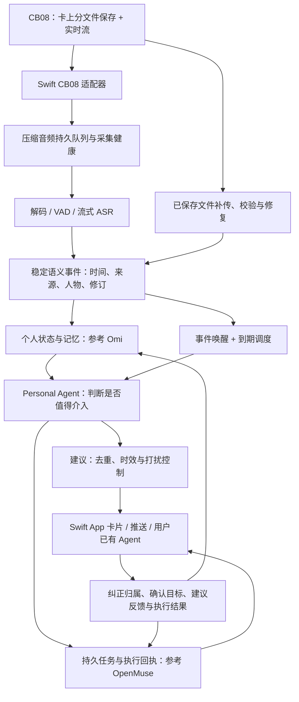

# Personal Agent 闭环：Omi、OpenMuse 与 CB08 长时实时能力深度核查

> 后续实测与实施：见 [CB08 长测结果](cb08-realtime-prototype-2026-10-20.md) 及 [2026-10-21 交付方案](personal-agent-delivery-plan-2026-10-21.md)。同一 TYPE=1 文件已实测约 3 小时 20 分钟，未发生切段；本文“尚未验证”的实验状态以新报告更新，固定提交的源码研究仍保留原时点。

> **后续实机更新：**[CB08 实时验证原型与结果](cb08-realtime-prototype-2026-10-20.md) 已补充声云硬件方 SDK 来源。2026-10-20 短测中，仅重订阅恢复了同一录音的后续实时流，卡上原始文件逐字节匹配；断连期间约 5.2 秒未自动补发。跨三小时长测正在运行。下文的未知项及旧日志应结合这次新证据阅读。

核查日期：2026-10-20。范围：开源仓库当前代码、项目自己的验证边界、现有 Swift/iOS 实现与历史硬件日志。不依赖现有深脑服务端，不把路线图当成已实现功能。本轮没有操作录音笔，也没有重新进行三小时或全天录音实验。

## 1. 结论与选型方向

产品应围绕“持续获得上下文 → 更新个人状态 → 事件/时间唤醒 Agent → 判断是否介入 → 建议或执行 → 纠正与结果回流”建设。模型长期在线不是必要条件；个人状态、任务与调度必须持续存在。

**Omi 更适合作为持续感知、记忆和主动建议的主要参考；OpenMuse 更适合作为长期任务、执行状态、人工介入和结果展示的参考。** 两者不是同一层面的替代品，也没有一个可以直接接上 CB08 就完整复现心力球体验。

若现在以现有硬件和 Swift App 做第一个产品原型，建议采用 **Omi 的感知与主动反馈路径，配一套统一的个人状态和任务账本；借鉴 OpenMuse 的持久任务、执行回执和界面表达**。不同时部署多套记忆库和任务系统。OpenClaw/Hermes 可以作为外接个人 Agent 的替代宿主，第一阶段二选一或暂不引入。

硬件结论是：**CB08 是值得验证的实时输入候选，尚不能认证为全天实时采集硬件。“约三小时”目前应解释为历史单文件切段边界，而不是总录音时长或电池续航上限。** 比三小时更早需要解决的是：断连后怎样接回同一条实时流。

## 2. 用同一条 Personal Agent 闭环比较

这里的 OpenMuse 指 [CopilotKit/openmuse](https://github.com/CopilotKit/openmuse)，不是同名记忆或图像项目。Omi 核查提交为 `b44802109ad4f0e55cc6d0e671cd959ac9b3a3fb`；OpenMuse 为 `1ac68f3909f2478ab6280883f1ab5ea65eb5719d`。以下是代码与项目文档能支持的判断，未运行它们的完整部署或 live provider 验收。

| 闭环环节 | Omi 当前可核对的实现 | OpenMuse 当前可核对的实现 | 对深脑的取舍 |
|---|---|---|---|
| 持续感知 | 穿戴设备/桌面上下文、实时转写、对话及说话人信息的现有产品路径 | 当前核心输入是聊天、邮件、文件、网页、用户目标；没有现成 CB08/连续音频入口 | 感知以 Omi 为主参考；CB08 必须另写适配器 |
| 从输入形成事件 | 转写片段、对话处理、事实与行动事项抽取，已有语音产品的数据链路 | 任务证据以 mail/file/web/user 表达；AG-UI 流是 Agent/UI 事件流 | 增加音频片段、归属、修订和事件边界，不能把 AG-UI 当作音频协议 |
| 个人记忆 | 事实命题、人物实体、证据、捕获置信度、可信度、有效期、替代关系、生命周期等结构 | AgentMemory 为 id/text/source/createdAt；支持聊天确认后记忆、编辑和遗忘 | 长期“了解我”的基础更接近 Omi；OpenMuse 的文本记忆不足以直接承担全天语音记忆 |
| 新上下文唤醒 | mentor 累积新对话后评估；v2 对对话修订、承诺到期事件建账 | worker 执行持久任务；维护循环刷新 Ideas；网页监控定时检查 | 新语音事件必须显式触发评估，不能只开放 MCP 等人来问 |
| 主动判断 | 相关性 gate → 建议生成 → critic；另有用处判断、去重、预算和频率机制 | 当前 Ideas 主要是邮件/目标规则；开放式模型可处理受委托任务 | 主动建议机制优先研究 Omi；不能把 OpenMuse 当前 Ideas 宣称为广泛自主洞察 |
| 长期目标与执行 | 有目标、行动事项、工具/应用接口；本次核对的 mentor/follow-up 路径以建议与提醒为主 | 任务有计划、检查点、等待输入/审批、暂停、取消、重试、产物和回执 | 长期执行状态更值得借鉴 OpenMuse；“提醒有承诺”与“替你办完”需分开实现 |
| 长时可靠性 | 有处理恢复与主动建议事件身份、预算等机制；仍有现有云服务和产品接入条件 | SQL 持久任务、租约、过期租约恢复、重启后发布结果对账 | 采用同一权威任务账本；外部操作不能因重启盲目重放 |
| 用户反馈 | 记忆审核/编辑、失效与替代，主动建议曝光/反馈结果；存在拒绝记忆的有界反馈辅助机制 | Ideas accept/edit/dismiss；记忆编辑遗忘；执行输入与审批 | 两者都不能仅凭按钮或反馈日志就认定“已自动学会用户偏好” |
| 交付 | 手机产品与主动建议投递代码路径已有基础；v2 是否可用受服务端配置约束 | 持久 App 内通知；APNs/FCM 推送与语音在路线图 | 我们仍需原生推送、卡片深链与过期控制 |
| 部署与客户端 | Python 后端、现有移动/桌面端；默认涉及 Firebase/Google Cloud、存储、检索及模型服务 | TypeScript/Hono、React Native/Expo、SQL、可选浏览器/Docker 电脑；Rich Threads 依赖单独 Intelligence 服务 | 保留 Swift 客户端；不要为了借鉴 Agent 体验先重写整个 App |

主要依据：[Omi 后端说明](https://github.com/BasedHardware/omi/blob/b44802109ad4f0e55cc6d0e671cd959ac9b3a3fb/docs/doc/developer/backend/backend_deepdive.mdx)、[Omi 记忆模型](https://github.com/BasedHardware/omi/blob/b44802109ad4f0e55cc6d0e671cd959ac9b3a3fb/backend/models/memories.py)、[OpenMuse 类型](https://github.com/CopilotKit/openmuse/blob/1ac68f3909f2478ab6280883f1ab5ea65eb5719d/packages/domain/src/agent.ts)、[功能及边界](https://github.com/CopilotKit/openmuse/blob/1ac68f3909f2478ab6280883f1ab5ea65eb5719d/docs/FEATURES.md)。

## 3. Omi：真正值得复用的不是录音列表

### 3.1 记忆已经超出“向量库里存摘要”

`Memory` 包含 predicate、arguments、subject_entity_id、subject_attribution、object_entity_ids、capture_confidence、veracity 等字段；`MemoryDB` 还有 evidence、valid_at、invalid_at、superseded_by、canonical_memory_id 和生命周期字段。数据库代码也有替代、软失效、来源撤回后处理剩余证据的路径，不能把它概括为只有字段的空壳。

这对全天语音尤其关键：

- “客户希望周五交付”不能直接写成“我承诺周五交付”。必须保存说话者和归属状态。
- “我住杭州”后来变成“我搬到上海”时，要更新当前事实并保留过去状态，避免检索时两条都被当成现在。
- 音频听清了，不代表事情一定是真的；捕获置信度与事实可信度是不同量。
- 删除或否定一个来源后，要判断事实是否还有其他有效证据，不能只删一条可见卡片。

可借鉴其建模与生命周期，但这些结构不能证明中文、多人混谈和电视声的归属已经可靠。需要用我们的真实场景评估，不应把“有声纹/说话人字段”当成“识别对了”。依据：[记忆模型](https://github.com/BasedHardware/omi/blob/b44802109ad4f0e55cc6d0e671cd959ac9b3a3fb/backend/models/memories.py#L106)、[数据库失效与撤回逻辑](https://github.com/BasedHardware/omi/blob/b44802109ad4f0e55cc6d0e671cd959ac9b3a3fb/backend/database/memories.py#L1395)。

### 3.2 主动反馈已有可研究的决策链

当前 `mentor_notifications.py` 缓存最多 50 条合并后的消息，新增消息积累到阈值才进行评估；同一说话者相近片段会先合并，因此阈值不能直接换算为“每十句话”或“固定十秒”。静默检测还使用 120 秒阈值及空格分词计数，中文必须重新验证。

`produce_mentor` 可以核对到以下流程：为来源及修订版本领取事件 → 组装用户事实、目标、近期对话和已发建议 → 相关性判断 → 生成建议 → 复核 → 可配置的用处判断 → 与历史投递去重 → 持久化 feed/chat → 尝试推送。它强调具体、能改变下一步行为的信息，默认多数对话不应打扰。

这比“每分钟总结一次”更接近产品目标。我们应借鉴的是介入机制，不是照搬英文提示词。输入缺少来源、人物和时间，即使用同一个提示词，也会输出错误的个人建议。依据：[缓存触发](https://github.com/BasedHardware/omi/blob/b44802109ad4f0e55cc6d0e671cd959ac9b3a3fb/backend/utils/mentor_notifications.py)、[实际 producer](https://github.com/BasedHardware/omi/blob/b44802109ad4f0e55cc6d0e671cd959ac9b3a3fb/backend/utils/proactivity_producers.py#L295)、[相关性和复核提示](https://github.com/BasedHardware/omi/blob/b44802109ad4f0e55cc6d0e671cd959ac9b3a3fb/backend/utils/llm/proactive_notification.py#L27)。

### 3.3 不要误判为开箱即用的自托管主动 Agent

v2 路径的 admission 含付费/flag 条件；flag 实现通过 PostHog 查询服务端 cohort，错误时关闭该能力。承诺跟进使用 Cloud Tasks 做到期唤醒，执行时复核任务仍未完成且截止时间版本未改变；该 producer 本身不创建、完成或修改任务。

所以，代码存在不等于 clone 后默认就会主动提醒，也不证明该能力已对所有生产用户开放。我们要独立部署，必须明确替换认证、功能开关、模型路由、任务运输及投递配置，同时保留去重、预算和来源版本检查这些正确性机制。

依据：[flag authority](https://github.com/BasedHardware/omi/blob/b44802109ad4f0e55cc6d0e671cd959ac9b3a3fb/backend/utils/proactivity_flags.py)、[到期唤醒](https://github.com/BasedHardware/omi/blob/b44802109ad4f0e55cc6d0e671cd959ac9b3a3fb/backend/utils/commitment_followup_tasks.py)、[v2 contract](https://github.com/BasedHardware/omi/blob/b44802109ad4f0e55cc6d0e671cd959ac9b3a3fb/backend/docs/proactivity_v2/CONTRACT.md)。

### 3.4 CB08 不能冒充 Omi 硬件直接接入

两者 GATT UUID、封包、序号与音频分片约定不同。CB08 是 AE20 服务与带 magic/SEQ/CRC/LEN 的业务帧；Omi 自有设备协议不是这个格式。应保留现有 CB08 协议核心，新建标准采集适配层，验证实时码流后再送入 Omi 或独立的流式处理服务。没有证据说明可以把 Omi 固件刷到 CB08。

## 4. OpenMuse：强在把事情持续做完，当前还不是全天感知型 Agent

### 4.1 已有的长期任务能力很有价值

任务记录含 goalId/milestoneId、计划、证据、输入、状态、nextRunAt、leaseId/leaseUntil、attempts、actionId、result 和 artifactIds。worker 用租约竞争及检查点恢复工作；任务可以等待输入/审核、暂停和取消。维护循环对任务结果和已接受 Ideas 做恢复对账。

这能解决“关掉 App 后任务是否还在”“Agent 到底做到哪步”“外部动作是否真的成功”“恢复后是否重复执行”等问题。长期个人 Agent 需要的是这些可追踪状态，不能把所有工作埋在一段聊天历史中。

它的受委托模型路径确实能读工具、保存计划、请求输入、准备待审核动作并在回执后继续，不能把项目整体贬为假演示。另一方面，项目自己的验证文档明确区分了真实 Chromium/Docker 测试、虚构邮箱/模型协议 fixture 与尚待验证的真实账号、实时模型和 Intelligence 持久化。

依据：[worker](https://github.com/CopilotKit/openmuse/blob/1ac68f3909f2478ab6280883f1ab5ea65eb5719d/apps/server/src/engine/worker.ts)、[模型工具与任务恢复上下文](https://github.com/CopilotKit/openmuse/blob/1ac68f3909f2478ab6280883f1ab5ea65eb5719d/apps/server/src/engine/model.ts)、[验证范围](https://github.com/CopilotKit/openmuse/blob/1ac68f3909f2478ab6280883f1ab5ea65eb5719d/docs/VERIFICATION.md)。

### 4.2 Ideas 的主动性边界应讲清楚

`refreshIdeas` 当前检查邮件附件和英文 form/sign 等关键词、coffee/meet/schedule 等会面关键词，以及没有里程碑的 active goal，生成建议并去除已经完成或已发出的来源。维护循环每分钟运行，Ideas 的刷新条件是距离上次超过 15 分钟；这不是“全天对所有新音频实时推理”。

网页 watch 则是实在的窄场景闭环：按变化、包含文本或价格阈值检查，保存基线、去重、失败退避，再产生通知。但网页条件监控不能自动推广成“理解个人所有目标并持续推进”。

Ideas 的 dismiss 会改变该条建议状态，不等于模型已经学会“以后这类场景不要提醒”。源事件自动识别、跨源关联、策略更新和因用户纠正而撤销下游判断，仍需我们补齐。

依据：[维护循环](https://github.com/CopilotKit/openmuse/blob/1ac68f3909f2478ab6280883f1ab5ea65eb5719d/apps/server/src/engine/service.ts#L70)、[Ideas 规则](https://github.com/CopilotKit/openmuse/blob/1ac68f3909f2478ab6280883f1ab5ea65eb5719d/apps/server/src/engine/service.ts#L554)。

### 4.3 记忆与运行条件是实际接入成本

当前 `remember_fact` 接收用户明确提供或确认的偏好，文本记录有来源；受委托任务模型读取 memory 列表放入上下文。这是可用的简单个人记忆，但还缺全天语音所需的说话者、片段时间、事实有效期和证据版本语义。不能把它直接替代成时序个人状态引擎。

项目仍标为 Alpha。当前所有 workspace 模式启动都要求 `CPK_INTELLIGENCE_API_KEY`；Rich Threads 的 Intelligence 是另行配置的服务，不包含在这份 MIT 应用代码里。若要求完整独立部署，必须确认该服务的部署方式，或者替换线程持久化边界，不能按“本地 SQL 已经包办聊天持久化”估算。

PGlite 适合单进程；独立 worker 使用 PostgreSQL。服务器/worker 主机必须在线；App 退出不等于服务器关机。设备推送、语音输入回复、广泛健康/银行/社交连接、自适应长期计划等仍在路线图。AG-UI 解决 Agent 状态向 UI 的流式交付，不能代替 BLE、ASR 或手机后台采集。

依据：[remember_fact](https://github.com/CopilotKit/openmuse/blob/1ac68f3909f2478ab6280883f1ab5ea65eb5719d/apps/server/src/engine/conversation.ts#L364)、[Rich Threads 依赖与验证边界](https://github.com/CopilotKit/openmuse/blob/1ac68f3909f2478ab6280883f1ab5ea65eb5719d/docs/RICH-THREADS.md)、[路线图](https://github.com/CopilotKit/openmuse/blob/1ac68f3909f2478ab6280883f1ab5ea65eb5719d/ROADMAP.md)。

## 5. 其他开源方案应该放在哪一层

| 方案 | 适合承担的职责 | 不应替它假设的能力 |
|---|---|---|
| OpenClaw | 个人 Agent 会话、工具、渠道、持久定时任务、heartbeat 与事件唤醒；适合接用户已有 Agent | heartbeat 默认节奏不是实时语音处理；需要我们的事件适配、可信记忆和来源修订 |
| Hermes Agent | 跨会话记忆检索、Skills、用户模型候选、定时自动化与多渠道宿主 | Skills 能改进不等于个人建议已自动变好，也不解决 CB08 断流与人物归属 |
| FunASR / sherpa-onnx 等语音组件 | 在确定中文、设备端/服务端资源后评估 VAD、ASR、说话人相关处理 | 识别语音不等于识别用户意图，不单独提供完整 Agent 闭环 |
| Graphiti / Mem0 等记忆组件 | 在独立记忆层成为瓶颈后，比较时序关系或偏好记忆能力 | 不能与 Omi 记忆同时默认各自成为权威来源；也不负责主动唤醒和任务正确性 |

本轮对前两者核查官方代码/文档；后两行沿用此前组件候选，不构成本轮性能选型。不要从“项目多”推导出“架构更完整”。若选择 OpenMuse 作为执行宿主，就先用它的任务系统；如果选 OpenClaw/Hermes，就让任务归属有一个清晰的权威边界。

依据：[OpenClaw heartbeat](https://github.com/openclaw/openclaw/blob/d85fcb29bec40d33dc6055fe4144cbf468b8848c/docs/gateway/heartbeat.md)、[持久定时任务](https://github.com/openclaw/openclaw/blob/d85fcb29bec40d33dc6055fe4144cbf468b8848c/docs/automation/cron-jobs/how-it-works.md)、[Hermes 官方 README](https://github.com/NousResearch/hermes-agent/blob/bd3cbe91a90097f9804f16ea5c1768f5cbaaf0b7/README.md)。

## 6. CB08 的三小时：证据究竟支持什么

### 6.1 历史记录支持单文件切段，不支持总录音上限

本地 `Sources/CoreSelfTest/main.swift` 的历史样本及 `Continuation.swift` 注释记录：

| 文件 | 文件名指示的开始时间 | 时长 | 据此计算的边界 |
|---|---|---|---|
| note20260829-140354 | 14:03:54 | 10,801 秒，即 3:00:01 | 计算结束时间为 17:03:55 |
| note20260829-170356 | 17:03:56 | 796 秒，即 13:16 | 起点比上一段计算终点晚 1 秒 |

这与“约三小时生成下一文件”的历史观察一致，且后面存在继续录制的一段。因此 README 中笼统的“设备有三小时上限、到点自动断开”应该收窄为“历史观察到单文件约三小时切段”。这里的“断开”不能直接解释为蓝牙链路断开。

证据等级也要保留：本轮读到的是代码里的历史记录与测试样本，未找到默认 manifest 路径的原始清单，也未重放原始音频重新测量。**两个文件的时间差不能证明只有一秒音频缺失，更不能证明实时推流无缝。** 精确硬件行为还需边界实验。

`deviceCapSeconds = 10_700` 是识别“接近上限”的软件阈值，等于 2:58:20；`maxGapSeconds = 5` 是续接判断容差。两者都不是固件规格，不能拿 10,700 秒当作真实最大录音时长。

### 6.2 协议的数字宽度解释不了三小时限制

上游 TYPE=3 的录音时间返回 duration:UInt16 LE + size:UInt32 LE。UInt16 秒最大可表示 65,535 秒，即 18:12:15，不是三小时；文件列表时长字段还是 UInt32。因此没有证据说明三小时来自该字段溢出。

是否是固件轮转策略、编码/文件管理策略或其他限制，目前无法从协议确定。公开协议也没有给出该设备持续推流续航、热稳定性或准确可用存储规格。容量单位在厂商文档、上游显示和本地观察之间有差异，不能据此推算能录多少天。

依据：[上游协议固定提交](https://github.com/lomehong/record/blob/ac762fea4cb3372fa87d0739310796f216902a23/docs/%E5%8D%8F%E8%AE%AE.md)，以及本地 `Continuation.swift`、`CoreSelfTest/main.swift`。

## 7. 当前硬件与 App 的实时能力分级

| 问题 | 当前证据 | 判断 |
|---|---|---|
| 能否产生实时音频？ | 协议有 1-0/1-1；历史真机开始后计数到 31 个实时业务帧 | 短时存在实时推流；不是 31 个 20ms 编码包的证明 |
| 蓝牙断开后卡上录音是否继续？ | 2026-09-07 / V1.0.0 日志：重连后同一文件继续增长并保存 | 短时已验证 |
| 重连后是否自动恢复实时流？ | 同一日志：重连后两秒窗口实时帧增量为 0，卡上录音仍继续 | 该次没有自动恢复；最先要解决的阻断点 |
| 单文件超过三小时后是否继续记录？ | 历史样本显示 3:00:01 后有相邻 13:16 文件 | 支持文件切段续录的历史判断，需新实验确认当前设备行为 |
| 三小时边界实时流是否继续？ | 没有边界上的流、状态及文件身份联合记录 | 未知 |
| 锁屏/后台是否可稳定采集？ | 已声明 bluetooth-central 和恢复标识，但业务层会断开且无音频持久接收 | 当前 App 未实现该产品能力 |
| 能否持续 8 小时/24 小时？ | 没有连续 BLE+录音功耗、温度、电池、后台恢复实验 | 未知，不能承诺 |
| 能否恢复丢失的实时音频？ | 保存文件可作为事后来源；没有文档化的实时序号重传/接回游标 | 有事后修复方向，无法保证当时及时反馈 |

历史正式日志：`docs/validation/ios-0.1.8/hardware-production.json`。05:10:05 开始，05:10:08 断开，05:10:14 重连仍录同一文件，05:10:16 显示 10 秒/20,200B，但重连观察窗口没有收到实时帧；05:10:17 保存为 10 秒/20,600B。它证明卡上录音与蓝牙实时流是两条不同的能力。

另一个暂停实验里，state 仍显示录音中，录音时长却停在 2 秒。故“状态=1”“蓝牙已连”“socket 已连”都不能作为捕获健康证明，要同时跟踪音频字节/解码采样前进、最近有效声音片段和端到端处理水位。

### 7.1 当前 App 有明确的实现阻断

1. `BLEClient.swift:561–575` 收到实时帧只增加计数，并从 pending 中过滤，不写音频文件、不解码、不送流式 ASR。
2. `iOS/AppModel.swift:1536` 附近，确认开始录音后主动断开，以免接收当前不用的实时音频。
3. `sceneChanged(active:false)` 会取消录音观察/控制；满足条件时断开蓝牙。录音监控循环受 `isForeground` 限制。
4. 录音/暂停会阻止同步，当前文件也被跳过。协议虽有分段导入命令，但没有证据证明安全地边录边下载正在增长的文件，不能把它当作现成实时替代方案。
5. 现有 Core Bluetooth restoration 只恢复 peripheral/delegate/标识等基础状态，没有实时音频游标、持久队列和处理水位恢复。

**因此，今天把新 Agent 后端接在原有上传接口后面，只能得到录完后的 Agent。** 三小时会话进行期间，系统仍可能没有本次上下文。

### 7.2 iOS 能支持后台蓝牙事件，但需要完整工程验证

项目的 `iOS/Info.plist` 已有 `bluetooth-central`，不能说“iOS 天生不允许后台 BLE”。Apple 官方说明允许为相关蓝牙事件唤醒 App，也提供状态保存/恢复；同时后台模式不保证 App 永远运行，恢复后还需要重新确认服务、特征和订阅等进度。

BLE 事件唤醒不是持续运行任意 WebSocket、ASR 和 LLM 的许可。应把手机职责收窄到接收、持久化、有限解码/分段及可靠上传，把长期 Agent 放在持续运行的服务端。锁屏、系统终止和用户主动强退要分开测，不能用一次前台成功推导后台可靠。

依据：[Apple Core Bluetooth 后台处理指南（归档文档）](https://developer.apple.com/library/archive/documentation/NetworkingInternetWeb/Conceptual/CoreBluetooth_concepts/CoreBluetoothBackgroundProcessingForIOSApps/PerformingTasksWhileYourAppIsInTheBackground.html)。此文支持机制边界，不能代替目标 iOS 版本的实机验收。

## 8. 数据量不是当前最明显的瓶颈，但电量尚未知

本地已保存文件的封装假设为 40B/20ms、16kHz 单声道 Opus：

| 格式/时段 | 按现有配置计算的数据量（十进制） |
|---|---:|
| 压缩音频速率 | 2,000B/s，约 16kbps，不含 BLE/协议/容器开销 |
| 压缩 1 小时 | 7.2MB |
| 压缩 3 小时 | 21.6MB |
| 压缩 24 小时 | 172.8MB |
| PCM 16kHz/16bit/mono，1 小时 | 115.2MB |
| 同格式 PCM，24 小时 | 2.7648GB |

三小时历史文件 21,602,000B 与 10,801 秒也符合上述压缩速率。依据是 `OggWrap.swift` 与历史样本；**尚未验证实时 body 总是同一帧布局**。接入前必须验证完整码流及解码结果，不能仅因为 body 长度能被 40 整除就宣称音频有效。

从平均数据量看，持续低码率音频没有明显的带宽数量级障碍；这不证明射频、后台调度、丢包恢复或电量可行。持续开 BLE 的耗电可能显著不同于当前“录卡上、同步时连接”的策略。电池百分比、充电状态码不能推算连续实时时长，边充边录也未验证。

工程上应保存压缩的本地追加日志/分段文件，按需解码为 PCM，消费队列有界；BLE 回调不能等待大模型、网络或大块转码。不要在内存中累积一天 PCM，也不要为了让 Agent 理解连续性拼一个越来越大的全天文件。

## 9. 建议的实际组合与职责边界

第一阶段可以保持两个服务边界：语音/记忆服务与任务/交付服务，但用户、记忆、任务各只有一个权威来源。不是让两个完整开源 App 各管理一套用户数据。

必要接口和行为：

- **采集事件**：capture_session_id、physical_file_id、capture_epoch、音频范围、设备/手机时间映射、接收时间、缺口和补传状态。设备 1B SEQ 会回绕且不覆盖在 CRC 内，不能当作全天全局时间轴。
- **语义事件**：event_id、revision、来源音频范围、speaker/owner attribution、原话、推断、置信度。ASR 临时文本和稳定文本分开，不把每次 partial 都永久写记忆或触发行动。
- **上下文更新**：先更新事实/承诺/目标状态，再发出事件唤醒；使用来源与版本幂等，网络重试和归档补传不会重复生成承诺。
- **介入**：当前可用上下文与用户目标一起评估；结果可为保持沉默、请求确认、发建议、准备任务。每个建议有来源、失效条件和有效时段。
- **反馈**：“不是我说的”更新归属并撤销依赖该误判的未执行建议/任务；“别提醒这类事”更新明确策略；“稍后再说”改变投递时间。这些不能统一解释为“不喜欢内容”。已发生的外部动作要保留回执，不能仅靠删卡片假装撤回。
- **状态水位**：分别展示已采集、已上传、已转写、已理解到的时间及缺口。断网八小时后补回的旧内容可以补记忆，但不能伪装为当前情境发出已经过期的紧急建议。

三小时轮转时保留同一个逻辑采集会话并创建新物理文件。归档修复与实时路径指向同一音频事实；不要让一次切段在 Agent 眼里变成两个陌生人、两个项目或两份重复承诺。现有 Mac 端 raw 拼接只解决离线材料连续性，不自动恢复真实音频缺口、实时处理或墙上时间映射；iOS 当前也没有同等续接调用路径。

## 10. 先验证硬件资格，再验证完整产品闭环

以下是建议的实验，不是本轮已完成的测试。实验音源应可核对时间标记和内容，保留卡上文件与实时流作比对。

| 顺序 | 实验 | 要回答的问题与记录 |
|---|---|---|
| A | 15–30 分钟实时流与卡上同时保存，包含一次受控断连 | body 能否完整解码；流与文件是否同源；不停止/不新建卡上文件能否接回实时流；只订阅或哪个命令有效 |
| B | 连续 3 小时 20 分钟至 4 小时，完整跨越边界 | 轮转前后文件名、状态、录音计数、1-4 事件、BLE 连接和音频样本是否前进；是否需要重新启动流；缺口多大 |
| C | 8 小时日常后台场景 | 锁屏、超距、断网、系统恢复、App 重启分别影响什么；卡上与实时覆盖率、补传去重、端到端延迟、手机/设备电量曲线和温度 |
| D | 在通过供电与热稳定检查后扩展更长时段 | 真实续航、充电行为、存储和处理成本；不预设 24 小时一定能通过 |

A 阶段尤其不能盲目在重连后重复发 `1-0`：它可能开始新的录音或改变设备会话，当前行为未知。必须先观察当前文件与状态，再确认是否存在“附着正在录制的流”的可靠方式。B 阶段也不要在尚不清楚轮转行为时加入自动停启，掩盖真实问题或损失录音。

需要预先定义并测量：可解码音频覆盖率、边界/恢复缺口、关键事件捕获率、采集到稳定事件的延迟、到有效反馈的延迟、错误归属、重复提醒、纠正后的抑制、每小时功耗，以及每条被用户认为有帮助的反馈成本。不能只验“socket 一直绿着”。

如果接回流与轮转通过，保留 CB08 做连续 Personal Agent 原型；若只能卡上不断录、无法恢复实时流，它仍可做事后记忆，但达不到持续及时反馈的产品承诺。是否换硬件应由这两个实验决定，而不是仅由“三小时”字样决定。

产品闭环实验与硬件测试交错进行：先用一段受控 30–60 分钟音源、提前确认的个人背景和一个目标，验证无需用户提问即可产生有依据的及时反馈；再让用户纠正归属，检查同类误判是否停止。长录音能保存只是输入资格，真实的产品验收是“当时有帮助，而且下一次更懂用户”。

## 11. 本次材料与未完成验证

主要证据快照位于 `research/personal-agent-comparison-2026-10-20/sources/`，包括固定提交记录、Omi 记忆/主动建议代码、OpenMuse 任务/Ideas/模型代码、上游 CB08 协议/实现、Apple 官方后台说明。此前 X 使用反馈与截图见 `docs/personal-agent-reassessment-2026-10-20.md` 和 `research/heartball-personal-agent-2026-10-20/`。

未完成：新一轮设备长时实验、两套项目完整部署、中文主动建议质量评测、真实账户工具执行和推送验收。本文不把源码中的实现、项目作者自己的验收和我们本轮亲测混在一起。开源根许可证与外部服务也应分开核算：Omi/OpenMuse 根代码为 MIT，不代表模型、语音服务、第三方 SDK 或 Intelligence 服务一并免费或自托管。
