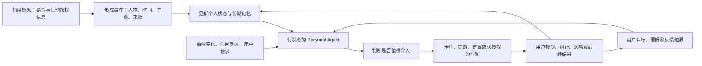

# 心力球的 Personal Agent 模式：社交反馈复核与深脑方案修正

> 2026-10-21 实施更新：[下一版交付方案](personal-agent-delivery-plan-2026-10-21.md)。CB08 长测已完成，两份历史选段已确认是多人场景；ASR 质量修复与事件、个人状态、主动反馈及纠正闭环并行推进。本文保留 10 月 20 日研究时点的证据与判断。

> 后续源码与硬件核查见 [Omi、OpenMuse 与 CB08 长时实时能力深度对比](personal-agent-oss-and-hardware-deep-dive-2026-10-20.md)。该文补充 Omi 当前记忆及主动反馈实现、OpenMuse 的实际能力和外部依赖，并将“三小时上限”收窄为历史单文件切段证据；选型以该文的具体边界为准。

日期：2026-10-20。本文修正此前偏重录音处理、记忆检索与组件选型的分析。按用户要求，以持续感知和 Personal Agent 的主动反馈闭环重新建模，不依赖现有深脑后端源码。

## 1. 需要修正的结论

此前把“短录音→项目归集→MCP 查询”设为主要验证目标，只验证了信息能被存下并找回；把持续实时处理放到后续阶段，延后了真正需要检验的核心体验。

更合适的产品目标是：**持续获得个人上下文，让有长期状态的个人 Agent 理解当前处境、追踪目标与未闭环事项，在合适的时机提供有用反馈，并根据用户纠正调整后续行为。**

ASR、摘要、向量搜索、时序图谱和 MCP 都是实现这个闭环的部件。单独把它们接起来，并不会自动得到 Personal Agent。

但必须区分目标与证据：这次反馈明确支持持续采集、后台事件聚合、内置 Agent 及外部 Agent 使用个人上下文；仍不足以证明心力球原生产品已经普遍实现秒级、主动、跨应用执行的完整闭环。特别是最具体的 Jarvis 演示，来自用户自行接入的外部 Agent，而且截图由用户发起提问。

## 2. 这次实际查了什么

通过 Ego Lite 搜索 X 的心力球最新帖子，累计保存 40 条不同 URL 的检索结果；其中包含购买询问、转述、引用与产品观点，不能视为 40 位实测用户。重点打开并复核了 5 位有设备使用描述的作者：Jeffrey.W、dontbesilent、safari、居然sir、木锋；读取正文、相关回复，并查看了原生 App 与外部 Jarvis 的截图。

同时检索微博、小红书、酷安和 V2EX。访问到微博一条先锋测试开箱，但作者明确写尚未拿到配对手机，故未把其 Agent 设想列作实测。其余跨平台检索没有提供足够可核对的独立使用样本，不能据此声称这些平台没有反馈。

X 有一条包含复杂 OR 条件的检索返回了无关结果，已排除，不据其结果判断功能存在与否。部分帖子把引用原帖的时间也放在同一个 article 中；日期判断以主帖可见时间和对应主帖 URL 为准。

这是一组早期、偏重 AI 爱好者的便利样本。帖子作者与厂商关系、是否获得样机或商业合作未全面核实；点赞和转发不用于证明产品可靠性或市场接受度。

## 3. 逐条反馈及其含义

### Jeffrey.W：自动形成生活事件，而不是要求人记住录过什么

2026-10-17 的主帖描述持续录音、无感同步，以及后台按话题和事件整理。原生 App 截图展示今日事件，内容包括午餐/出行/购物讨论、咖啡与生活杂谈、晚饭讨论和整理随身物品。事件按语义组织，用户无需先定义一场会议或一个音频文件。[原帖](https://x.com/JeffreyCalm/status/2111391479797301707)

这支持的产品判断：输入应当是连续的生活事件流，软件负责形成用户可理解的事件，而不是让用户管理一堆文件。

截图还展示处理进度水位和设备连接状态。它支持我们需要明确表示上下文新鲜度，不能用这张截图推算通常处理延迟，也不能据此证明始终实时。

10 月 19 日该作者补充，按键主要给自动记录增加重点标记。[补充](https://x.com/JeffreyCalm/status/2112065950162075825) 这是把按键用作重要性信号的思路，不等同于我们已经验证 CB08 具有同样机身事件。

### dontbesilent：个人上下文交给用户自己的 Agent

10 月 19 日的对比帖称，App 内有 Agent，但也可以通过微信、飞书和多种 AI 工具读取上下文，日常不必打开专属 App。他举的采集对象包括咖啡、奶茶、饮酒、睡醒、服维生素等低密度日常信息。[对比帖](https://x.com/dontbesilent/status/2112103009354448901)

这支持的判断：很多价值来自原本不会主动输入给 AI 的碎片事实。若每次都要打开 App、选分类、决定是否重要，系统仍会缺失这些上下文。

同日另一个主帖展示把心力球数据接给 Grok Bot 后回顾全天活动。他平时对 AI 的语音提示词也被采集，从而补充了工作过程信息。[活动回顾](https://x.com/dontbesilent/status/2112097114172063963)

更具体的例子是自己编写 Jarvis skill，同时接心力球和佳明 MCP。截图里，用户先要求回顾下午活动并汇报身体数据，Agent 拉取信息后组合回答；回答还指出手环数据未更新，需要同步。[Jarvis 原帖及截图](https://x.com/dontbesilent/status/2112119323011784875)

这条证据说明个人 Agent 可以综合多个传感器来源；但它是用户自行组装的外部 Agent、用户主动发问后的响应，不是心力球原生主动推送的证明。跨源数据更新并不同时发生，Agent 应明确数据新鲜度。

### safari：两周使用后，日常与会议的表现有明显取舍

10 月 20 日，该作者自述使用约两周，认为产品更适合全天记录生活细节、一对一对话与灵感，多人会议纪要表现不好；人声和周围声音可能混在一起。回复中补充，可以登记自己的声音提高识别准确率，但区分效果仍有限。[主帖](https://x.com/safaricheung/status/2112401099751932109)、[声纹回复](https://x.com/safaricheung/status/2112497652478926994)

含义：以会议转写准确率和长文纪要丰富度作为唯一目标，会错过它的产品价值；但个人 Agent 更依赖正确归属，识别错“谁说的”可能污染用户模型与后续建议。

他还指出当前主要依赖配套 App，尚未深入系统级能力。不能把拥有手机厂商资源直接写成已经打通系统通知和所有应用数据。

### 居然sir：上下文污染已经实际发生

10 月 19 日主帖表达了很强的正面体验，同时指出环境内容被误认为自己的对话，出现自己没有讨论过的选择题答题话题。[原帖](https://x.com/juransir/status/2111988816676631008)

含义：VAD 只解决是否有人声，无法判断声音是否来自用户、周围人或视频；转写完成后仍要处理来源和归属。对一个会主动给建议的 Agent，这比列表里多一条错误纪要的影响更大。

### 木锋：使用者在意连续采集与接入已有 AI

10 月 20 日主帖自述购买过多种 AI 录音设备，认为主要优势是持续录制转写与无感接入 AI。[原帖](https://x.com/mufengwwww/status/2112221393681355174)

这提供另一个独立使用者的方向性反馈，但帖子很短，没有长时间耗电、准确率或主动反馈的可复核记录，不能用来证明这些指标。

### 微博开箱：明确区分设想与已使用

42 号电波在 10 月 16 日的帖子把它理解为收集个人 context、通过 MCP 提供给 Agent 的入口，但结尾明确表示等待配对手机到手再测试。[微博原帖](https://weibo.com/2/detail/5354650085625323)

它可以帮助理解用户期待，不能充当实际配对使用或主动 Agent 功能的证据。

## 4. 更准确的产品模型

这里存在四个相互配合的循环：

1. **感知循环：**持续接收信息，及时形成稳定事件；断连时保留缺口与恢复进度。
2. **理解循环：**把新事件放进当前目标、已有关系和未闭环事项中，更新处境模型。
3. **主动循环：**新信息、截止日期或状态变化唤醒 Agent；决定是否值得说、何时说、从哪个入口说。
4. **反馈循环：**用户纠正归属、改变目标或否定建议后，影响记忆和下次介入。

只有检索和问答，会缺少第三、第四个循环。只让模型定时发送一篇日报，也未必说明它理解了用户当前的目标与可采取的行动。

持续采集、实时转写、近实时上下文可用、主动反馈和自主执行是不同能力。它们有不同的延迟和证据要求；此次社交样本没有把五种能力全部证实。

## 5. 实时应该怎样理解和设计

产品需要及时形成可用上下文，在信息仍然有用时给反馈；不要求每个 Opus 包都触发一次大模型，也不宜把每句话都变成打断。

建议按三条路径处理：

| 路径 | 触发 | 应提供的价值 |
|---|---|---|
| 快速判断 | 明确承诺、重要标记、与已有事实冲突、临近截止 | 在当前情境仍可改变时给出少量提示 |
| 状态维护 | 一段沟通结束、主题切换、资料或任务状态变化 | 自动更新当前处境、项目和未闭环事项 |
| 周期复盘 | 用户选择的日/周节奏 | 总结反复出现的模式，验证之前建议是否有结果 |

无新信息且无待处理事项时，Agent 可以保持沉默。介入还应考虑信息可信度、时效、重要性、是否可行动、当前是否适合打扰、同一件事是否已提醒，以及用户是否拒绝过。

MCP 是工具和数据访问通道，不会自动把新内容推送进 Agent，也不会自动让 Agent 运行。需要另一个事件或调度机制，使新上下文真正触发评估。仅“提供 MCP，等用户来问”仍只完成了被动使用路径。

## 6. 我们的硬件与 App 要重新承担什么职责

### 硬件与采集层

CB08 继续作为已有音频输入设备，但若要验证及时反馈，就必须尽早验证实时 Opus 接收与恢复。当前模式在录音保存后才同步文件，正在进行的长会话中，Agent 看不到尚未提交的内容。这是链路能力问题，换一个更强的记忆库不能弥补。

因此“实时以后再做”需要修正为：**先在一个受控连续会话里验证及时上下文和反馈，同时保留卡上文件作为恢复来源，再逐步扩展到锁屏、断连和全天使用。**

不能因为真机曾收到实时帧，就承诺整天无缺口。需要量出音频缺口、稳定事件何时可用、补传是否重复、手机后台行为和耗电。

### App

App 应是 Agent 的状态与纠正入口：最近理解到了什么、当前关注什么、建议依据是什么、哪些地方不确定、上下文更新到何时，以及如何让 Agent 改正。

用户应能自然反馈“刚才是客户说的，不是我的承诺”“这个项目暂停了”“只在快到期时提醒我”。这些反馈必须进入状态，而不只是删除一张卡片。

原有记录与阅读页面继续有用，但主动建议、当前任务和最新状态应成为日常使用的主要内容。卡片需要区分原话、系统推断和行动建议。

### Agent 运行层

至少需要持续身份/会话、工作记忆、长期记忆访问、目标与边界、事件唤醒、工具调用、任务与承诺状态、反馈交付、去重和打扰控制。

这里的“长期运行”指状态和调度持续存在，模型可按事件调用，不必在没有输入时持续消耗推理。

## 7. 开源选型需要改变优先级

### Omi：应研究其主动反馈代码，而不仅是转写

本次进一步读到 [mentor_notifications.py](https://github.com/BasedHardware/omi/blob/b44802109ad4f0e55cc6d0e671cd959ac9b3a3fb/backend/utils/mentor_notifications.py)：它会缓冲对话片段，在积累足够新增上下文后交给后续导师提示评估，而不是每个音频包调用一次模型。

另有 [Proactivity v2 contract](https://github.com/BasedHardware/omi/blob/b44802109ad4f0e55cc6d0e671cd959ac9b3a3fb/backend/docs/proactivity_v2/CONTRACT.md) 讨论对话导师与承诺跟进的事件、去重、成本和反馈计量。文档包含阶段与 rollout 约束，不能把其中每一条设计都当作已经全面上线的生产行为；但它比单看 Omi 的记忆列表更接近本次要研究的问题。

复用重点：何时积累足够信息、什么事件值得评估、何时保持沉默、如何控制重复与打扰、建议产生后如何收集结果。其代码中还存在依赖空格分词的阈值逻辑，中文接入需要单独评测，不能原样搬用就假定效果一致。

### OpenClaw：个人 Agent 的持续运行与唤醒骨架候选

[OpenClaw](https://github.com/openclaw/openclaw) 提供个人助手运行框架、会话、工具/Skills 和多渠道能力。本次阅读其 [Heartbeat 文档](https://github.com/openclaw/openclaw/blob/d85fcb29bec40d33dc6055fe4144cbf468b8848c/docs/gateway/heartbeat.md)，确认有周期 Agent turn 与事件唤醒，并区分是否需要向用户交付消息。

可研究的接法：我们提供语音事件、记忆查询和承诺工具；事件到来后唤醒该用户的 Agent，周期机制补充检查需要时间触发的事项。现成默认 heartbeat 不是秒级语音处理器，也不应把它直接当作连续音频入口。

### Hermes Agent：个人记忆、Skills 与多渠道运行的另一候选

[Hermes Agent](https://github.com/NousResearch/hermes-agent) 的官方 README 描述持久记忆、跨会话检索、Skills、MCP、消息网关和内置定时任务。它更适合用来验证一个持续了解用户的 Agent，而不只是一次性分析任务。

可研究的接法：把录音和个人状态做成可调用工具，用结构化事件提供必要的新上下文，再由 Agent 执行固定的观察、跟进和复盘策略。语音检测、音频恢复和可信事件抽取仍需单独完成；Skills 能更新也不等于建议会自动变好，必须看真实反馈。

### 其他组件回到部件的位置

FunASR/sherpa-onnx 解决语音处理；Graphiti 解决时序关系候选；Mem0 解决个性化记忆候选；pgvector 解决向量检索；MCP SDK 解决访问协议。它们都不单独负责何时唤醒、当前目标是什么和何时主动反馈。

建议先选 OpenClaw 或 Hermes 其中一个验证 Agent 运行骨架，参考 Omi 的持续语音与主动反馈设计。不是把三个完整框架同时部署，更不是同时叠加 Graphiti、Mem0 和多套任务系统。

## 8. 新的最小验证：缩短使用时段，保留完整主动闭环

此前“录一条短灵感，隔天问能不能找回”只适合作为数据通路检查，不再作为产品核心验收。

新的受控实验可以是一个持续 30–60 分钟的工作/沟通窗口，提前放入用户确认的相关上下文和一个关注目标。期间自然讨论，不要求每句话先打开 App。

示例：先前已知接口预计下周才能交付；这次讨论中出现周五交付完整功能的承诺。系统应在信息仍有价值时识别冲突，引用两处依据，以卡片或选定渠道提示用户确认，而不是等用户事后询问。

完整链路：

1. 新语音及时成为有来源、有时间、有归属的事件。
2. 在没有本次用户提问的情况下唤醒 Agent。
3. 结合此前上下文和当前目标做判断。
4. 有值得介入的内容才输出；不确定时先询问归属，不把别人或电视里的话当成用户意图。
5. 用户纠正后更新相关状态，同一个误判不反复提醒。
6. 后续状态变化能使旧建议失效或完成，形成结果反馈。

上述例子是我们的实验设计，不是已观察到的心力球功能演示。

评价重点包括：关键事件是否被捕获、信息可用与反馈时延、错误归属、重复提醒、用户是否认为有帮助、是否采取行动、纠正是否改变后续行为、静默是否合理，以及单位有效反馈的运行成本。首次受控实验不能证明整天使用成熟，后续还需在真实日常中验证。

## 9. 当前最稳妥的判断

用户指出的 Personal Agent 方向比此前的录音/记忆管线模型更接近应研究的核心。社交反馈尤其支持持续上下文输入和用户自己的 Agent 这一组合；也显示归属错误、数据新鲜度、生态限制等实际阻碍。

原生产品主动反馈的触发方式、稳定延迟、频率与长期效果，本次仍没有足够可复核的实测。因此我们应以完整主动闭环为产品目标，同时明确哪些是心力球已观察到的体验、哪些来自外部 Agent、哪些仍是待验证设计。
