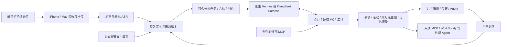

# 心力卡：统一 Agent 适配与真实转写回放

后续完整事件／首页契约及 131 份同一天来源回放见 [2026-10-24 记录](xinlika-complete-events-2026-10-24.md)。该轮遇到模型连接阻碍，尚无新的语义比较成绩；下面保留本轮 114 份来源的原始结果和已知失败，不能混作新版通过。

本轮目标是替换云端的信息处理执行方式。录音、ASR、同步与纠正仍复用已有协议和数据库；不另造一份“Agent 记忆库”。普通记录自动处理，微信导入先接显式文件，不扫描本机聊天数据库。

本轮选择 **Hermes**，已接入共享服务的可选处理器，尚未切换正在运行的云端。选择依据是本次真实转写的具体事项延续和活动碎片程度；不是根据项目名气，也不宣称它在价格、速度或所有语义判断上胜出。官方 DeepSeek Harness 适配器保留，可使用相同领域工具与 Skill 切换。

## 实际比较与接入结果

主比较按「会议首段 3 份→后续 6 份→聚餐会话每批最多 20 份」依次处理。下表仅含整理阶段，纠正问答、开发失败和后续修复另计。

| 实测项 | Hermes | DeepSeek Harness |
|---|---:|---:|
| 模型请求 | 63 | 47 |
| 输入 tokens | 1,501,213 | 1,118,575 |
| 缓存输入 tokens | 1,131,720 | 697,013 |
| 未缓存输入 tokens | 369,493 | 421,562 |
| 输出 tokens | 43,610 | 48,414 |
| 整理耗时 | 约 17.1 分钟 | 约 15.8 分钟 |
| 活动容器 | 6 | 16 |
| 可见事项 | 43 | 46 |
| 已知同一具体事项的跨对话关联 | 找到 | 未找到 |
| 已知不同事项保持分开 | 是 | 是 |

Hermes 总 tokens 更多、耗时更长，缓存占比也更高；没有可核验单价，不能直接称它更便宜。活动数用于比较碎片程度，不能据此声称真实会议／聚餐边界已经准确识别。六组既有聚餐回归检查仍有未通过项：短产品反馈被放在 detail，未达到首页保留要求；作业方法与效果的归并检查两者均未通过，来源中涉及不同方法，粒度仍需核验。本次没有用反复修改预期结果来制造全通过。

受控撤回后的问答两者均保留原文、维持撤回状态，没有将撤回项作为有效个人事实引用。typed 引用契约修复后，Hermes 该阶段 9 次调用／95,735 tokens／41.15 秒；DSH 为 10 次／282,213 tokens／80.32 秒。Hermes 首次问答因本项目工具未强制引用版本而失败，开发消耗保留，不归咎于框架。早期嵌套工具参数、超时等失败试次也单列在 validation JSON，不能从成本记录中抹去。

选定 Hermes 后，在隔离的真实共享 HTTP 服务中复用了此前真实重点转写：独立生成 1 条重点事项，保持原始录制时间，不改普通录音事项身份。手机／Mac 协议客户端两次纠正同一归属字段，版本推进到 3，原生问答与只读 MCP 均读到了最新字段。这里验证的是协议与后端链路，没有把它冒充手机／Mac UI 真机验收。

纠正造成的来源重建已收尾：待处理来源版本 0、待处理原生任务 0、缺少有效活动容器的可见事项 0，归属版本 3 仍保留。但重建后，原有跨对话主题出现漏关联。新增修复机制会保留旧关系的原文锚点作为候选，隐藏旧标题／摘要，按当前有效事项和纠正字段重新判断；只有版本、权限和各成员证据都有效才可恢复。它不强制恢复旧关系，也不把同一份转写里的不同事项当作同一事项。

关系修复在普通来源重建后单独排队，按证据版本去重；即使 Agent 判断「不关联」，也记录本次复核，不循环请求直到得到想要的答案。关系任务不能重复抽取事项、活动或个人记忆。结构回归已通过。首次真实原生关系复核遭遇模型 HTTPS 连接失败，失败证据保留；网络恢复后的 v2 回放重新建立了同一具体事项的主题，不同的模型选择事项仍分开，归属版本 3 保留。该次 4 次模型请求、83,438 tokens、61.54 秒；但摘要夹带了内部句柄，不能直接作为面向用户文案。

随后加入「不在摘要暴露内部编号、不因关联补写因果」约束，v3 用相同真实材料再跑，Agent 认为人物照片资料库设想与改图约束问题缺少明确承接，选择不关联。用户此前确认它们是同一具体事项，故当前配置仍有漏关联，不能宣布纠正后的跨对话关系稳定通过。v3 为 5 次请求、109,552 tokens；它没有改写原始转写、事项或记忆，未产生 ASR，活动覆盖完整，待处理任务为 0。两次结果和配置差异均保留，属于纠正重建后的开发修复回放，不替代最初框架比较成绩，也不构成统计准确率。没有继续根据该已知答案反复重跑到通过。下一步应补充来源上下文与关系反馈评估，不能靠强制恢复旧关系解决。

本轮同时补上连接连续失败的中止和持久队列退避重试，避免故障时空转。

详细脱敏结果见 [validation/result.json](validation/xinlika-agent-adapter-2026-10-23/result.json)。本轮共 112 项相关结构、协议、恢复与回归测试通过；测试夹具不作为真实对话质量分数。打包检查未包含音频、SQLite 或私有运行目录。所有实录原文、模型正文和密钥仍在被忽略的 `.build`。

## 处理边界



- 原生框架负责模型与工具之间的推理执行循环；本项目只负责业务任务、权限、原文校验、事务和同步。不是把两个模型接口改个名字比较。
- `NativeProcessAdapter` 统一任务与回执；原生 SDK 在独立进程运行，只有任务范围内的 MCP 工具。没有 shell、浏览器、录音设备控制工具。
- `AgentDomain` 写回已有 `workspace_events`、主题、活动、`claims` 和答案表；原始音频及 ASR 结果不重做。
- 任务内以 `d1` 等短编号引用来源，服务端确定性解析为真实 ID；引用连续原文片段编号，避免模型抄错长 UUID 或改写引文。
- 来源版本、处理授权与当前纠正状态参与校验。写入必须有数据库回执；“已保存”文字不算成功。重放已提交任务复用回执，零模型调用。
- 录制／原始消息时间与处理时间分开。音频时间精度仍为来源批次包络，不能冒称逐字对齐。

## 原生版本与比较约束

| 方案 | 实际使用 |
|---|---|
| Hermes | `NousResearch/hermes-agent`，`3ba2b0787ed3a73ec3b08085ed0137f235209cf4`，原生 `AIAgent` 与 MCP，独立 Python 3.14 环境 |
| DeepSeek Harness | 官方 `deepseek-ai/deepseek-harness`，`687f282e8625c6b8d11ff58211a90524be2e4317`；实际 SDK `deepseek-harness-sdk==0.2.1rc2` 的原生进程与 MCP |
| MCP | 官方 Python SDK `mcp==1.30.0` |
| 公共模型 | 同一个已配置的 `doubao-seed-2.1-pro`，同一输出上限与 thinking 设置 |

两者均使用同一份 `prompts/skills/xinlika-context/SKILL.md`。本轮以原生系统提示入口注入该 Skill；没有把动态 Skill 发现、自建 Skill 或完整插件生态算作已验收。Hermes 的附加 MCP 辅助工具与框架内压缩属于其实际运行开销，不伪装成两者提示包完全相同。

真实输入为此前已有的 105 份聚餐会话转写和 9 份会议转写，共 13,886 字符。输入哈希：`4caa5ea0f22e73f04f443ca0080f69079a0c87912e3c1592d2822029a487fd24`。剥离旧摘要、旧事项和旧模型记忆，只复制原文、来源与录制时间；关系标签仅用于事后评估，未注入提示。整个会话范围包含聚餐前后，不能把全程都称为餐厅。

归并以六组既有项目回归检查点，再逐条回看选出的事项和引文。六组检查点不是独立人工标注的金标准；例如作业讨论中的不同方法与效果是否应合成同一事项，存在粒度歧义，应同时保留原始检查结果和复核说明，不能包装成准确率。会议同／不同事项的关系来自用户此前的明确反馈，检验同一具体画面创作事项的延续，以及不同事项不能硬连。记忆纠正使用真实原句上的受控纠正／撤回，不冒充历史用户反馈。原文均为既有资料回放，不是未来对话盲测，也不是 ASR 准确率测试。

成本记录实际 provider 返回的 prompt、completion、cached tokens、请求数和耗时。失败、压缩和修复消耗也保留。未取得可验证账单单价，不估算人民币费用；单次小样本比较不代表所有模型或所有部署环境的结论。

## 文件导入

入口：`scripts/xinlika-import-context.py`，支持本机 `--root` 或共享服务 `--connection`。共享服务新增鉴权的 `POST /v1/context/import`，仅 editor 可写；reader 可用于外部 MCP。

支持明确的 JSON messages/records 数组、带时间和说话人的 TXT、时间／发送者／内容三列表格 HTML。JSON 示例在 `Config/context-import.example.json`。不同导出器的 HTML 和私有字段仍可能需要专用适配，不能宣称支持所有微信导出格式。

```sh
/path/to/venv/bin/python scripts/xinlika-import-context.py /private/messages.json \
  --connection /private/editor-connection.json --account stable-account-id --analyze
```

连接文件格式为 `{ "baseURL": "https://your-service", "token": "本地私有凭据" }`；不提交仓库。导入前校验时间、发送者与会话身份，缺失原始时间直接报错，不拿导入时刻代替。按账号、渠道、会话和消息 ID 去重；相同消息 ID 内容变化保留原文并返回冲突。20 MB／20,000 条以内，非文本消息单独计数；无 ASR 请求。

`--analyze` 显式启用该导入来源的分析。导出文件中的“本人发送”标记仅为导出器报告，不等于声纹核实；原始发送者和时间保留在正文及消息索引，不自动变成用户本人经历。当前没有收到真实微信导出文件，文件格式与链路通过结构测试，不等于真实微信效果验收。

每条消息是带原始时间的来源单元，Agent 再按窗口归并；不是一条消息一张首页卡。不同导入文件的处理授权隔离，相同文件重新选择 `--analyze` 可开启该文件的处理，不借此自动开启其他文件。原始消息 ID 的去重仍跨文件生效。

## 两个方向的 MCP

**向外提供个人上下文**：`scripts/xinlika-mcp.py --connection /private/reader-connection.json`，或 `--database /private/heartball.sqlite`。默认只有 `search_context` 和 `read_source`，只读、带原始时间与版本，不提供 SQL、音频、密钥、ASR 或设备控制。来源授权撤回、原文更正后，旧来源不能继续读取。

WorkBuddy 标准 stdio 配置见 `Config/workbuddy-mcp.example.json`，需替换为实际 Python、脚本与私有 reader 连接文件路径。官方支持项目级 `.workbuddy/mcp.json` 或用户级 `~/.workbuddy/mcp.json`。本轮验证的是标准 MCP SDK 与共享服务之间的真实连接，没有擅自修改用户 WorkBuddy 配置，也没有声称 WorkBuddy 界面已验收。[WorkBuddy 官方 MCP 文档](https://www.workbuddy.ai/docs/zh/workbuddy/From-Beginner-to-Expert-Guide/Function-Description/MCP-Guide)

**接入外部 MCP**：配置 `agent_runtime.external_mcp_config`，文件内为 `servers` 字典，每个服务器显式配置 `tool_allowlist`。支持 stdio 与 HTTPS Streamable HTTP，凭据通过允许的环境变量读取。原生 Agent 调用 `external_mcp_call` 后得到标为外部数据的结果，不能用导入正文生成可执行命令或扩大工具清单。已有真实 MCP 服务尚未提供，这个方向目前以真实 SDK 连接的本地测试服务验证。

仅转发外部配置显式列出的 `env_allowlist` 与 `headers_env` 变量，不继承整个宿主凭据环境。本地 loopback MCP／共享上下文连接绕过系统网页代理，避免本地 token 被转发；外部 HTTPS 服务仍尊重运行环境的代理配置。

## 安装与启用范围

`requirements-agent-runtime.txt` 固定公共依赖、MCP 与 DSH SDK；Hermes 放在单独的 Python 3.14 虚拟环境，固定上述提交。安装 Hermes 时使用其仓库 `pyproject.toml` 中官方 `tool.uv.override-dependencies`，避免上游浏览器依赖与 Pillow 版本冲突，不私改框架源码。

服务只有在 processing JSON 明确设置 `agent_runtime` 时才走新链路，否则沿用原处理器。已存在的历史文档首次启用时作为基线登记，不自动全库重新发送模型；新增来源与纠正导致的版本变化再进入任务。默认累积 180 秒，最多 20 份来源／10,000 字符，重点与会话结束可提前提交。合批不是停止／重启硬件，也不是活动边界。

主动反馈在本轮迁移中保留既有“观察→回应→独立审核”与冷却、去重、静默控制，不把原生框架自己批准的草稿冒充独立审核。该部分尚未迁入候选原生循环，也不计入本次整理／问答试次成本。新配置可显式关闭 `proactive_feedback`，但默认保留既有能力。普通日常整理没有逐条确认前置步骤。

生产分支默认只保留任务、回执、usage 与业务来源；不逐次复制整段模型上下文。成功后的任务临时 SDK home 会清理。回放工具显式开启私有详细证据，用于对比原生压缩、重试与校验失败，不能据此把实验日志体积当正常业务存储。

原始数据、模型请求／回复、SDK 日志与导入原件均留在忽略的 `.build`。本轮不重启现有服务、不修改运行中录音、不向仓库上传原声或正文、不自动提交 Git。后续正式切换应独立安排发布与回退，不能把隔离环境的验收写成云端已经切换。
