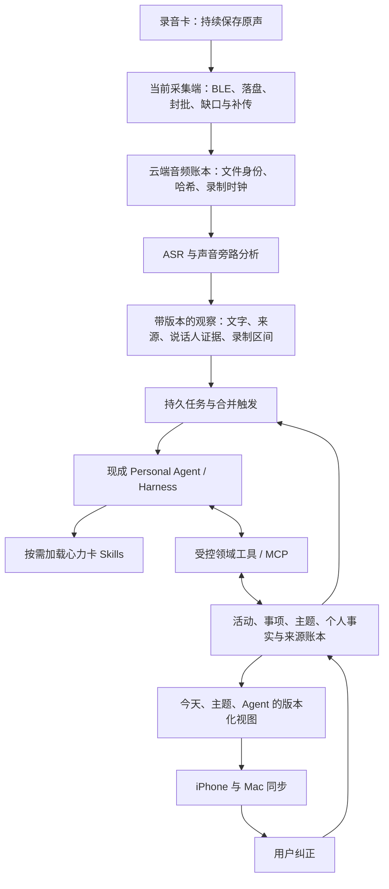

# 心力卡云端 Agent 底座与处理架构复核

后续实现已完成原生 Hermes／官方 DeepSeek Harness 适配、真实转写隔离对照与共享处理器接入，当前选择 Hermes。执行结果与未通过项见 [统一 Agent 适配与真实转写回放](xinlika-agent-adapter-2026-10-23.md)。本文保留下方研究阶段的判断与当时边界，不以研究结论替代后续实测。

日期：2026-10-23，Asia/Shanghai。范围：现有源码核对、官方文档与 GitHub 源码研究；包含用户追加的 DeepSeek Harness 与记忆／处理插件路线。本轮没有切换线上服务、安装运行候选 Agent、重新上传原声或重跑 ASR。以下选型是基于接口与源码的工程判断，不是候选系统已经通过真实聚餐验收的结论。

## 1. 建议先确定的架构边界

现有理解大体正确：录音卡保留原声，iPhone／Mac 作为采集端，上传已封批音频；云端转写和分析，多端读取共同结果。需要修正两点：

1. **Agent 是持续维护用户上下文和事项状态的运行环境，不应只是 ASR 后的一次摘要调用。** 它应能根据任务选择 Skills、检索原始依据、查询既有事项与记忆、调用受控工具，再依据执行回执决定下一步。
2. **记忆不是“结果展示后，把所有摘要写进去”的最后一步。** 有价值的会议上下文、本人事实、Agent 工作状态、程序性 Skills 是不同对象。记忆在理解、问答和主动反馈前后都会参与；个人事实不能由录音中的任意第一人称自动生成。

建议保留现有可靠采集和存储链路，引入现成 Agent 运行环境，替换固定的智能决策层。不要同时重写硬件协议、上传、ASR、多端同步，也不要再自行搭一套通用 Agent 循环。

同一用户的 iPhone 与 Mac 使用同一份云端业务状态、同一个用户作用域的 Agent。当前采集端拥有 BLE 会话，其他端从云端查看，不竞争连接录音卡。Agent 无法替代 iOS 后台采集、唤醒休眠硬件或恢复根本没有录到的声音。

## 2. 当前实际实现：超过提示词调用，但还不是完整自主 Agent

下表基于本地源码；部署版本沿用项目既有记录，本轮没有远程复查线上状态。

| 层次 | 已有实现 | 当前限制／演进方向 |
|---|---|---|
| 采集与传输 | 持续录音、默认 60 秒／最长 300 秒封批、独立重点、持久落盘、缺口与卡上参考补齐、跨文件发现 | 继续保留；批次与物理文件不应决定活动边界 |
| 处理可靠性 | 哈希复用已有 ASR、持久任务、重试、SQLite、LangGraph 与 SQLite Checkpointer | 继续承担可靠任务，不交给聊天历史代替 |
| 事件整理 | `Processor` 中 extract→persist→evaluate；organize、merge、topic、query 等固定图 | 能自动执行，但模型不能在一个通用行动循环中自主选择领域工具、补读证据和切换 Skills |
| Personal Agent | observe→respond→review→publish；五分钟扫描、变化指纹、冷却与限频 | 是受控的主动反馈流程；不是完整工具规划器或用户目标管理器 |
| 检索 | SQLite FTS5 trigram 与中文子串回退 | 主要为词面召回；跨说法、跨天实体与主题召回仍需增强 |
| 个人事实 | 原文与声明分离、来源引用、版本与纠正；事实初始状态为 proposed | 自动展示事件不等于事实已进入可信个人记忆；目前 `memory_auto_confirmed=False`，不能称已完成无痛个人记忆 |
| 同步 | 多端共享修订与纠正 | 应继续读取同一业务视图，不改为各端自行理解 Agent 自由文本 |

源码定位：

- `scripts/heartball_processing.py`：`ModelAdapter`、`Processor` 和各固定图。
- `scripts/heartball_personal_agent.py`：`PersonalAgent` 的观察、上下文、反馈与发布。
- `scripts/heartball_agent_store.py`：`commit_document` 写入 review_pending 文档和 proposed 声明；现场对话中的第一人称 owner 当前被保守改为 unknown。
- `scripts/heartball_recall.py`：FTS5 trigram 检索。
- `scripts/heartball_activities.py`：活动上下文与可见事件范围。
- `prompts/personal-agent/SOURCES.md`：已借鉴 Omi／OpenClaw／Hermes 的行为逻辑，但没有部署这些项目的完整运行环境。

当前问题的架构解释是：小批次产生多个中间结果，再由后续任务做整理、归并、跨话题关联和审核；输入修订又使派生结果失效。源码可见 `context_changed` 与有限重试保护，但这不等于本轮已测出每一类积压的占比。**换成更长提示词，或单纯换模型，都不会自动改变这些任务与对象的边界。**

## 3. 先分开五种“分段”

| 对象 | 决定因素 | 用户如何看到 |
|---|---|---|
| 卡上物理文件 | 固件、录音控制、文件续段 | 原声与恢复详情 |
| 上传批次 | 网络、后台时机、60–300 秒策略 | 通常不展示 |
| 活动 | 场景和交流过程，如一场会议、一顿聚餐 | 今天的一条活动，可持续数分钟到数小时 |
| 事项 | 活动中一个完整、有可理解结果或背景的事情 | 活动内条目；足够独立有价值时可成为时间线事件 |
| 主题 | 多次活动中同一具体项目、对象与目标的延续 | 主题页与 Agent 检索 |

两小时会议可以一直更新同一活动，内部保留多个事项；不能因为两百多份底层材料就铺满首页。短暂但重要的口述也不能因时长短被隐藏。不同事项同属“健康”或“工作”，不是自动归并的充分理由。

从真实聚餐的目标呈现看，应形成有录制依据的聚餐活动，内部展示有意义的谈话事项；残句保留检索和原文入口，不独立占首页。这里描述的是目标行为，不声称现有 29 个子事项或某次局部修复已经证明全自动边界正确。用户提供的约 22:20–23:15 场景标签应作为评估参照，不能直接当成模型自行识别的成绩。

## 4. 可部署运行环境的比较

检索包括 Personal Agent、Agent Harness、Skills、Webhook、服务接口与持久化等方向，优先官方仓库、文档和实际代码。没有以 Star 数排序，也没有把记忆库当成 Personal Agent。

| 方案 | 可直接复用的能力 | 对心力卡的主要代价／边界 | 本轮判断 |
|---|---|---|---|
| [Hermes Agent](https://github.com/NousResearch/hermes-agent) / MIT | 工具调用循环、按需 Skills、会话与上下文管理、Cron、Webhook、REST Runs／Responses、任务状态与流式事件 | 仍需领域工具、业务任务账本、声音来源规则；原生短记忆不能成为另一套个人事实权威 | **按“尽快接入现成 Personal Agent、少维护框架”的标准，优先候选** |
| [DeepSeek Harness](https://github.com/deepseek-ai/deepseek-harness) / MIT | Cordis 插件化 Agent、工具、模型、会话、压缩、Skills、MCP、Python SDK／JSON-RPC | 当前 developer preview，源码版本 0.2.1-rc.2；需要宿主适配、插件组合与版本兼容管理，不能把它的所有事件入口当可靠队列 | **按“把心力卡做成可组合的开源应用底座”的标准，重点候选** |
| [OpenClaw](https://github.com/openclaw/openclaw) / MIT | 完整助手 Gateway、Skills、工具、定时与多渠道；可启用 Responses HTTP 接口 | Gateway 按同一信任边界设计；用户 Session key 不是租户权限；需要裁剪与领域适配 | 如果近期重心转向 IM／多外部工具，价值较高；当前不是优先整套迁移 |
| [QwenPaw，原 CoPaw](https://github.com/agentscope-ai/QwenPaw) / Apache-2.0 | AgentScope 的行动循环、Skills／MCP、心跳、管理台、带会话的聊天 API、自部署 | 自带记忆与控制台需要和心力卡账本协调；Hub 2.2.0 官方定位仍是可信内部团队早期版本 | 运维管理和中文控制台路线的有力备选；不是现成公网多租户平台 |
| [DeepAgents](https://github.com/langchain-ai/deepagents) / MIT | 规划、工具、Skills、上下文卸载、子任务与 LangGraph 持久化接缝 | 是 Harness 库，不是开箱即用的 Personal Agent 服务；还要保留／建设宿主 API、触发和调度 | **保留现有 Python／LangGraph 的最低迁移阻力路线**，但不等于直接部署完整助手 |
| [nanobot](https://github.com/HKUDS/nanobot) / MIT | Python Agent 循环、Skills、MCP、会话、自动化、SDK 与兼容 HTTP 服务 | 一个实例默认共享画像与记忆；按需实例隔离；当前源码已不宜再用早期“几千行”介绍判断复杂度 | 轻量接入候选，仍需同样的领域工具和服务恢复验证 |
| [Omi](https://github.com/BasedHardware/omi) / MIT | 最接近随身声音场景的对话处理、相关性判断、主动反馈和上下文策略 | 全栈替换会引入其设备、认证、存储及 Firebase 等假设 | **借鉴领域处理逻辑和评估，不替换已跑通的整套采集／同步** |

另查了 [Agent Zero](https://github.com/agent0ai/agent-zero)：偏完整计算机工作环境与数字工作者，当前需求不需要把桌面操作能力作为核心。GitHub 许可证元数据为 NOASSERTION，本轮未完成许可证全文复核，不将其列入本次可直接采用清单。

### Hermes 的实际接入优势与限制

[官方 API 文档](https://github.com/NousResearch/hermes-agent/blob/3ba2b0787ed3a73ec3b08085ed0137f235209cf4/website/docs/user-guide/features/api-server.md)提供 `POST /v1/runs`、查询状态、事件、停止／引导，以及 Responses 会话链。其 Runs 幂等账本保留有时间限制；Canonical 模式与 Legacy 模式的保证不同，不能统称永久 exactly-once。

重启中断还可能产生 unknown 执行状态，需要先核对领域写入回执，再按明确语义处理。不能换一个新 key 盲目重跑写操作。[Webhook](https://github.com/NousResearch/hermes-agent/blob/3ba2b0787ed3a73ec3b08085ed0137f235209cf4/website/docs/user-guide/messaging/webhooks.md)有按实体合并触发，但缓冲位于内存，硬杀进程会丢当前窗口；所以仍由心力卡 outbox 保证待处理观察不丢失。

[Hermes 记忆](https://github.com/NousResearch/hermes-agent/blob/3ba2b0787ed3a73ec3b08085ed0137f235209cf4/website/docs/user-guide/features/memory.md)的 MEMORY.md／USER.md 是有容量限制、会话开始时载入的快照，不适合装入一天所有录音。其文档也明确长会话应有自然边界。心力卡应按活动／任务使用短上下文，跨活动用领域检索，不能把全天材料塞进一个无限续长的 Agent 会话。

### 其他运行环境需要注意的真实接口差别

- [OpenClaw Responses](https://github.com/openclaw/openclaw/blob/2241637b352738a34e9b976397098a9fe644769c/docs/gateway/openresponses-http-api.md)默认关闭；没有明确路由时每次请求默认无状态。稳定 Session、Responses continuation 和权限都需要正确接入。[官方信任模型](https://docs.openclaw.ai/gateway/security/trust-model)明确共享 Gateway 不是互不信任用户之间的隔离边界。
- [QwenPaw API](https://github.com/agentscope-ai/QwenPaw/blob/0db9a8e625e73917a0d113e255b3147134022db8/website/public/docs/api-tutorial.zh.md)为 `/api/console/chat`，支持 `X-Agent-Id` 和 `session_id/user_id`；这不是只换原模型 URL 即可。其 [Hub](https://github.com/agentscope-ai/QwenPaw/blob/0db9a8e625e73917a0d113e255b3147134022db8/website/public/docs/hub.zh.md)提供按人进程／容器，但仍标注可信团队边界。
- [DeepAgents 实际代码](https://github.com/langchain-ai/deepagents/blob/c89da392fbfdea1df7b6ff1ea8bad030efab090d/libs/deepagents/deepagents/graph.py)组合 Skills、Memory、Filesystem、上下文压缩等 Middleware，可接既有 LangGraph 子图。它复用程度高，但服务外壳并不会自动出现。

## 5. DeepSeek Harness＋插件，是否适合成为底座

这里指官方 [deepseek-ai/deepseek-harness](https://github.com/deepseek-ai/deepseek-harness)，不是“DeepSeek 模型＋任意框架”的泛称。

### 结构上的优势

[架构文档](https://github.com/deepseek-ai/deepseek-harness/blob/687f282e8625c6b8d11ff58211a90524be2e4317/docs/architecture.md)将 Agent loop、模型适配、工具、会话持久化、上下文压缩都放在 Cordis 插件接缝上。对于已有原生 App 的心力卡，可以只使用服务侧运行环境，而不采用其 Web 聊天产品作为 App。

- **可组合性高**：把声音观察、活动状态和记忆检索放进特定工具／上下文插件，按需加载，减少修改通用内核的需要。
- **Python 可以复用**：[官方 Python SDK](https://github.com/deepseek-ai/deepseek-harness/blob/687f282e8625c6b8d11ff58211a90524be2e4317/docs/user/guide/python-sdk.md)通过打包的运行进程驱动 Harness，不要求把现有 Python 后端改写成 TypeScript。SDK 正常执行不要求系统安装 Node；开发原生插件、包管理和构建是另一回事。
- **Skills 与可执行插件分离**：[Skill filesystem](https://github.com/deepseek-ai/deepseek-harness/blob/687f282e8625c6b8d11ff58211a90524be2e4317/packages/skill/skill-filesystem/README.md)支持 SKILL.md、前置条件／可见性和按需载入；复杂存储或生命周期动作放工具和插件，领域判断放 Skills。
- **不是强制绑定 DeepSeek 模型**：[模型配置](https://github.com/deepseek-ai/deepseek-harness/blob/687f282e8625c6b8d11ff58211a90524be2e4317/docs/user/guide/providers.md)支持第三方及自定义兼容接口。但 sdk-minimal 的默认组合与 Web／sdk 不同，不能由 Web 的能力推断所有 Profile 都包含相同适配器。
- **会话可审计与恢复**：Session 日志保留模型可见输入和工具结果；[SDK server](https://github.com/deepseek-ai/deepseek-harness/blob/687f282e8625c6b8d11ff58211a90524be2e4317/packages/sdk/server/README.md)有 session/resume。会话恢复不等于任意进行中的业务副作用都能自动安全重放。

### 与现成 Personal Agent 相比的代价

| 维度 | DeepSeek Harness＋领域插件 | Hermes 等完整 Personal Agent |
|---|---|---|
| 初次接入 | 选择 Profile、SDK 宿主、插件与领域工具 | 使用现成 Runs／Responses 等接口，领域工具仍需接 |
| 产品掌控 | 可以精确决定上下文、工具、会话及插件组合 | 更快取得完整助手行为，需要裁剪默认角色和工具 |
| 维护范围 | Harness 版本、插件 ABI／配置、SDK 协议、组合兼容性 | 产品版本、接口、Profile／工具配置及领域适配 |
| 处理可靠性 | 现有心力卡任务账本必须继续负责；不能只用实验 Webhook／Workflow | 自带更多服务运行能力，但业务幂等、版本、补偿仍由心力卡负责 |
| 记忆正确性 | 取决于接入的记忆工具、源数据与准入规则 | 同样取决于来源与领域规则；原生 memory 不是正确性保证 |
| 适合目标 | 建设可组合的开源应用底座 | 尽快取得完整个人助手运行环境 |

三个不能被“Everything is a Plugin”掩盖的具体边界：

1. **版本成熟度**：所查源码为 `0.2.1-rc.2`，README 明示 developer preview 与可能不兼容变更。不能因为官方开源和功能丰富，就宣称已适合无监督承接生产全天任务。
2. **可靠执行不是每个插件都自带**：[Webhook runtime](https://github.com/deepseek-ai/deepseek-harness/blob/687f282e8625c6b8d11ff58211a90524be2e4317/packages/experimental/webhook/README.md)明确没有内建队列、去重、重放和完成回执；[动态 Workflow](https://github.com/deepseek-ai/deepseek-harness/blob/687f282e8625c6b8d11ff58211a90524be2e4317/packages/workflow/workflow/README.md)当前没有脚本检查点／中途恢复。不要把它们直接替换心力卡已持久化的处理队列。Schedule 有持久任务，但投递与任务回执非原子，仍可能重投，不能当 exactly-once。
3. **默认组合不是心力卡组合**：sdk-minimal 默认角色偏软件工程，含广权限本地 shell，默认工具并不完整覆盖个人助理需求；官方模型的 [session-log 插件](https://github.com/deepseek-ai/deepseek-harness/blob/687f282e8625c6b8d11ff58211a90524be2e4317/packages/session/session-log-deepseek/README.md)默认可随官方 API 请求附带会话日志元数据。录音产品需要明确关闭无关日志外发、卸载无关执行工具，只暴露必要来源与操作。这是当前组合实际行为，不是已发生本项目数据外传。

### 记忆插件不应按名字或宣传直接选

[DSH 官方 MCP memory 指南](https://github.com/deepseek-ai/deepseek-harness/blob/687f282e8625c6b8d11ff58211a90524be2e4317/docs/user/guide/mcp-memory.md)的 Memorix、MCP Reference Memory、Engram 都是默认关闭的互操作示例。指南明确：DSH 负责接通工具，不负责替用户安装、迁移、运维这些记忆服务，也不保证其记忆策略适合当前应用。

| 组合 | 可以解决什么 | 对心力卡不足的部分 | 建议 |
|---|---|---|---|
| DSH＋现有业务账本的受控 MCP | 复用原文、录制时间、纠正、事项、主题和现有检索 | 要一次性整理领域工具与记忆准入规则 | **第一阶段优先，避免两套事实权威** |
| DSH＋[Graph Memory](https://github.com/adoresever/graph-memory) | 上下文压缩、跨会话召回、SQLite、可选向量与图导航、保留原始问答依据 | 原始依据是 Agent 问答，不是录音原声／ASR 的身份、时间和说话人；当前为 beta；自动提炼增加辅助模型调用 | 可作为上下文管理候选影子验证；不要直接接管个人事实和今天投影 |
| DSH＋[dsh-memory-plugin](https://github.com/disc0nct/dsh-memory-plugin) | 简单键值事实、分类和本地持久化；部署轻 | 所查 `scoring.js` 的“semantic”实际为 token Jaccard／子串，分词只保留 a–z／0–9；中文不能当向量语义检索使用；缺少录音领域的来源与事实有效期模型 | 不选作中文全天语音的核心记忆 |
| DSH＋官方示例的 MCP Reference Memory | 基本实体、关系、观察的存取 | 官方指南说明为子串查找，无内建向量、自动总结、冲突消解或遗忘策略 | 协议演示合适，不等于完整个人记忆 |
| DSH＋Memorix／Engram | 可跨会话保留工作上下文；MCP 互操作有官方示例 | 示例默认身份与 Git 项目／工作目录有关，不等于手机用户；录音来源、时效、纠正传播仍需适配 | 只在明确作用域后评估，不作为默认产品方案 |
| DSH＋[Mem0](https://github.com/mem0ai/mem0) | 已有记忆写入／更新／检索 API，可自部署，用户作用域可配置 | 是记忆组件，不能负责活动边界、谁说了话、是否值得通知；库、自托管与云平台功能不能混称 | 需要更强记忆服务时单独比较；不与多个记忆系统同时自动写同一事实 |
| DSH＋[Graphiti](https://github.com/getzep/graphiti) | 时间化关系、事实变化历史、来源与混合召回 | 需要图数据库／嵌入／模型与服务运维；自动抽取仍会出错；不是 Personal Agent | 项目／人物／关系及历史状态查询成为瓶颈后，再考虑派生索引 |

Graph Memory 作者公开的上下文缩减实验不是我们的餐厅／会议成绩。其 README 自己说明不同版本、工具循环与请求数量并非严格同时 A/B；不能将其中的上下文降幅说成心力卡总体费用降幅。当前插件版本和主 Harness 版本也必须实际配对验证，不能因宣称兼容就跳过。

QwenPaw 的 ReMe 方案另提供现场记忆→长期整理→关系／检索的分层，值得比较，但本次不把它重新包装成 Personal Agent。若采用该后端，同样只能有一个经过定义的个人事实写入口。许可方面，本轮所查 Mem0 与 Graphiti 的根 LICENSE 均为 Apache-2.0；不能沿用旧介绍假设所有组件都是 MIT。

## 6. 推荐的最小产品组合

**保留现有采集／ASR／持久任务／来源账本／多端同步；增加一个可替换的 AgentAdapter、一个领域工具入口，以及版本化的心力卡 Skill 包。**

按用户“成熟、尽量直接采用、以后主要优化 Skills”的优先级，当前优先验证 Hermes。DSH 与其并列进入隔离对照，重点验证 SDK 接入、插件兼容和故障恢复。不会先整套迁移 Hermes 再整套迁移 DSH，也不会在线叠加两个 Agent 对同一事项自动写入。最终只启用一个决策运行环境。

如果 DSH 在相同真实材料与工具契约下通过恢复／质量门槛，并且组合维护成本可接受，它的插件接缝更适合心力卡长期产品化；如果优先要求现成服务控制能力，则 Hermes 的 Runs 接口更直接。这是当前工程取舍，不是未经试验的模型质量排名。

### 一次性需要做的适配

1. `AgentAdapter`：提交观察范围与任务目标、获取运行状态、终止／超时、记录模型与 Skill 版本、恢复和执行回执。业务事件是持久事实，Agent Session 是执行上下文，两者不共用 ID。
2. 领域工具：读取有版本的原文范围、检索活动／主题／事实、更新活动与事项、关联主题、更新个人记忆、提交用户纠正、生成 App 内反馈。
3. 受控提交：写工具必须检查用户作用域、来源版本、引用范围、录制时间依据和幂等键。返回真正提交的对象 ID／版本，不能以模型一句“我记住了”当写入成功。
4. 运行观测：队列水位、最老未处理观察、模型失败／限流、上下文大小、每录音小时的调用量／Token、来源被拒原因与修改审计。

这些代码是录音产品与通用 Agent 之间的稳定接缝，不能全靠 SKILL.md 替代。但可以复用当前 Store、校验函数和已验证的 LangGraph 操作，不再自研规划循环、上下文压缩、通用工具执行器、Skills 加载器或记忆插件框架。

领域工具可先通过现有 Python 服务／MCP 暴露；不要求一开始写 DSH 专用 TypeScript 插件。反过来，面向 Codex／其他助手的只读 MCP 是产品外部接口，和 Agent 内部调用领域工具不是同一个发布任务。当前项目尚没有已验收的外部 MCP server，不能称已支持。

### 应由 Skills 维护的八类策略

| Skill | 主要判断 | 不应越权替代的部分 |
|---|---|---|
| 声音与交流来源理解 | 结合语音、场景、声纹证据，区分现场／远端会议／播放／未知；保留有价值会议上下文 | 不把声纹分数或模型猜测当本人身份真值 |
| 活动持续维护 | 开启、续写、收束、重新打开活动；长会议不按上传分钟切断 | 不伪造绝对精确边界 |
| 有意义事项提炼 | 完整事情、决定、意图、可回顾背景；残句入详情；短而重要的口述优先 | 不要求每份原文生成一个事件 |
| 跨活动主题关联 | 查询已存在的具体对象／项目／目标；延续同一事项，分开泛泛同类话题 | 不直接把相似关键词当同一具体事项 |
| 个人记忆整理 | 主体、事实类型、时间、证据、冲突与替代；允许普通记录自动沉淀 | 不把别人的第一人称或助手自己的总结当本人事实 |
| 有用的主动反馈 | 有新增价值、具体风险／机会、时间相关性和去重；允许静默 | 不为证明 Agent 在工作而制造卡片 |
| 记忆问答 | 先检索证据，必要时沿主题和来源补读，回答带来源 | 不拿模型常识填补未录到或未确认的经历 |
| 纠正与影响传播 | 更正事实／主体／关联后，找到受影响的摘要、主题、记忆和反馈 | 不再次转写未变化的音频，也不悄悄覆盖历史版本 |

主动反馈策略可以继续参考 [Omi 的实际实现](https://github.com/BasedHardware/omi/blob/3976e0ff0173db083ba019817587f0b975b5398c/backend/utils/llm/proactive_notification.py)：先判断是否值得打扰，再生成具体反馈并过滤低价值内容。复用的是判断原则和测试案例，不意味着每分钟必跑三次模型；低价值输入应尽早静默。

## 7. 记忆如何自动写入，而不是逐条让用户确认

需要四层数据，不能全部挤进一个 MEMORY.md：

1. **观察／原文**：ASR、录制区间、版本、场景和说话人证据。不管是否上首页，都能追溯。
2. **情景记忆**：会议、聚餐、讨论的活动与事项，包含他人或远端发言。可以自动保存为“这次讨论提到了……”，并允许检索。
3. **用户个人事实**：本人的偏好、经历、明确承诺、目标、状态变化。只有支持相应主体和语义的依据才进入该层；无法归属本人时留在情景记忆，普通记录照常自动整理。
4. **Agent 工作状态**：执行中的任务、检索线索、上下文压缩和检查点。可以随运行环境重建或迁移，不能比业务账本更有权威。

Skills 另存，表示“怎么处理”，不表示“用户发生过什么”。

个人事实建议保留 `subject`、`predicate`、`value`、`source_refs`、`source_revision`、`valid_from/to`、`recorded_interval`、`evidence_state`、`supersedes` 等字段。以上是目标契约，不是声称当前 schema 都已实现。与人有关的确认不必靠用户点击：校准后的来源／说话人证据、明确自述、跨来源印证或用户纠正可以支持自动准入；不能把未经校准的一个固定分数当通用通过线。

**不确定时调整归属和表达，不弹逐条审核。** 例如保留“聚餐中讨论过某安排”，而不是自动记成“我已承诺该安排”；需要采取外部行动且关键主体不明时，再集中澄清。

当前餐桌声纹远低于安静口述的匹配表现，既有报告为 615 个粗语音窗口仅 2 个匹配。这不是 615 个独立人工真值样本，不能计算声纹准确率，也不能用降低阈值凑通过。换 Agent 无法直接修复这个声音模型问题；来源证据不充分时必须仍可组织会议／聚餐上下文，并限制本人事实归属。

初期禁用候选运行环境对其原生个人事实文件的自由自动写入，或把其用途限定为可重建的工作缓存。统一通过领域工具维护个人事实，避免用户在 App 改正后，另一套隐藏记忆又把旧事实写回来。

## 8. 从结构上降低积压和碎片化

- **传输不断，推理合并**：仍按一分钟封批；ASR 观察持续入账。普通交流按活动的未处理范围合并触发，重点结束、用户问答和纠正优先；不把“每批都过完整 Agent”作为约束。
- **持续更新而非不停新建**：为活动与事项保持稳定 ID；新材料通常更新既有对象。自然边界与状态变化由 Agent 判断，定时器只提供最长等待上限。
- **新录与补录分开排队**：实时反馈优先；历史恢复按录制顺序与版本合并处理。避免一次补回数百批将前台记录饿死，也避免乱序导入改变事件发生时间。
- **证据包按需读取**：初次只传观察水位、当前活动和变化摘要；Agent 需要时调用来源／主题／历史工具，不重复把全天全文放入每次上下文。
- **一次主要写入者**：同一用户活动的更新经过版本和串行提交保护；ASR／声音分析等独立任务可并行。旧工作器与新 Agent 不能同时拥有同一投影的写权限。
- **有界复核与修复**：只重审受影响的范围，保留失败与有限重试，避免“生成—校验失败—全量重生成”的循环。确定性结构校验由代码做，语义复核按风险使用。
- **队列与提交各自幂等**：采用至少一次任务投递＋幂等写工具；任何厂商运行环境都不能免除业务副作用的去重。前后 24 小时以上补传仍由本项目账本覆盖，不能依赖某个有限时长的 Runtime 缓存。

录制时间单独保持：设备时钟校准／会话时间锚与音频范围形成依据；`occurred_at` 与 `uploaded_at`、`processed_at` 分开。没有词级时间证据时保留区间和精度，不能由导入时刻或 Agent 当前时间代替。

## 9. 迁移与真实验收的顺序

1. 固定领域契约，将已验证操作整理成工具；旧服务继续运行。保存当前真实材料的业务快照和任务水位，不重跑已有 ASR。
2. 在隔离环境接 Hermes／DSH 两个候选，使用同一份已授权真实转写与同一组工具约束；所有写操作先进入各自影子投影。模型可兼容时使用同一模型；否则把模型差异列为混杂因素，不能把结果全归功于 Harness。
3. 用既有真实聚餐、会议、背景播放、本人独立口述，以及用户纠正后的版本回放。人工评价参照不写进待测 Skill 或输入，尤其不把餐厅时段先喂给模型再称自动识别。
4. 检查质量、成本、故障恢复与插件配对后只启用一个运行环境；新旧投影路由可回退，音频／ASR／业务账本不迁出。线上录音未结束时不通过服务重启做切换。

最少应验收：

| 检查 | 通过依据 |
|---|---|
| 真正执行而非口头承诺 | 可观测工具调用、来源读取、数据库提交与版本回执 |
| 活动／事项粒度 | 真实长会议和聚餐形成合理活动；完整事项保留，残句不上首页；不能仅按条数少判断成功 |
| 同事项／不同事项 | 同一具体事项续写；同类但不同对象分开；无证据不硬连 |
| 本人／他人／播放 | 会议上下文仍可查询；不产生无依据的本人经历／偏好／承诺 |
| 录制时间 | 延迟导入、跨文件、重处理后仍按正确录制区间呈现；保留精度 |
| 更正传播 | App 改正后关联记忆和派生结果失效／更新；两端同版本，无“隐藏记忆复活” |
| 恢复与去重 | 模型限流、断开 Runtime、重启中断、重复任务后不丢观察、不重复创建事实或反馈 |
| 成本与积压 | 记录每音频小时调用／Token／模型延迟／最老待处理时间，与当前实现同材料比较；不套用插件作者的节省比例 |

已经完成的是当前链路的源码复核与候选接口／源码研究；以上真实对照、故障注入与 Runtime 性能验证尚未执行。因此本轮不宣称选中任何候选就已达到心力球的整理效果。

## 10. 资料版本与复核范围

GitHub 引用以本轮取得的 commit 为研究快照，**不是建议线上跟随 main／master 或安装 latest**。实际接入还要选择包含必要能力的明确发布版本并固定插件依赖。

| 仓库 | 研究 commit | 复核重点 |
|---|---|---|
| NousResearch/hermes-agent | `3ba2b0787ed3a73ec3b08085ed0137f235209cf4` | API、Webhook、记忆、程序化集成、提示词组装及工具执行入口 |
| deepseek-ai/deepseek-harness | `687f282e8625c6b8d11ff58211a90524be2e4317` | 架构、Python SDK、SDK 协议、Skills、模型适配、会话日志、Webhook／Workflow／Schedule 边界 |
| openclaw/openclaw | `2241637b352738a34e9b976397098a9fe644769c` | Responses 接口；官方在线信任模型 |
| agentscope-ai/QwenPaw | `0db9a8e625e73917a0d113e255b3147134022db8` | API、Agent 实现、Skills、心跳、Hub、ReMe 记忆说明 |
| HKUDS/nanobot | `06f3981962ccfa37e9d8edda583cad4b651a6054` | 当前 README 的架构、API／SDK、部署与实例共享边界 |
| langchain-ai/deepagents | `c89da392fbfdea1df7b6ff1ea8bad030efab090d` | README、graph.py 与 Skills Middleware |
| BasedHardware/omi | `3976e0ff0173db083ba019817587f0b975b5398c` | README、proactive_notification.py；不是本轮完整后端审计 |
| agent0ai/agent-zero | `ff2a5b9c9c4e490ba38dd7c313e779510bb2071a` | README 与元数据，未完成 LICENSE 全文复核 |
| disc0nct/dsh-memory-plugin | `ef9b31d94a0204331168eb15e6f18ee290c730b3` | README、package.json、检索打分源码与 LICENSE |
| adoresever/graph-memory | `5841b1987c3967998818764c9d4238add5f3aa7c` | README、package.json、类型／来源／抽取契约、LICENSE；未复跑作者基准 |
| getzep/graphiti | `345e73161a61b0a4400f80c64e5bba6a584acb7b` | README 与 LICENSE；未部署图数据库 |
| mem0ai/mem0 | `2c81af3bbe27d9bccb09c772d583df9e9be72ee5` | README 与 LICENSE；未部署记忆服务 |

外部主页面一度出现渲染错误，部分 GitHub REST 请求触发匿名限流；已通过 Ego Lite 的官方仓库／文档页面和 Git CLI 固定源码补查。没有以搜索摘要、第三方榜单或旧版本宣传补齐未读接口。私有研究缓存保存在忽略的 `.build/personal-agent-architecture-20261023/`。
