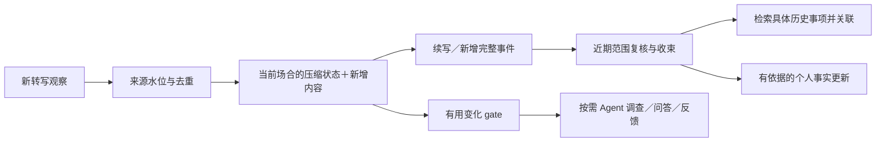

# 持续观察与实时 Personal Agent：GitHub 源码对照

2026-10-24。使用 Ego Lite 搜索并查看 GitHub 主仓库，随后将六个公共仓库固定到独立 `.build/ambient-agent-research-20261024/repos/` 核对源码。没有运行上游安装脚本或 Agent，没有发送本项目录音／转写、重复 ASR、改动采集、部署或重启服务。

**结论：有直接先例。Omi 的增量 Episodes、Dayflow 的滚动时间线和 MineContext 的上下文生产／消费分层，比继续单独比较通用 Harness 更贴近心力卡当前问题。** Hermes／DeepSeek 是执行器选择；持续输入如何成为事件与个人上下文，属于另一层产品逻辑。

下面是源码支持的机制与适配判断，不是用我们的中文聚餐／会议跑过的质量成绩，也不以 README 自述用户数或星数代替成熟度。

## 1. Omi：最直接的随身持续声音产品参照

[仓库](https://github.com/BasedHardware/omi)，本次提交 `4b4e35fdc9d61a5fb74380202cbc65d0432ecc6e`，根许可证 MIT。

### 实际如何运行

实时文字不是每批立即变成一张最终卡片。最新源码另有三层：Conversation（采集与正式处理）、Moment（新增的一段发言）、Episode（同一次会议／聚餐等场合的持续状态）。Episode 是原有对话之上的处理与展示层，**自身不删除／合并原始对话，不直接写正式任务和个人记忆**。

1. 新对话先通过轻量规则挂到当前场合，立即有结构，不等整段模型处理。
2. 发言暂停、长度／持续时长上限、连接结束等触发一个 Moment。触发处理不等于事件完结。
3. 每次低成本更新只读取“上一版压缩状态＋本次新增发言”，维护标题、要点、人物、未决问题、暂定事项。当前状态上限 2,400 字符，要点至多 8 条；更新节流至少 60 秒，短片段先积累。稳定提示前缀与变化内容分开以利缓存。
4. 是否同一场合先看间隔、日历和来源；含糊时才询问边界模型，置信不足退回规则。状态用版本比较交换，按各来源已应用偏移防止尾段或重连重复处理。
5. 对话正式结束后再补未送达尾文、核对正式处理产生的任务，暂定事项成为 kept／dropped；实时猜测不会直接成为正式承诺。

源码依据：[Episodes 架构](https://github.com/BasedHardware/omi/blob/4b4e35fdc9d61a5fb74380202cbc65d0432ecc6e/backend/utils/episodes/ARCHITECTURE.md)、[增量更新和提示词](https://github.com/BasedHardware/omi/blob/4b4e35fdc9d61a5fb74380202cbc65d0432ecc6e/backend/utils/episodes/incremental.py)、[状态及节流配置](https://github.com/BasedHardware/omi/blob/4b4e35fdc9d61a5fb74380202cbc65d0432ecc6e/backend/config/episodes.py)、[来源偏移与协调](https://github.com/BasedHardware/omi/blob/4b4e35fdc9d61a5fb74380202cbc65d0432ecc6e/backend/utils/episodes/service.py)。

主动建议另走“相关性 gate → 生成 → critic”，结合既有事实／目标及最近通知，多数情况保持静默。正式提炼的触发原因也有区分：首次结束、补录追加、用户重处理、恢复、合并等；补录会重新判断完整内容的相关性，恢复／手工保留的内容有不同保留政策。

依据：[主动反馈](https://github.com/BasedHardware/omi/blob/4b4e35fdc9d61a5fb74380202cbc65d0432ecc6e/backend/utils/llm/proactive_notification.py)、[处理触发契约](https://github.com/BasedHardware/omi/blob/4b4e35fdc9d61a5fb74380202cbc65d0432ecc6e/backend/utils/conversations/processing_trigger.py)。

### 对心力卡的意义和限制

- **最值得复用的是增量场合状态、来源水位、暂定／正式分离与结束核对。** 避免每分钟全量提炼后再反复合并。
- 场合状态可放内部或详情；首页仍可展示场合内的多个完整事件，不能退回“聚餐一条容器＋54个事项”的旧交互。
- 本提交 Episodes 默认受 beta 客户端门控，还要求近期有支持该界面的客户端标记。存在代码不等于所有正式用户已经使用，也不是我们的中文场景验收。
- 新 Occasion 分支配置为至少 15 分钟静默窗口、3 小时场合上限；代码注释中的更宽观察描述不能当作当前常量。这个 3 小时属于 Omi 业务场合策略，与 CB08 卡文件切段无关。
- 其短片段／词数门槛属于计算调度，不应照搬成心力卡的价值门槛。明确短反馈与主动重点需要保留／优先通道；英文词数阈值也不能直接用于中文。
- 整套 Omi 有自己的服务、数据与客户端假设；不能承诺只换 Skill 就兼容现有 CB08 和共享账本。

依据：[Occasion 策略与常量](https://github.com/BasedHardware/omi/blob/4b4e35fdc9d61a5fb74380202cbc65d0432ecc6e/backend/config/occasion_conversations.py)。

## 2. Dayflow：最贴近“把一天整理成可读时间线”

[仓库](https://github.com/JerryZLiu/Dayflow)，提交 `730d6f84b919998158ff7fdab15e3f032f7d8135`，根许可证 MIT。输入主要为 Mac 屏幕活动，不是随身音频。

源码里的标准配置是 15 分钟分析批次、45 分钟卡片回看窗口。生成时读近期观察和已有卡片；如果新窗口继续上一张卡，延长并重写它，而不是机械新建。卡片生成有串行门控；写入对指定范围进行事务替换，还保护更晚批次的卡片，避免旧批次重试覆盖模型根本没看过的新结果。

依据：[标准窗口](https://github.com/JerryZLiu/Dayflow/blob/730d6f84b919998158ff7fdab15e3f032f7d8135/Dayflow/Dayflow/Core/AI/LLMTypes.swift)、[已有卡片与滚动生成](https://github.com/JerryZLiu/Dayflow/blob/730d6f84b919998158ff7fdab15e3f032f7d8135/Dayflow/Dayflow/Core/AI/LLMService.swift)、[范围替换与重试保护](https://github.com/JerryZLiu/Dayflow/blob/730d6f84b919998158ff7fdab15e3f032f7d8135/Dayflow/Dayflow/Core/Recording/StorageManager%2BTimelineCards.swift)。

提示词明确按具体目标变化判断拆分，换应用不等于换事，同一任务的过程留在详细记录中。但当前 Claude 时间线模板也硬约束通常 10–60 分钟一张卡，并倾向把短支线归入大卡。**前者适合借鉴，后者会吞掉心力卡的短反馈、口述灵感和生活行为，不应直接复制。**

依据：[卡片边界及续写提示词](https://github.com/JerryZLiu/Dayflow/blob/730d6f84b919998158ff7fdab15e3f032f7d8135/Dayflow/Dayflow/Core/AI/ClaudeTimelinePrompt.swift)。

可复用滚动回看、旧卡续写、局部修订和过期写入防护。心力卡仍应保留稳定事件身份、版本与用户纠正，不能直接照搬删旧插新的数据库语义。Dayflow 也不能仅凭屏幕时间线证明会议说话人归属或跨对话个人事实准确。

## 3. MineContext：将上下文生产和主动消费分开

[仓库](https://github.com/volcengine/MineContext)，提交 `171c7a9ea8091e326ddcf0f10718aa1b58c83c65`，根许可证 Apache-2.0。当前主要围绕截图与文档，不能把 README 的未来多模态范围当作已完成全天音频支持。

截图处理先做感知哈希去重，再异步批量理解，按上下文类型把新材料与缓存材料交给模型合并。另有通用 ContextMerger：同类型向量召回有限候选，再用类型策略决定合并，避免每次拿全部历史比较。两条机制需分清，不能仅看 merger 类存在便宣称每份截图都已经执行完整历史召回。

消费侧另外按频率产生内容：当前默认活动 900 秒、待办 1,800 秒、建议 3,600 秒、日报定时。**持续采集和每种推理产物的更新频率是分离的。**

依据：[截图异步、去重和增量合并](https://github.com/volcengine/MineContext/blob/171c7a9ea8091e326ddcf0f10718aa1b58c83c65/opencontext/context_processing/processor/screenshot_processor.py)、[同类型候选召回](https://github.com/volcengine/MineContext/blob/171c7a9ea8091e326ddcf0f10718aa1b58c83c65/opencontext/context_processing/merger/context_merger.py)、[消费调度](https://github.com/volcengine/MineContext/blob/171c7a9ea8091e326ddcf0f10718aa1b58c83c65/opencontext/managers/consumption_manager.py)、[当前配置](https://github.com/volcengine/MineContext/blob/171c7a9ea8091e326ddcf0f10718aa1b58c83c65/config/config.yaml)。

值得借鉴不同节奏和有界候选召回，但其定时活动摘要不是自然场景边界识别。代码有 `event_time` 解析失败回落当前时间的路径，且活动生成查询使用更新时间；导入历史录音时必须继续遵守我们自己的录制时钟，不可原样沿用。源码也会删除被合并的处理上下文，心力卡需要保留来源与历史修订。

## 4. Ambient-AI：更直接的“观察变化→判断是否值得行动”

[仓库](https://github.com/KarSri7694/Ambient-AI)，提交 `55f36e0374456e528ec6585e8a505f5b694ba69c`，根许可证 MIT。当前完整桌面路径面向 Windows＋本地 llama.cpp，不是现成的 iPhone 云服务。

新转写／视觉观察／定时任务先成为持久 AmbientEvent，带来源、时间和置信；队列通过租约处理。判断层区分 opportunity／track／background／noise，只有值得深入的候选继续检索或研究。机会指纹去重，负反馈抑制重发，每日收件箱和工具调用受预算限制；默认 shadow 模式只产生提案。

它另有 TemporalWorkThread：先找项目／文件／工单等具体锚点，再组合词面、时间、实体和状态进行候选排序；最高分不足或领先差距不够就拒绝归属。确定线程后才注入该线程历史，避免相似内容把别的事项“带入”当前理解。已完成工作与未决阻碍参与后续判断。

依据：[事件消费与反馈抑制](https://github.com/KarSri7694/Ambient-AI/blob/55f36e0374456e528ec6585e8a505f5b694ba69c/src/application/services/autonomy_coordinator_service.py)、[机会判断及提示词](https://github.com/KarSri7694/Ambient-AI/blob/55f36e0374456e528ec6585e8a505f5b694ba69c/src/application/services/opportunity_judgment_service.py)、[线程路由与上下文](https://github.com/KarSri7694/Ambient-AI/blob/55f36e0374456e528ec6585e8a505f5b694ba69c/src/application/services/temporal_memory_service.py)。

这正面对应跨对话关联和主动反馈。需要注意这里名为 semantic 的路由分量实际包含词项重叠启发式，源码注释里的“calibrated”不是我们场景的校准证据；不能声称它已经解决中文多人聚餐。同样，本提交的转写入事件若未给 `occurred_at` 会回落当前时间，接入应强制携带录制区间。当前只作机制参考，不直接替换已验证的业务账本／模型循环。

## 5. Percept：音频上下文与外部 Agent 的接缝

[仓库](https://github.com/GetPercept/percept)，提交 `db9ffdbf9fee9aa795645244817d4bb4f0f75355`，根许可证 MIT。

它把 Omi／浏览器音频接入、对话转写、实体／上下文包、MCP 和外部 Agent 放在同一工程。音频接收中有约 5 秒静默冲刷、60 秒静默结束对话的不同层次。主动 InitiativeEngine 则是信号缓冲＋YAML 规则、条件时间窗、优先级、冷却和动作历史，不是每个音频片段都启动大模型规划器。

依据：[音频接收与对话结束](https://github.com/GetPercept/percept/blob/db9ffdbf9fee9aa795645244817d4bb4f0f75355/percept/audio/receiver.py)、[上下文包](https://github.com/GetPercept/percept/blob/db9ffdbf9fee9aa795645244817d4bb4f0f75355/percept/audio/context_engine.py)、[主动规则执行器](https://github.com/GetPercept/percept/blob/db9ffdbf9fee9aa795645244817d4bb4f0f75355/percept/initiatives/engine/core.py)、[MCP](https://github.com/GetPercept/percept/blob/db9ffdbf9fee9aa795645244817d4bb4f0f75355/percept/mcp/server.py)。

但本提交仍见认证失败自动回退 mock、部分英文正则／硬编码动作目标、内存冷却，以及新旧 `src`／`percept` 目录混合引用。不能把 README 的连接器 Live 标签当作完整可部署验收。适合参考“让已有 Agent 获得耳朵”的接口，不建议直接接管我们的服务端。

依据：[连接器回退](https://github.com/GetPercept/percept/blob/db9ffdbf9fee9aa795645244817d4bb4f0f75355/percept/pipeline/pipeline.py)。

## 6. Screenpipe：采集历史与可组合自动化，但要注意当前许可

[仓库](https://github.com/screenpipe/screenpipe)，提交 `5d84243ab130270c951543846f87fdec367cf19a`。

整体模式是持续采集屏幕／音频并存本地，Agent 通过搜索工具／MCP 按范围取材。Pipes 是带时间调度的 Markdown 自动化；共享工作区工具支持持久草稿、修订号、取证和发布，不要求一个无限延长的聊天会话持有全部历史。

依据：[产品与采集边界](https://github.com/screenpipe/screenpipe/blob/5d84243ab130270c951543846f87fdec367cf19a/README.md)、[Pipes 契约](https://github.com/screenpipe/screenpipe/blob/5d84243ab130270c951543846f87fdec367cf19a/crates/screenpipe-core/assets/skills/screenpipe-cli/SKILL.md)、[证据与共享修订 Skill](https://github.com/screenpipe/screenpipe/blob/5d84243ab130270c951543846f87fdec367cf19a/crates/screenpipe-core/assets/skills/screenpipe-workflow-maintenance/SKILL.md)。

**本次主分支根许可证是 Screenpipe Commercial License，README 也写 source-available；不能沿用它早先的开源许可印象，把当前代码当成可任意集成的 MIT 组件。** 本轮仅研究，不复制代码进心力卡。

依据：[本提交 LICENSE.md](https://github.com/screenpipe/screenpipe/blob/5d84243ab130270c951543846f87fdec367cf19a/LICENSE.md)。

## 对心力卡的具体调整判断

不需要同时部署六套系统。保留已有 CB08／Swift 采集、ASR 复用、来源账本、版本纠正和两端同步；领域流程优先对照 Omi 与 Dayflow，Hermes 保持可替换的执行器。

| 当前问题 | 可复用机制 | 需要维持的心力卡边界 |
|---|---|---|
| 每批反复提炼和补救归并 | Omi：压缩状态＋新片段、每源处理水位 | 原文与派生状态独立保存；小模型状态不能覆盖用户纠正或吞短反馈 |
| 首页事件碎、跨批断裂 | Dayflow：近期回看、已有卡片续写、局部修订 | 不复制十分钟最低时长；保持事件稳定 ID 与语义独立性 |
| 全天推理积压 | MineContext：生产／消费分频；Omi：低成本增量与正式收束分工 | 实时与补录分队；重点／纠正优先，不每分钟重算全天 |
| 同事项漏关联／不同事项串入 | Ambient-AI：具体锚点候选、差距不足拒绝路由、限定线程历史 | 分清“同一场合”和“同一具体事项”；关联带原句依据 |
| 他人／播放内容成为本人记忆 | Omi 的暂定与正式分离、主体证据；现有声音旁路 | 未知主体保留情景上下文，不能猜用户经历 |
| 主动反馈泛滥 | Omi gate／critic；Ambient-AI 的 track／机会、负反馈和预算 | “记录有价值”与“值得立即打扰”分开判断 |
| 外部 Agent 和聊天数据 | Percept／Screenpipe 的取材工具边界 | 一份来源账本，MCP 受控；导出者的本人标记不当声纹真值 |

建议的处理节奏是：

图为改造方向，不是本轮已实现的新线上链路。场合只是内在上下文，事件仍是首页单位。实时状态允许暂定，最终事实、主题和通知通过统一来源／纠正契约提交，不能另外建立一套隐藏权威记忆。

下一次验证应使用已经冻结的文字，比较增量方案的短反馈保留、同事项延续、不同事项边界、重连尾文去重和纠正后失效传播；同时计量每新增一小时观察的模型输入与重试，而非只看全天最后输出几张卡。本轮没有再调用模型或 ASR。
