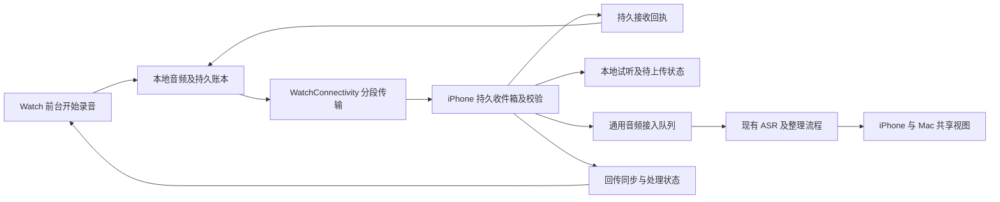

# Apple Watch 与 iPhone 联动评估

2026-10-26。已通过 Ego Lite 查看用户提供的小红书介绍视频、正文和部分评论、App Store 中国区页面、开发者官网／隐私政策／Mac 助手页，并核对当前工作区代码及 Apple 官方接口说明。本次交付是产品与技术实施方案，没有新增 watchOS target、安装竞品、实测手表、修改运行服务或发布版本。

## 建议

值得做。把 Apple Watch 作为心力卡新增的采集来源：手表独立录音和标重点，iPhone 接收、保管、上传，复用现有云端整理和 iPhone／Mac 共享结果。首版先覆盖随手想法、临时对话和有明确开始结束的会议；全天采集继续保留 CB08，手表全天能力待续航、收音及中断实测后判断。

第一项交付应是“手机不在身边也能录，回来后自动接回同一条记录”，随后才是接入自动整理。手机远程操作手表、手表操作录音卡和在手表问 Agent 分阶段加入。

## 竞品实际展示了什么

| 来源 | 本次观察 | 可以得出的结论 |
|---|---|---|
| 小红书约 20.7 秒介绍视频 | 抬腕录音；录音计时、波形和连接提示；手机日时间线、事项摘要和记忆问答；本地转写宣传 | 重点是降低记录成本，再按时间回顾；视频画面不是长录可靠性证明 |
| 同篇正文 | 点击开始、再点标重点、长按结束；主张本地保留音频 | 可以参考交互；电量和离线效果需要实机核验 |
| App Store | 当时显示 ¥28；描述保留首发 ¥18、原价 ¥38；版本 1.0.4；要求 iOS 18／watchOS 11 | 用户提到的 ¥38 是页面所称原价，不能当作本次所见售价 |
| 官网、隐私政策 | Watch 本地存储，经 WatchConnectivity 到手机；iPhone 上 SenseVoice 转写；AI 可使用外部服务处理文字，也可选支持设备上的本机 Apple 智能 | 录音不上传与 AI 全程离线是不同承诺；不能概括所有功能都不用联网 |
| Mac 助手页 | 展示经用户 iCloud 同步转写、供 Codex／Claude Code／Pi 读取及手表对讲的测试版，需 TestFlight 配合 | 对方已进入个人记忆和 Agent 方向，不能将“能接 AI／Mac”当作我们的独有优势 |
| 可见评论及商店评价 | 有闪退、来电／Siri 后录音中断的反馈，也有同步便利的正面评价 | 可靠采集应列为首轮验收；用户反馈不等于当前版必然复现，也不证明问题已修复 |

我们的机会是把新来源接进已经在用的事件、主题、重点、用户纠正和多端共同视图，并在真实使用中证明稳定性。现有语义质量限制仍应保留；这些能力不能据本轮研究宣称优于竞品。

## 现有代码可复用与必须新增的部分

| 部分 | 当前依据 | 处理方式 |
|---|---|---|
| iPhone 今天、主题、Agent 及纠正 | `iOS/XinlikaRootView.swift`、`iOS/XinlikaModel.swift`、`Sources/LuyinbiCore/HeartballClient.swift` | 新来源进入同一结果模型，界面注明 Apple Watch |
| 原声、不可变消息、落盘与重试思路 | `iOS/XinlikaCaptureStore.swift`、`iOS/XinlikaUploadQueue.swift` | 复用设计原则；类直接依赖 CB08，不能原样作为手表账本 |
| HTTP 传输、凭据和服务绑定 | `iOS/BackgroundUploader.swift`、`iOS/XinlikaConnection.swift` | 可复用传输基础；现有 POST 主要靠 App 执行时间＋短后台额度，不等于系统会持续跑完整个离线积压队列 |
| 服务端持久队列、ASR 缓存、整理和共享视图 | `scripts/heartball_shared.py`、`scripts/heartball_processing.py`、`scripts/heartball_agent_store.py` | 通用音频适配完成后进入这些既有流程，保留幂等、权限及录制时间 |
| 麦克风安全落盘经验 | `Sources/LuyinbiCore/MicRecorder.swift` | 借鉴 PCM／CAF、重采样及异常恢复；这是 Mac 实现，不是可直接编入 watchOS 的录音器 |
| watchOS 工程和两端会话 | `project.yml` 目前没有手表 target；现有代码没有 WCSession | 新增 watchOS App、WatchConnectivity 桥接及启动期恢复 |
| 手机本机录音 | 当前 iPhone 主线采集依赖 CB08，Info.plist 只有蓝牙后台模式 | 若也做 iPhone 自身麦克风录音，应作为另一项采集能力单列，不假定已经具备 |

### 不能只增加一个接收文件的方法

现有手机服务 `scripts/heartball_mobile.py` 校验 `card_file` 以 `note` 开头，批次是 CB08 裸 Opus：40 字节一个包，按 2,000 字节／秒换算时长；重点范围也是字节边界。`heartball_store.py`、`heartball_agent_store.py` 的时间定位、`heartball_recording_time.py`、`heartball_processing.py` 的 ASR 封装和 `heartball_acoustic_engine.py` 的声音旁路都带有这种假设。

因此不能把 CAF／M4A 改扩展名发给 `/v1/mobile/ingest`，也不应把手表伪装成 CB08。建议新增版本化的通用音频入口和独立接入账本，保留现有 CB08 路由；通用来源用采样数／时间范围定位，适配 ASR、文档证据、重点、播放及声音旁路后，再进入共享业务视图。不能仅修改接收接口和转写器，就认为接入已完成。

## 首版用户体验

**Watch：** 一个明确的开始按钮；录音中显示时长、收音状态、标重点、结束。开始成功和重点落盘后给触觉反馈。可借鉴长按结束以降低误触，同时提供明确的结束控件。表盘入口先用于打开录音页；后台直接发起录音需要单独验证，不承诺“抬腕自动录”。

**离开手机：** 继续本地录音，显示“已存手表，待同步 N 段”。手机不可达不应成为录音失败条件。中断时显示已停止和保留的时长；系统允许时尝试恢复，但恢复必须以实际音频写入为准。电话期间缺失的声音无法补造。

**iPhone：** 将“录音卡”入口扩展为“采集”，容纳 CB08 与 Apple Watch。待同步／已接收／待上传／整理中／已完成分别显示；本地收到原声后即可试听，即使服务未连接。整理完成后进入现有“今天”，不另建一份互相冲突的时间线。

**重点：** 首版建议显式开始／结束一个重点范围，沿用心力卡已有概念。若要做“一点标记刚才这句话”，须额外定义回溯窗口与上下文策略；一个时间点不能直接当作已知语义范围，ASR 也不能凭空提供词级对齐。

**两种设备同时录音：** 保持各自来源身份，用户可选择当前主要来源。不要把两台设备听见同一场会议当作字节重复；同场录音的内容归并需要独立证据与后续策略。

## 推荐的联动结构

### WatchConnectivity 分工

| API | 使用范围 | 约束 |
|---|---|---|
| `transferFile` | 已封口音频段及最少元数据 | 异步、受系统电量与调度影响；没有分钟级必达承诺 |
| `transferUserInfo` | 重点、结束事件、持久接收回执、恢复请求 | 小型持久事件；不同传输通道间的到达先后不能靠发送顺序推定 |
| `updateApplicationContext` | 最近设备状态、待传数量、摘要处理状态 | 后一次会替换前一次，不能用于必须逐条保留的重点和回执 |
| `sendMessage` | 可达时加速状态交互和反馈 | 失败有持久通道兜底；iPhone 发消息不能据此唤醒手表开始录音 |

`WCSession` 在手机启动期初始化，不依赖用户进入采集页。接收文件时须在 delegate 返回前移动到自己的容器；临时路径不能交给异步任务后放任回调返回。先保管并校验，后提交接收回执。初始化需覆盖手机冷启动、激活失败及更换配对手表的生命周期。

Apple 官方明确要求 `transferFile`／`transferUserInfo` 使用配对真机验证；Simulator 不支持这两项方法，不能用模拟器绿灯作为双端同步通过。

### 可靠传输契约

建议共用一个纯 Foundation 的版本化协议层，至少包含：

- 身份：`schemaVersion`、`workspaceBindingID`、`watchInstallationID`、`recordingID`、`segmentID`、`sequence`。
- 音频：`codec`、`container`、`sampleRate`、`channels`、`frameCount`、`byteCount`、`sha256`。
- 时间：录制起始时刻及原时区、会话内采样偏移、段实际时长、单独的接收时刻；校时变化作为事件记录。
- 控制：独立 `eventID` 的重点起止、中断、恢复、结束；结束声明最终段数、最终序号和实际采样范围。
- 回执：`recordingID + segmentID + sha256` 的持久接收确认；同 ID 内容不同必须报冲突。

两条状态链分别保存：

`录音中 → 段已封口 → 待传 → 已交给系统 → 手机持久接收`

`手机持久接收 → 待上传 → 服务端接收 → ASR → 整理完成`

系统的发送完成回调不能替代手机业务落盘确认；手机收到音频也不能显示“整理完成”。结束事件先于最后音频到达时进入等待补齐状态，不能抢先终结服务端录音。重复或乱序内容按稳定身份接收，向后端提交前验证完整性；有真实中断时保留缺口，不能用紧挨的 sequence 掩盖时间缺失。

手机收到回执后，手表才按保留策略回收已确认的段；已确认回执需要能在重复传输时重发。回执丢失、两端进程重启、传输失败都沿用原身份。存储不足时显示状态并安全结束，不删除尚未确认的原声。

服务归属在录音创建时绑定。手机更换空间／处理服务后，旧录音保持隔离，不自动转给新服务；Watch 只需不敏感的绑定标识，不持有现有生产云端令牌。未完成服务绑定也能录，等待用户明确归属后再上传。现有 `source_kind` 是现场对话／背景播放等声音场景，另加 `capture_source=apple_watch`，不能混用。

### 录音格式与后台限制

先试短段 PCM／CAF 落盘，封口后再评估压缩及传输策略。可从 30–60 秒段开始验证，不把段长当语义边界。参考 Mac 录音器现有“活跃文件压缩时进程终止不可恢复”的实测教训，但 watchOS 的真实恢复结果须重测。

16 kHz、单声道、16 bit PCM 的理论音频数据为 32,000 字节／秒，约 115.2 MB／小时、921.6 MB／8 小时，尚不含容器和副本。全天原样传 PCM 的存储和电量代价必须测量。分段轮换还要验证无漏采、无重叠；不能先假定停旧录音器再开新录音器无缝。

配置手表麦克风权限和实际录音所需音频后台模式，前台发起音频会话，观察 interruption、route change 和媒体服务重置。后台配置不是录音永不中断的保证。重新激活后检查实际收音和写入；不允许恢复则保留原声并明确提示。SDK 26.5 范围内按可用 API 实现，不照抄文档里更高系统版本才有的接口。

手机只接收手表文件时，不因这个需求添加手机麦克风后台录音；现有 CB08 的蓝牙后台运行保证也不能移植为手表文件同步时延保证。

## 具体开发批次

| 阶段 | 建议文件与改动 | 通过标准 |
|---|---|---|
| P0：离线录音与传回 | `project.yml` 新增 Watch App；拟新增 `watchOS/` 录音器／本地账本／界面，`SharedCapture/` 协议，`iOS/WatchCaptureInbox.swift`、`WatchConnectivityCoordinator.swift`；启动期注册接收 | 真机离线录音、重连后校验一致、本地试听、重点与缺口保留、重启去重 |
| P1：接进现有整理 | 拟新增通用音频持久入口与版本化 schema；适配 ASR 格式、采样时间定位、重点引用、原声播放和声音旁路；复用共享所有权、权限及业务结果 | 同一录音只入账一次、不重复 ASR、时间来自 Watch、iPhone／Mac 同一事项身份 |
| P2：日常可用 | 采集来源页、表盘入口、待传管理、回执重发、存储清理、实测后选择封段压缩方式 | 连续使用、电量、低空间、弱连接、来电／Siri、系统终止完整验收 |
| P3：控制与问答 | 手表显示摘要、标记当前 CB08 重点、查询 Agent；手机可达时的控制另定义命令协议 | `commandID` 幂等、明确目标设备／会话、真实结果回执；离线命令过期，不能延迟后突然开始录音 |

P0 不应直接套用 `XinlikaModel.start/focus/stop`：这些方法操作 CB08。拟新增的 Watch 控制器应拥有自己的状态。手机“开始手表录音”不能假定远程后台可用；首版从手表主动开始最可靠。

P1 的新接入应做 CB08 回归检查，尤其是已验证的锁屏采集、原声补齐和上传恢复。通用音频结构是新增能力，不能迁移现有真实录音来制造测试样本。

## 本地处理与费用取舍

首版复用现有云端处理，交付速度更可控，但录音会按用户启用的处理服务上传，不能沿用竞品“原声不上传”的承诺。Watch 应保留离线采集能力；首次开启该来源的云端整理时明确数据流。

下一阶段可评估 iPhone 本地 SenseVoice／其他 ASR，只同步文字到共享 Agent：有利于减少原声外传，但新增模型分发、机型性能、内存、电量、后台处理和重复处理仲裁工作。原文在手机转写，不等于后续 AI 也离线。语音来源切换为本地处理时，旧待传原声不能因默认队列而继续外传。

对方买断价不能证明我们能以同样价格承担不限量云端 ASR 和 Agent。先记录真实每小时音频量、处理费用和耗电，再决定免费额度及付费方式；本次不建议直接定价。

## 必须用配对真机做的验收

1. 手机关机／离开范围，Watch 新录一段并标重点；回来后原声可听，录制时间、范围及哈希一致。
2. 录制中落腕、回表盘、切 App、锁屏；确认收音仍写入，不能仅观察 UI 计时。
3. 来电、Siri、音频路由变化、低电量及系统终止；已封口段可恢复，活动尾段的可恢复界限可量化，真实缺口可见。
4. 文件重发、乱序、结束先到、回执丢失、双端重启；只产生一份段和一次有效整理，重复请求返回原回执。
5. iPhone 后台／系统结束／用户强制退出分别观察；不以前台调试结果代替后台传输结论，强退后保留待同步并允许重新打开恢复。
6. 撤销授权、切换空间／服务、重新配对手表；旧音频不串账号、不改变原归属。
7. 同时使用 CB08 和 Watch；两路来源不抢状态、不相互结束，不按同时间自动误合并。
8. 至少 30 分钟连续场景，再逐步做 2 小时及目标全天测试，记录型号、watchOS、电池健康／起止电量、空间、温度、缺口和手机后台条件；达到实测标准后才描述全天能力。

当前开发机有 Xcode 26.5 及 Watch 平台 SDK，本次 `simctl list devices available` 只列出 iOS 26.5 设备。尚未核验用户的 Apple Watch 型号、系统版本或配对真机条件；不能给出手表实测通过结论。

## 来源

- [用户提供的小红书介绍](https://www.xiaohongshu.com/explore/6ad60345000000002701e2a3)；访问时使用用户提供的完整链接，此处不保留临时访问参数。
- [腕记 App Store](https://apps.apple.com/cn/app/id6822356428)、[开发者官网](https://kelvinmade.com/wristmemo/)、[隐私政策](https://kelvinmade.com/wristmemo/privacy.html)、[Mac 助手测试版](https://kelvinmade.com/wristmemo/mac/)。竞品能力来自介绍和页面声明，本次未安装验证。
- [Apple WatchConnectivity 官方样例](https://developer.apple.com/documentation/watchconnectivity/transferring-data-with-watch-connectivity)。
- [transferFile](https://developer.apple.com/documentation/watchconnectivity/wcsession/transferfile(_:metadata:))、[transferUserInfo](https://developer.apple.com/documentation/watchconnectivity/wcsession/transferuserinfo(_:))、[sendMessage](https://developer.apple.com/documentation/watchconnectivity/wcsession/sendmessage(_:replyhandler:errorhandler:))、[updateApplicationContext](https://developer.apple.com/documentation/watchconnectivity/wcsession/updateapplicationcontext(_:))。
- [Watch 后台会话](https://developer.apple.com/documentation/watchkit/enabling-background-sessions)、[UIBackgroundModes](https://developer.apple.com/documentation/bundleresources/information-property-list/uibackgroundmodes)、[音频中断处理](https://developer.apple.com/documentation/avfaudio/handling-audio-interruptions)。文件接收临时路径的生命周期另核对了本机 Xcode 26.5 的 `WatchConnectivity.framework/Headers/WCSession.h`。
