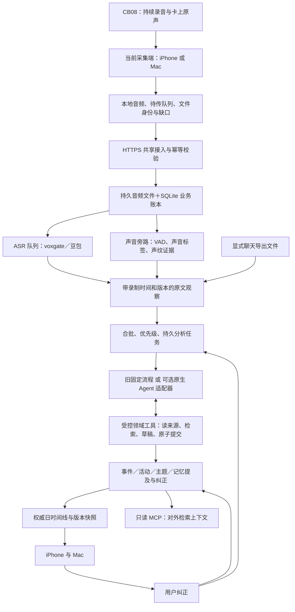

# 心力卡当前架构与流程核对

2026-10-24。依据当前工作区源码、既有部署记录及[最新全天实录对比](xinlika-day-agent-comparison-2026-10-24.md)。本次没有读取线上私有配置、远程核验部署、调用模型／ASR、操作录音卡或重启服务。因此下文严格区分已有共享链路、源码可选能力和隔离实测结果。

后续同日新增了显式启用的[增量状态＋滚动时间线实现与冻结实录验证](xinlika-incremental-2026-10-24.md)。该后续实验调用了已有模型接口，未重复 ASR，也未切换已有服务；下文的线上描述不能视为已启用新策略。

## 整体结构

当前是“边缘可靠采集＋共享业务账本＋异步分析＋多端共同视图”。不是把原声直接交给一个常驻聊天机器人，也不是已经完全由 Hermes 接管了线上。

## 一、设备与采集端

- CB08 负责持续录音和卡上原声保存。采集端负责 BLE 协议、厂商握手、接收落盘、身份／时钟核对、缺口和恢复；Agent 不负责唤醒休眠卡、控制固件或补造缺失声音。
- 同一时刻由一个采集端持有卡的 BLE 会话。随身场景由 iPhone 采集，Mac 读取共享云端结果；Mac 本机采集是另一种模式，不意味着两个设备同时接收同一张卡。
- 默认按 60 秒音频封批，可配置到 300 秒，结束提交尾段。封批不停止卡上录音，也不代表一个语义事件结束。
- 重点是同一录音上的独立时间范围和处理对象，不要求另启一份物理录音。普通记录持续接收，重点独立整理。
- 断连记录为缺口，重连先确认文件身份并尝试恢复通知／握手。已有实测不能保证同文件实时推流必然恢复；可靠兜底是保存后、设备空闲且归属明确时自动下载卡上原声、逐字节对齐并只补缺失范围。跨文件续段按身份和时间证据发现，身份模糊时不强行拼接。

主要源码：`iOS/XinlikaModel.swift`、`iOS/XinlikaCaptureStore.swift`、`iOS/XinlikaUploadQueue.swift`、`Sources/LuyinbiCore/CardSegmentDiscovery.swift`。

## 二、共享服务和持久处理

已有个人共享空间通过 HTTPS 接入；每台设备独立可撤销凭据，有编辑／只读权限，会话归属绑定采集设备。共享 API 不提供 BLE 或远程启停录音。

目前是单个人空间的模块化服务：音频存文件系统，元数据、文档、任务、事件、主题、事实提及、纠正、回执与修订号存 SQLite（WAL）。不是多租户平台，也没有已经接入的向量库／图数据库。声音模型独立进程消费同一业务证据；模型接口和 voxgate 在这层后面，不直接暴露给 App。

处理顺序是：校验上传消息与音频哈希 → 持久入账 → ASR 任务 → 版本化文字 → 整理任务。重复请求复用上传回执，相同音频优先复用已有 ASR；整理或纠正失败不应重新转写已成功的音频。持久任务有状态、租约、重试及失败记录，不依赖一个 Python 线程或 Agent 聊天历史作为唯一进度。

已有一致性备份代码和恢复验证；容器内备份与异机灾备是不同保证，不能据此宣称已完成异机自动备份。本次没有重新核验线上备份状态。

主要源码：`scripts/heartball_shared.py`、`scripts/heartball_store.py`、`scripts/heartball_agent_store.py`、`scripts/heartball_processing.py`、`scripts/heartball_backup.py`。

## 三、声音理解与身份

声音是与 ASR 并行的辅助证据，不是“先认出本人，才准许保存文本”。已实现独立队列和 sherpa-onnx 模型组合：Silero VAD、Zipformer 声音标签、WeSpeaker 声纹特征及三段登记／独立复核。音频哈希将标签绑定到原声。

来源标签、声音场景、匿名说话人、登记声纹和个人事实归属不是同一个结论。室内／音乐／人声标签不能可靠推断“现场还是设备播放”；声纹相似也不能排除本人声音回放。餐桌重叠发言的实测仍弱，会议与他人谈话可以保留为上下文，不能因此全部写成用户本人的经历或承诺。

主要源码：`scripts/heartball_acoustic_engine.py`、`scripts/heartball_acoustic_worker.py`、`scripts/heartball_voice.py`。

## 四、Agent 当前实际状态

源码有两条互斥的主要整理路径：

| 路径 | 实际行为 | 状态 |
|---|---|---|
| 旧 `Processor` | LangGraph 固定提炼、组织、归并、主题与问答流程 | 保留，未配置 `agent_runtime` 时仍使用 |
| 新 `NativeProcessor` | ASR 原文只入账；持久任务交给 Hermes／DeepSeek 原生循环，通过相同 MCP 读写领域数据 | 已实现可选接入并隔离验证；最新全天比较未切换线上 |

新路径并非每分钟都跑完整 Agent：普通记录默认合并等待 180 秒，最多 20 份文档／约 10,000 字符一组；按同一逻辑录音、同一录制日、普通／重点分别取材。重点和结束录音不受普通等待方式限制。这是有界调度，不是已通过验收的自动会议边界识别。

原生框架负责模型—工具推理循环；心力卡负责权限、任务、来源版本、结构校验、事务、幂等和共享视图。任务加载同一心力卡 Skill；框架可读工作区和授权来源，按需检索，不开放设备控制或任意 shell。

大任务可分块保存草稿，最后统一校验、原子提交。来源必须有可核对的片段引用，完整事件模式要求每个原文片段被分配到事件或残句。结构覆盖不等于语义无遗漏：有价值短反馈仍可能被错当残句。

主动反馈尚保留原来的 observe → respond → review → publish 固定流程，有变化检测、去重、静默、冷却与限频；并未全部迁入原生 Agent。当前不是一个统一完成所有决策的自主 Personal Agent。

本轮 Hermes 暂为事件整理候选；两者全天实录都漏了已确认的同事项跨对话关联，不能把“工具能写主题”当作关联能力已经稳定。

主要源码：`scripts/heartball_native_processing.py`、`scripts/heartball_runtime_adapters.py`、`scripts/heartball_agent_runtime.py`、`scripts/heartball_mcp.py`、`scripts/heartball_personal_agent.py`、`prompts/skills/xinlika-context/SKILL.md`。

## 五、事件、主题、记忆与同步

必须区分六个对象：

| 对象 | 含义 |
|---|---|
| 原声／原文 | 最底层证据，保留录制时间、来源身份和版本 |
| 完整事件 | 用户可以独立回顾的一件事；可跨多份上传批次 |
| 活动 | 一场会议／一顿饭的背景范围，内部可以有多个事件，不强行充当首页卡 |
| 主题 | 不同交流中同一具体项目／问题的延续；不是“健康／工作”这种泛分类 |
| 个人事实提及 | 偏好、状态、计划、承诺等带主体和依据的声明；当前仍有 proposed／confirmed／retired 状态 |
| Agent 执行状态 | 任务、草稿、压缩上下文和回执；不是另一份更有权威的个人记忆 |

普通事件无需逐条确认。保留“这次会议讨论了什么”与认定“本人承诺做什么”分别处理；当前个人事实自动准入尚不完整，最新全天比较没有新增个人事实声明。记忆也不是 UI 展示后的最后一步：检索旧上下文参与提炼、关联、问答和反馈，新结果带依据写回同一账本。

现有召回主要是 SQLite FTS5／中文词面回退，没有成熟的实体解析和跨说法语义召回。原生 Agent 能多步检索，也仍受候选上下文、任务范围和来源质量限制。

共享日视图输出唯一事件时间线，两端消费同一身份和排序；活动留在背景／详情，残句不独占首页。事件日期按录制时间，上传／处理时间独立。没有词级对齐时显示的是来源时间包络，不能宣称精确话题起止。

同步目前使用修订号＋日期／时区视图身份，变化后读取权威完整快照，不是逐实体增量推送。纠正带预期版本；旧版本冲突拒绝，保留原文历史，并使受影响的派生结果失效后局部重建，不重复 ASR。关系重建仍可能漏关联。

主要源码：`scripts/heartball_day.py`、`scripts/heartball_timeline.py`、`scripts/heartball_recall.py`、`scripts/heartball_shared.py`。

## 六、外部上下文的两个方向

- 向外：只读 MCP 的 `search_context`／`read_source`，返回带时间、版本和授权的上下文，外部 Agent 不直接获得音频、SQL、密钥或设备控制。WorkBuddy 有配置示例，不能称已做其实际界面验收。
- 向内：通过白名单接外部 MCP，或显式导入支持格式的 JSON／TXT／表格 HTML 聊天导出文件；保留原始发送者／时间、按消息身份去重，再进入同一观察账本。没有收到真实微信导出样本，格式链路测试不等于真实微信效果验收。

## 判断与下一步优先级

可靠采集、补齐、ASR 复用、共享账本与版本化纠正应继续保留；它们不能由通用 Agent 代替。主要短板在“连续观察怎样成为稳定、忠实、可更新的用户上下文”。

1. 先把普通／重点、补录／新录、纠正／关系修复统一为明确任务，逐步收束旧新语义路径；主事件写入保持一个决策所有者。
2. 以稳定事件身份持续更新上下文；检索并核对具体对象、问题及原文承接，再做跨对话关联，不能仅扩大整日提示词。
3. 统一个人事实的主体、时效、撤回和替代规则；不确定时保留情景上下文，避免把审核负担退给用户。
4. 再逐步迁移主动反馈到相同证据／任务契约，保留独立审核与限频；最后以真实场景和故障恢复验收切换。

全天回放用于质量比较，不应成为每分钟重算全天的生产流程。当前单空间规模首先需要减少重复推理和修复语义边界，不能凭这轮结果判断必须先拆微服务、换数据库或叠加多个记忆系统。
