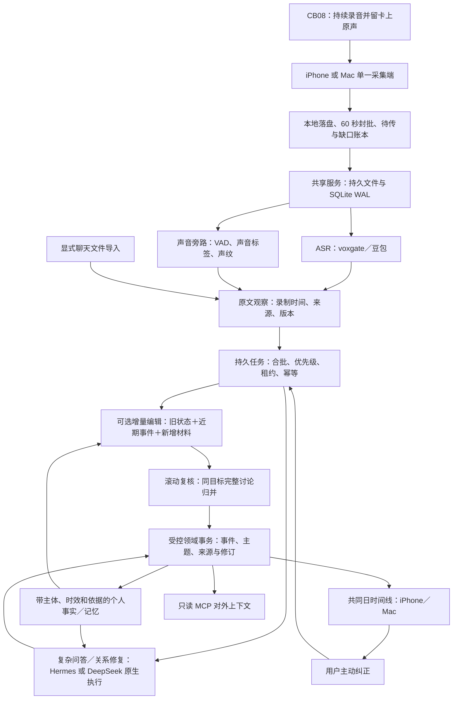

# 心力卡现有架构与 Harness² 接入判断

核对日期：2026-10-24。本文保留接入前的架构核对与设计依据。用户随后授权的实际接入、官方框架执行、冻结实录回放、独立留出测试及成本，见 [Harness² 接入与实测](xinlika-harness2-integration-2026-10-24.md)。未将实验候选写入真实运行配置。

## 现有架构及启用边界

图中语义处理层描述新策略在代码中的接入位置，不表示线上已经切换。

处理策略目前为：没有 `agent_runtime` 配置时使用旧 `Processor` 固定流程；配置原生运行时后由 `NativeProcessor` 接管任务；再显式设置 `analysis_strategy=incremental`，普通整理改走有界增量编辑，问答和明确关系修复仍回退原生适配器。`rolling_review=true` 开启滚动归并。最新增量策略完成隔离实录回放，尚未写入真实运行配置；不能用代码能力替代线上配置证据。

增量编辑示例等待约 180 秒合批，输入至多五分钟／八份文档／约 2,200 字符，压缩状态至多 2,400 字符。它续写同一事件 ID；上传封批、分析窗口和语义事件是不同边界。重点保持独立处理。滚动复核每 30 分钟水位回看 45 分钟，并在结束后补尾窗；归并保留原身份及精确来源。

共享业务账本是事实、纠正和同步的权威。模型工作状态、Agent 聊天历史与外部框架文件不是第二套权威。个人记忆参与检索、关联、问答与反馈，并非在 App 展示后才追加；当前本人归属和自动事实准入仍未完整验收。主动反馈沿用已有 observe→respond→review→publish 流程，未在本轮全部迁入原生 Agent。

已测的来源完整性不等于语义准确率。10 月 21 日冻结开发材料共有 131 份转写、774 个片段；最终六个既有检查点和已知跨录音正负例通过，原文未变，最终 90 个首页事件。该日已用于多轮开发，不能再当独立盲测集。全面会议边界、复杂主题、餐桌声纹及播放来源区分仍有未验收部分。详见 [增量实现与实录证据](xinlika-incremental-2026-10-24.md)。

## 核实的 Harness² 能力

来源：Google Research 官方仓库 [`google-research/harness2`](https://github.com/google-research/harness2)，本次固定提交 `1cfe254e8d25b15f37048c3730134686abe60335`；论文 [arXiv:2610.14224v1](https://arxiv.org/abs/2610.14224)，提交日期 2026-10-09。仓库许可证 Apache-2.0，自述为研究代码而非官方支持的 Google 产品；第三方依赖分别遵循其许可证。

它在保持模型权重不变时，优化提示词、工具指导、Skill、记忆文件、脚本及编排等运行配置。

- 任务级：提出通用／领域候选，在同一任务与相同环境中试跑，对比轨迹与产物，再组合有证据支持的修改。
- 跨任务级：保存采用的执行配置、观察到的修改影响和有依据的经验，用于以后改进。
- 可并行或顺序递归；支持 OpenCode、Codex 执行底座，现成基准适配为 JobBench、LAB、WorkBuddy-Bench。
- 代码把方法、底座和任务适配分开：`core/spec.py` 的 `BenchmarkAdapter` 定义任务、执行、轨迹、交付物、配置验证及评分接口。可以在保留其递归方法时，自建心力卡任务适配。

“不依赖标准答案来提出修改”不等于不需要验收。论文第 2.2 节说明行为对比并不能证明结果正确；附录 E.6 和 F 讨论了选错结果、共享错误假设、随机性及额外成本。相关原文见 [论文 HTML](https://arxiv.org/html/2610.14224v1)。

## 推荐接入位置

新增独立优化任务服务，消费授权的转写快照、执行回执及开发失败案例，产出候选 Skill 版本。实时采集、上传、ASR、业务权限与来源校验保持原有职责。

以下是接入前列出的适配工作；实现状态以接入实测文档为准：

1. **版本化可编辑面。** 增量 Skill 已是文件；滚动复核 `PROMPT/REVIEW` 仍内嵌在 Python，应抽为版本化资源。让每个隔离执行明确加载候选资源路径，并将内容哈希写入回执。只生成候选文件却仍读取生产提示词，不算有效优化。
2. **心力卡任务适配。** 用已有冻结回放实现 `BenchmarkAdapter.execute`；每个候选独占 SQLite、状态缓存、任务和结果目录。相同起始来源、历史状态及模型设置下运行。已成功的 ASR 直接读取，不触碰录音卡或线上账本。
3. **模型和执行底座。** 官方示例偏向 Linux／Python 3.12、OpenCode/Codex 与 Vertex 配置。现有豆包 Chat Completions 接口还需接编辑器模型路由；Codex 默认的 Responses API 也不能直接假定兼容。可以沿用现有领域执行器和计量接口，不要求为优化更换采集链路或 ASR。
4. **执行证据。** 向优化器提供原文、时间、候选召回、事件续写／归并、校验失败及可归因的成本轨迹。用泛化问题描述替代把某一天的人名、行程或标准答案写进公共 Skill。
5. **外部验收与版本启用。** 优化器提出并试跑候选；独立校验决定候选能否成为后续材料的执行版本。一次候选输出被选中，不等于该 Skill 对未来任务一定更好。

首阶段允许自动修改：事件层级／首页准入、同事项续写和分拆规则、跨对话检索指导、多人／播放来源的措辞与事实准入规则、处理任务的 Skill 及工具说明。参数优化后续单独实验，避免同时改提示、检索、窗口及模型而无法归因。

来源完整性、录制时间、权限、幂等、事务、原始数据、评测器和留出答案放在不可编辑的宿主边界。官方默认执行网络开放、Codex 沙箱关闭；我们应在独立环境限制其能看到的目录与服务，不能把默认执行环境直接指向生产库。依据见 [官方实验指南](https://github.com/google-research/harness2/blob/1cfe254e8d25b15f37048c3730134686abe60335/docs/EXPERIMENTS.md)。

## 评测与成本门槛

重点测量：同事项被拆碎的比例、不同事项误合并、明确短反馈保留、残句占首页、跨对话关联的精度／召回、无依据事实、将他人或播放内容归给本人，以及纠正后的旧结果失效。结构门槛同时要求来源不丢不重、原文未变、身份稳定和普通记录无需逐条确认。压低首页卡片数量不能单独作为优化目标。

时间序列数据按整场活动／整天划分开发和留出集；同一长会议的相邻片段不能随机撒入两边。隐含答案留在评测进程，不提供给编辑器／执行器，也不进入经验库。先用已曝光的 10 月 21 日材料开发，再用未参与调优的真实时段评估泛化。

用独立模型评审作辅助，保留必要的实录人工抽查；模型自评、文字覆盖、两个模型答案一致均不构成准确率。

官方 `core/recursion.py` 说明两种模式调度 `4k` 次任务执行和 `3k` 个改进阶段，随后还有经验提取等工作。因此 `k=1` 也不是一次模型调用；如果一次任务是整天回放，开销会迅速放大。先以少量完整场景及 `k=1` 验证适配和收益，严格限制轮数、tokens、耗时和并发，计入失败与编辑器成本。匹配的既有基线回执可以复用，但候选改变后的执行必须实际试跑。

当前 42.7 万 tokens 是既有增量＋滚动链路这份开发语料的最终成本，不是 Harness² 运行成本。尚未对其在心力卡上的收益、金额或生产吞吐作实测结论。

## 两类“记忆”

- 心力卡个人记忆：用户发生过的事情、偏好、计划和更正，绑定主体、时间、依据与权限。
- Harness² 改进经验：哪些处理规则在什么情形下改变了行为、证据是什么、是否可迁移。

它们分别存储与授权。后者应沉淀可迁移的处理经验，不把用户的原始私人生活记录变成跨任务通用规则。相关实现是官方 `core/library.py` 的领域经验库，而不是可直接替换心力卡业务记忆的成品模块。

后续已经实现隔离优化器和官方框架调用，结果见 [接入与实测](xinlika-harness2-integration-2026-10-24.md)。接入成功与候选质量达标是两项独立结论；不应把一次自动组合解释为无人值守的质量保证。
