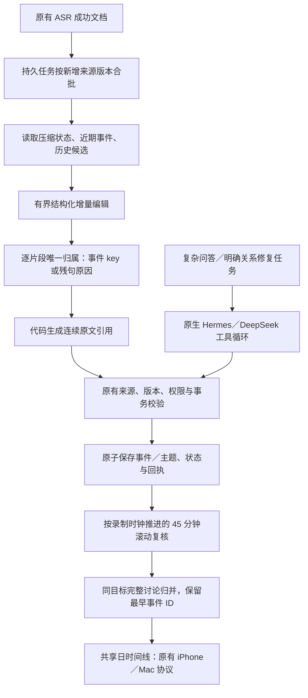

# 心力卡增量状态与滚动事件实现

2026-10-24。当前变更为显式配置启用的服务端处理策略。没有安装到真实设备、切换线上、启停录音、连接录音卡或重复 ASR。实录回放、模型正文、凭据和逐条复核仅保留在忽略的 `.build/xinlika-incremental-20261024/`。

## 已实现的链路

普通新增材料走一个有界结构化步骤，结构／引用错误最多一次修复调用；这不是另一套自研通用 Agent 循环。复杂问答与显式关系修复继续交给既有原生适配器。主动反馈流程没有在本次替换或冒充已重新验收。

### 开源复用

- 从 Omi 固定版本 `4b4e35fdc9d61a5fb74380202cbc65d0432ecc6e` 适配 `clean_text`、列表清理去重、压缩状态限长及“旧状态＋新发言”规则。修改其 JSON 预算方式，按完整字段减量，不截断 JSON。
- 将 Dayflow `730d6f84b919998158ff7fdab15e3f032f7d8135` 的 45 分钟回看／范围重叠思路移植到 Python 候选选择，采用同一事情续写而非每批新建。没有采用十分钟最低卡片时长，也没有照搬删除旧卡再插入新 ID。
- 两套 MIT 版权声明和完整许可随 `scripts/heartball_incremental_reuse.py` 保留。更详细映射见 `prompts/skills/xinlika-incremental/UPSTREAM.md`。

本次没有整套迁移 Omi 的 Firestore／Redis／客户端，也没有重写 Dayflow 的屏幕采集器。继续复用心力卡已有任务、ASR、来源引用、业务账本、纠正、共享视图与原生 Agent 接口。

### 调度和上下文

- 常规采集／上传仍独立于推理。新策略示例按约三分钟合并等待，分析窗口最多五分钟、八份文档或约 2,200 字符，不把这些边界当事件边界。
- 压缩状态最多 2,400 字符，包含标题、最多八条要点、人物和未决问题，是暂定工作缓存，不写正式任务或个人事实。
- 状态按逻辑录音、录制日、普通／重点、来源组隔离。**此处没有声称已自动识别真实会议／聚餐边界**；物理录音与现实活动仍不是同一个对象。
- 近期同逻辑录音事件最多十条，可保留原 ID 续写；不同录音的历史候选最多八条，由中文双字／英文词项检索召回，候选分数不作为语义真值。核对原文后只通过主题关联。
- 滚动复核每 30 分钟水位回看最近 45 分钟，结束后补尾窗；每个上下文最多 24 个事件或约 22,000 字符，保存分窗计划防止第一窗归并后漏掉尾部。它复用原有 `EventMergeStore`、来源授权／版本校验和原子提交，不替换原始转写。输入不足两事件时零调用。单个超大事件独占窗口，不强行截断后归并。
- 复核先提出归并，再用独立调用核对原文和边界；每窗最多三次调用，失败保留原状并记录，不无限重试。最终使用显式事件 handle 的唯一归属对象，避免计数数组错位或一个事件被重复放进不同归并组。单成员组原样保留，不凭空补第二成员。
- 同一对象与目标下比较不同方法、反馈与效果属于完整讨论过程。不同目标、不同场景保持独立；没有用最短时长或固定卡片数量压缩结果。滚动复核不能隐藏未归并事件或写入个人记忆。
- 已有会议来源元信息原样传入。它只说明同一场会议，不提供“哪些事项相同”的评估答案。原文中的来源不明或多人发言不会自动成为用户本人经历。

### 可靠性与来源分配

源文档签名／代次记录已处理证据。来源更正或授权变化使压缩状态失效；提交前重新核对当前及历史依赖。状态版本通过比较交换保护；事件／主题、状态、来源水位和领域回执在同一 SQLite 事务内写入。失去队列确认后可复用回执，不再次调用模型。

迟到材料按自己的录制时钟处理，不读取未来状态，也不覆盖更新的运行状态。焦点录音保持独立；普通续写不吞并其他录音或重点。事件时间继续来自原始录制时间；缺少词级时间时仍是来源区间，不编造精确话题起止。

最初试次暴露了重复／不连续引用的接口问题。最终接口改为每份文档的逐片段归属数组：每个位置恰好对应一个原文片段，模型只选事件 key 或残句原因，程序生成连续逐字引用。所有片段仍由旧领域校验核对。没有靠丢掉重复片段、删除有意义反馈或修改评估标签来通过。

结构覆盖完整不等于语义正确：误将短反馈归为残句、给错事项或过度概括仍需实录质量检查。

## 配置与源码

`Config/incremental-agent.example.json` 是占位示例，**未写入任何实际运行配置**。关键项为 `agent_runtime.analysis_strategy="incremental"`。不设置时继续原来的处理策略。示例关闭主动反馈便于先验收事件整理，不代表修改了用户现有设置。

- `scripts/heartball_incremental.py`：上下文准备、唯一归属、原子状态与领域提交、计量和原生任务回退。
- `scripts/heartball_incremental_reuse.py`：携带上游许可的纯函数适配。
- `scripts/heartball_incremental_review.py`：有界滚动复核、复用归并事务、精确原文位置和最终来源覆盖审计；示例通过 `rolling_review=true` 开启。
- `scripts/heartball_native_processing.py`／`heartball_runtime_adapters.py`：可选策略接入既有任务服务。
- `scripts/replay-xinlika-incremental.py`：新的私有目录、冻结哈希校验、按录制时间回放、任务回执恢复、复用原评估器。
- `scripts/test_heartball_incremental.py`：版本、权限变化、乱序、连续引用、独立重点、唯一归属、事务回滚与零调用重放等结构验证；不作为真实语义成绩。

## 本次回放口径

输入保持 2026-10-21 的 131 份已有授权转写、15,772 字符、774 个原文片段，SHA-256 为 `01e2b40aaf75e18ee9a7e840b1ec2f7905771f2133c5d8183d0c10a391d3842b`。是该录制日已有可用来源，不是 24 小时音频覆盖。含会议、聚餐、其他设备测试和播放内容，不能全称为现场聚餐。

评估标签只在回放结束后用于既有检查点，不进入模型。最终逐录制时间形成 35 个输入窗口；窗口不强制对应 35 个事件。

另从空隔离工作区运行一次原生 Hermes 整日对照，同一输入哈希、模型和提供方参数，预算 48 次调用／900 秒，不在耗尽后追加恢复。它在 48 次调用后未提交回执，质量项未评分。历史成功试次另作参考，不混称为本次冷启动成功。

比较的是整日原生规划与增量领域步骤两种处理架构，提示、调度和工具开销不同，不是固定提示下的框架／模型准确率排名。tokens 是提供方报告值；没有金额或适用单价，不换算人民币。开发失败、修复、最终回放及对照开销应分别保留。

## 最终实录结果

脱敏证据见 [validation/result.json](validation/xinlika-incremental-2026-10-24/result.json)。最终使用已完成的 35 个增量回执，从归并前数据库快照单独运行滚动复核。19 个复核子窗完成、无失败，批准 10 组归并；首页从 101 条变为 90 条。数量下降不是质量证明，也没有为了达到固定数量删除事项。

六个既有开发回归锚点全部通过：融资与后续寄送分开、约见安排与课堂残句分开、商务与休息健康分开、孤立数量不占首页、明确产品短反馈保留、讨论中的方法与效果归入完整事件。已知同事项的两次录音有主题关联，已知不同事项未混入该关联。

人工对照了完整讨论的两处原文、产品反馈和已知关联材料。它们不是独立盲测：同一天开发语料经过格式／规则修复后重复用于评估。跨对话指标仍以会话来源覆盖为主，不能推导所有主题都关联正确；个别主题及归并组仍需更细的事项范围标签。没有声称全日事件准确率，也没有宣称识别出了所有现实活动边界。

最终活动事件的精确字符范围与保留片段另做审计：774/774 个原文片段恰好归属一次，缺失、重复、过期引用均为零，131 份原文、录制时间及版本保持不变。此检查覆盖归并后的最终投影，不只检查初始提案；它仍不证明每个片段语义归属正确。没有生成个人事实或承诺。

### 开销

提供方模型为 `doubao-seed-2.1-pro`，以下均包含相应阶段失败尝试；没有调用新 ASR。

| 阶段 | 模型调用 | 总 tokens | 结果 |
|---|---:|---:|---|
| 最终增量编辑 | 41 | 328,918 | 35 窗完成，含一次零调用候选恢复 |
| 最终滚动复核 | 22 | 98,018 | 19 子窗完成，10 组归并 |
| 最终组合链路 | 63 | 426,936 | 指定回归检查通过 |
| 原生 Hermes 整日对照 | 48 | 2,614,478 | 调用预算耗尽，未提交，不评分质量 |

最终组合输入 tokens 为 382,758，其中缓存命中 96,648、未缓存 286,110；输出为 44,178。原生对照未缓存输入为 358,381，缓存命中高达 2,206,736。因此不能将总 tokens 的差额当作同幅金额节省，更不能把未完成对照作为同质量降本结论。无可核实适用单价，金额留空。

最终组合活跃处理时间合计约 17.5 分钟，分散在全天的多个窗口，不是一次请求延迟或实时采集 SLA。调度等待、开发停顿和真机网络不在此数内。

另保留了两个失败的增量接口试次，共 30 次调用／172,514 tokens；第一版滚动复核 22 次／95,076 tokens，第二版 19 次／73,568 tokens。第一版有两个结构失败窗；第二版结构完成，但来源数组错位导致正确的完整讨论候选被独立校验拒绝。最终以显式 handle 修复，并在上下文完全一致时复用两处已有候选。没有按某个锚点手工补关联或写入答案。包含上述开发试次、最终链路和原生对照，本轮实际观察开销共 **182 次调用／3,382,572 tokens**；初次试验不是免费或一次成功。

## 验证与启用边界

- Python 结构、权限、纠正、事务、恢复、精确来源与任务服务回归检查见 validation。
- 真实最终日数据通过 `XinlikaWorkspaceCheck`，两端共用的 Swift 协议解码出 90 个事件，无客户端二次归并；这不是 iPhone／Mac 真机界面验收。
- 导出的服务端包只含允许的源码、提示和部署模板，包含开源许可；无音频、真实数据库或运行凭据。
- 新策略已接入代码与占位配置，**未部署、未切换已有服务**；没有连接录音卡、启停采集、重启服务或 Git 提交。原有录音与服务继续使用原配置。
- 真正自动识别会议／聚餐边界、复杂主题的全面准确性、声源／本人归属以及新一天留出验证仍未在本次完成验收。问答、记忆纠正、主动反馈沿用原链路，本次没有冒充重新验收。
