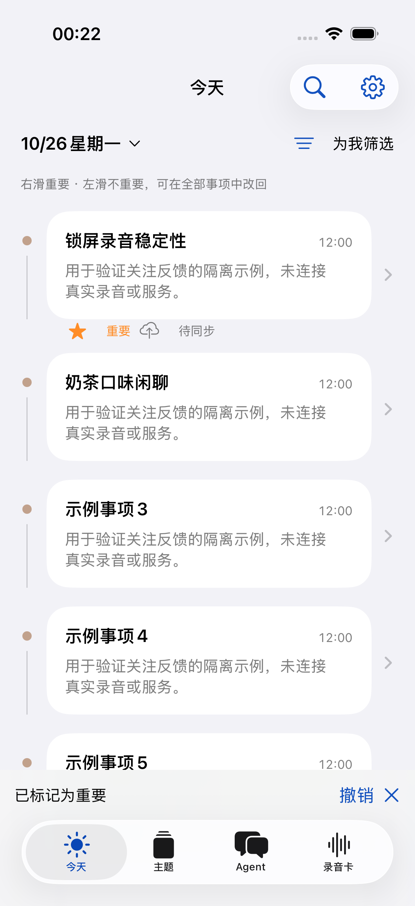

# 事项重要程度与关注偏好反馈

版本 **0.3.10（29）已于 2026-10-26 上线并覆盖安装到原 iPhone**。云端于北京时间 11:38:50 接管，手机于 11:43 安装并启动。真实手机已显示事项标记按钮和筛选入口，服务连接正常。

安装前按用户要求正常结束本轮录音，约 108 分钟；完整卡文件自动补齐并由云端逐字节核对。安装后页面确认“待传 0、当前文件已对齐”。原有实时接收中断仍保留在账本中，不将文件对齐解释为没有接收缺口。

## 用户操作

- “今天”的事项完整右滑标为重要，完整左滑标为不重要；短滑可露出同名按钮。使用 iOS 原生列表滑动。
- 每次操作提供撤销；长按菜单和事项详情提供重要、不重要、取消标记，支持不使用手势操作。
- “为我筛选”会暂时隐藏明确标为不重要及 Agent 建议少关注的事项；重要标记优先于建议。可以切换全部事项、重要事项、不重要事项、重点片段。
- “重点片段”仍指录音中人为圈定的片段，事项重要程度是另一种反馈。
- 显示“重要/不重要”和“猜你关注/猜你少关注”，区分用户判断与模型建议。未同步、版本冲突分别显示“待同步”“需重新标记”。
- 标记存入独立手机账本，联网及 App 恢复运行时自动重试；网络丢失回执后沿用原请求 ID，撤销不会越过此前未确认的操作。反馈队列不阻塞原声上传。

截图来自隔离模拟器，内容是测试示例，未连接真实录音或写入用户偏好。

## Agent 怎样参考反馈

这是显式例子驱动的上下文个性化，没有训练新模型或修改模型权重。标记不写入个人事实、身份或提醒。

未来增量提炼会得到有来源的历史标记例子。至少有 3 个不同的有效标记事项，且新建议能引用至少 2 个同方向、同来源类型、具体关心点相近的例子，才允许给出关注/少关注建议；否则保持普通。不能仅因为同属工作、生活或涉及同一个人而泛化。

上下文最多选用最近有效标记中的 8 个重要、8 个不重要例子；两种方向分开取样。反馈数量显示为“当前参考”，不是终身累计次数。服务端验证例子身份、标记方向、来源类型和读取时的偏好版本；无效或过期建议退回普通，不阻止原文的正常处理。

原文、原声与规范事件均保留。有效的关注/少关注建议不能将事项降成首页不可见的 detail；低关注只影响默认筛选、优先级和摘要详略。同一事项续写时，只要原标记的证据锚点仍有效，标记继续生效；原文纠正、撤回、来源权限取消或事项被替换后，旧标记停止作为当前偏好依据。不会把旧标记自动移给另一个事项。

## 一致性与兼容

`POST /v1/feedback` 新增 `action=rate_event`：必须携带稳定请求 ID、事项版本、独立的偏好版本，以及 `values.interest=important|unimportant|neutral`。重复请求返回原回执；过期版本返回 409，不覆盖其他客户端的新判断。

`GET /v1/agent` 增加 `eventInterestProtocol=1`、`interestProfile`，事项投影增加 `user_interest`、`interest_version`、`suggested_interest`、`interest_reason`。旧反馈行为保持原契约；新客户端只有读到能力标记才开放交互。云端仍运行旧版本时，不会显示已支持学习的假象。

处理配置保持 v6 的不可变 Skill bundle，增加宿主关注指导与字段约束，profile revision 为 4。新证据和引擎哈希一并登记，没有重跑历史 ASR、旧留出集或历史录音。

## 验证与实际交付状态

- iOS：173 项单元测试通过，含离线持久化、丢回执重试、撤销顺序、跨服务隔离、409 冲突和旧快照覆盖保护；3 项界面测试通过，覆盖左右完整滑动、撤销、全部事项找回、详情改标及大字体/纵向滚动。
- 服务端：145 项相关回归测试通过，含反馈回执、鉴权、独立版本冲突、撤回来源、同事项续写保留锚点、低关注仍可检索及原有增量/处理/共享服务契约。
- 真实模型的 4 组隔离合成例子全部通过：具体关注、具体少关注、同大类但不相关、冷启动不泛化。共 4 次模型调用，无 ASR；每组原文未改、来源分配完整且无重复。没有测量真实用户长期偏好改善，不能把小样本结果解释成个性化准确率。
- Release 真机签名构建通过；独立安装包及无凭据服务端源码包保留在忽略目录 `.build/xinlika-interest-20261025/`。
- 云端 release 为 `xinlika-interest-20261026`，profile revision 4；复用原持久输入边界，上传入口先接管，再交接处理锁。旧容器保留停机，可回滚。部署前在线快照保留；原 2,840 个已完成 ASR 任务的状态和尝试次数、2,840 条转写缓存均无改变。
- 覆盖安装后，手机 27 个采集会话和 3,222 条上传消息身份全部保留，服务地址与凭据相同。已核对系统安装版本、服务连通、新筛选菜单与详情重要/不重要按钮。
- 没有替用户给真实事项制造偏好标签；真实用户长期偏好效果仍待日常标记积累。完整滑动与撤销在隔离模拟器验证，真机本轮只验证功能入口和数据保持，不冒充真实偏好效果验收。

脱敏机器结果见 [result.json](validation/xinlika-interest-2026-10-26/result.json)。未给真实用户的任何事项虚构重要/不重要反馈。
